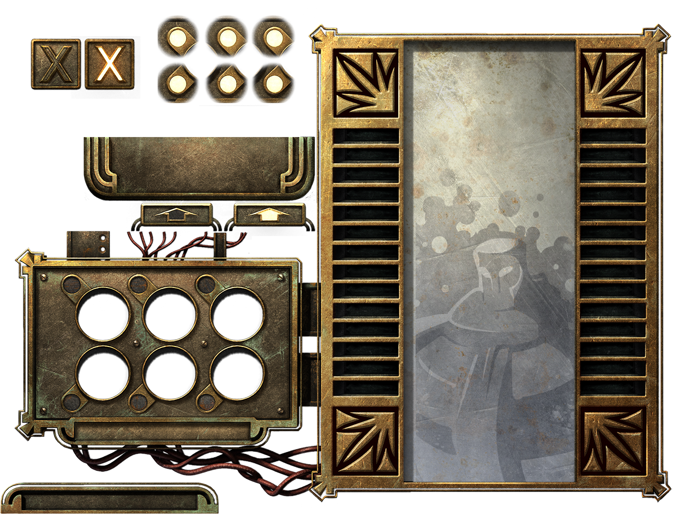
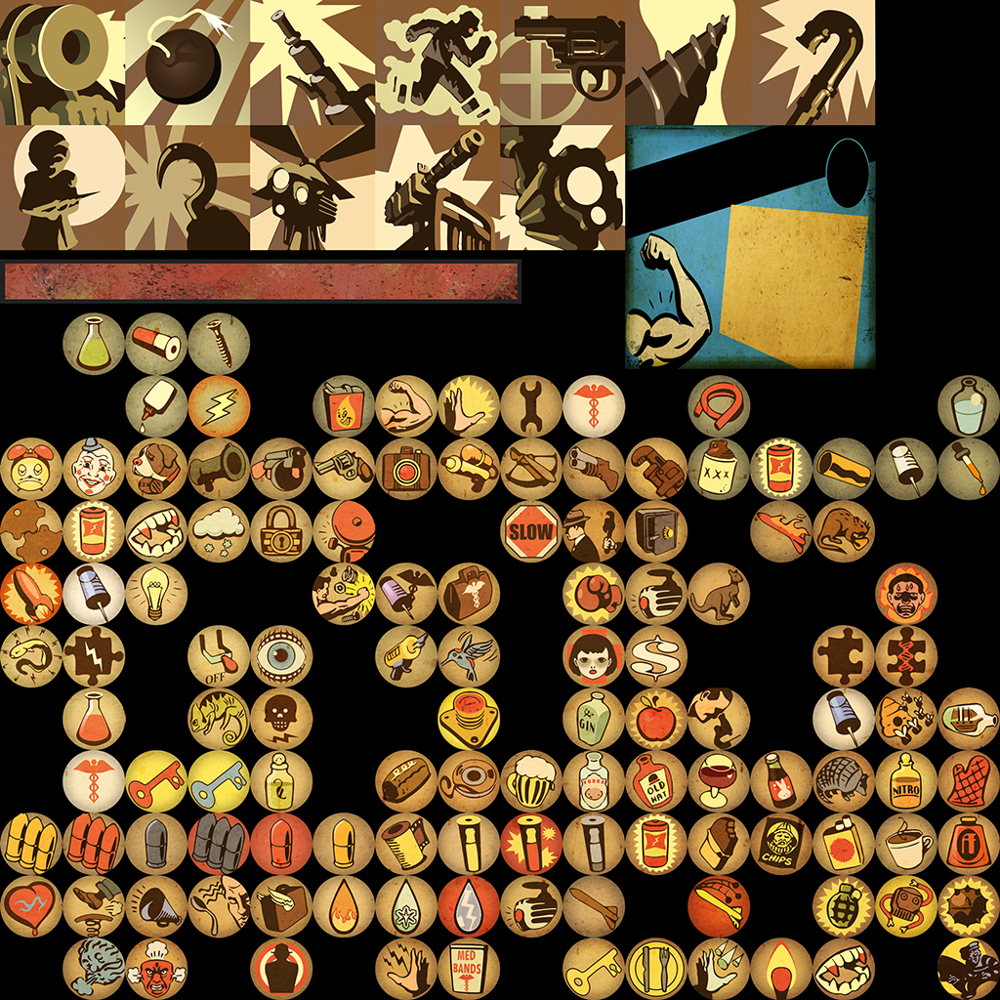
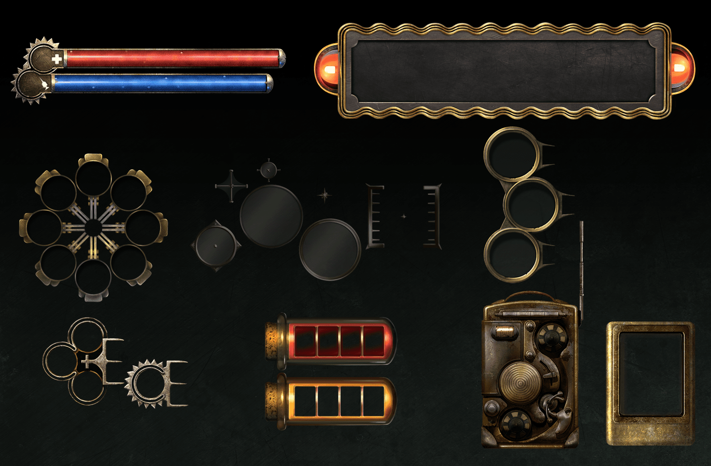
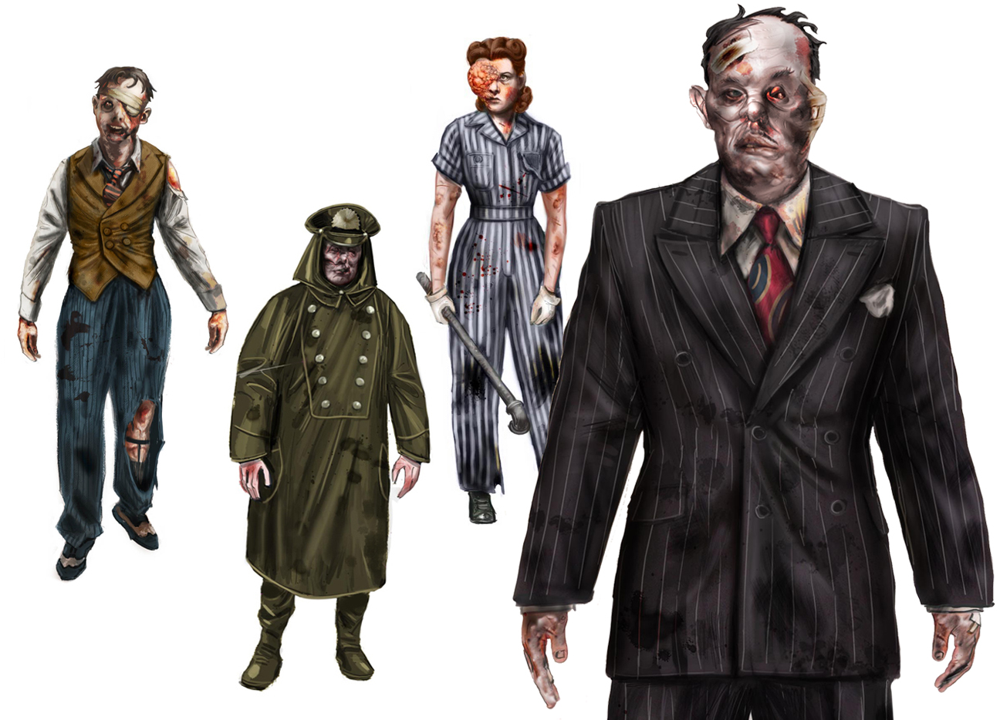
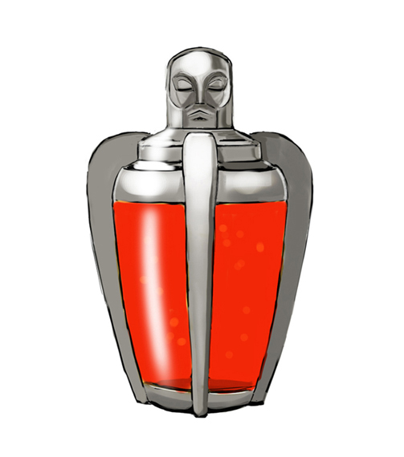

# BioShock · pesquisa focada de personagens, objetos e menus v9

## Fontes e limites

Material de pesquisa dos portfólios de **Shelby Tang** e **Robb Waters**, inspecionado nesta rodada. Os direitos pertencem aos artistas e titulares dos jogos. Não há licença presumida para reutilizar imagens, atlas, ícones ou personagens no Aetherforge.

Separar três coisas: o que o artista declara, o que observamos na imagem e a decisão autoral que propomos. BioShock original, BioShock 2 e Infinite não são automaticamente o mesmo sistema de interface.

## 1. Shelby Tang · BioShock: The Collection

**Fonte primária:** [portfólio da artista](https://www.shelbypeterson.com/bioshock-the-collection). A artista relata o trabalho de ampliar, repintar e, às vezes, redesenhar os assets de UI de BioShock e BioShock 2 para a coleção. Isso não atribui a ela a criação de toda a interface original de 2007.

### Gene Bank / PlasmaQuick

**Observação:** encaixes, placas, fios e grade de ventilação têm espessura e sinais localizados de uso. A ficha explicativa é uma superfície clara, não outro painel preto. Há uma linguagem comum sem fazer cada peça ter exatamente o mesmo contorno. O arquivo é uma prancha/atlas de elementos, não uma screenshot montada de gameplay.

**Aplicação:** cada menu do Aetherforge será um instrumento distinto, com áreas calmas de texto em porcelana e chassi escuro. Criar encaixes próprios e um arco partido original. Não recortar molduras, fios, botão X ou os leques desta prancha.

### Plasmídeos e ícones

**Observação:** vários ícones representam pequenas ações, pessoas e objetos em poucas massas de cor. O círculo contém uma cena, não apenas um pictograma fino. Silhueta, gesto e contraste fazem o trabalho.

**Aplicação:** criar medalhões originais de habilidade: trabalhador resguardado por escudo, voz de provocação como ondas contra uma placa e martelo de manutenção em impacto. Preservar função e números do GDD, sem copiar personagens publicitários ou ícones de plasmídeos.

### HUD e instrumentos

**Observação:** tubos, fileiras de encaixes, bordas materializadas e aparelhos portáteis convivem. A informação importante é grande; o ornamento serve de suporte. Algumas peças são circulares, outras alongadas — não existe obrigação de fazer todo botão ser um manômetro.

**Aplicação:** seletor visível de Caça/Mineração, recarga como trilho de ponteiro e gavetas de bolsa. Não criar um minigame de hacking, uma árvore de genética ou uma mecânica de pressão que não existe no projeto.

## 2. Robb Waters · BioShock

**Fonte primária:** [portfólio do artista](https://www.robbwatersart.com/bioshock). A página separa cidadãos, objetos, gráficos e estudos da Little Sister. Mostra como desenho de personagem e desenho gráfico podem compartilhar a mesma cultura visual sem serem o mesmo asset.

### Cidadãos / Splicers

**Observação:** roupa, profissão, postura e assimetria distinguem as pessoas antes das alterações físicas. Casaco de chuva, uniforme e terno contam histórias diferentes; não são a mesma silhueta com outra arma.

**Aplicação:** diferenciar Guarda, Pistoleiro e Alquimista por ocupação e grandes massas. No bestiário, uma máquina de recolha, uma sentinela e um fiscal precisam revelar funções antigas distintas. Aetherforge continua com monstros mecânicos e alterações pelo Éter Negro; não transplantar ADAM, Splicers, máscaras de baile ou deformações específicas da referência.

### Frasco de ADAM / desenho de produto

**Observação:** o objeto tem forma de produto, pega e proteção; o conteúdo é contido por uma carcaça, não uma esfera flutuante genérica. A silhueta e o rosto esculpido são específicos de BioShock.

**Aplicação:** o cartucho do Alquimista terá alça de trabalho, encaixe seguro e um vidro jade pequeno. **Não copiar** rosto, frasco, cor vermelha característica ou a mesma distribuição de carcaças.

## 3. Fontes contextuais consultadas

- [Game UI Database — BioShock](https://www.gameuidatabase.com/gameData.php?id=1171): índice secundário de categorias de telas; útil para distinguir mapa, compra, modais e HUD. Não usado como fonte de fórmulas ou de assets.
- [Robb Waters — BioShock Infinite](https://www.robbwatersart.com/bioshock-infinite): referência contextual de produto, propaganda e ícones; não confundir suas propostas com o estilo Art Déco do primeiro BioShock.
- [James Ku — BioShock 2](https://www.jameskuart.com/bio2): o artista identifica os personagens mostrados como trabalho da **cinemática**. Não usar seus renders para prometer orçamento de polígonos, rig ou custo de gameplay do nosso idle.

## Síntese autoral

Não buscamos “BioShock com outra marca”. Buscamos os princípios úteis: **instituições fabricam objetos reconhecíveis; profissão constrói silhueta; ferramenta conta história; UI e mundo compartilham materialidade**. A assinatura própria do Aetherforge será o Arco Partido e seus instrumentos de expedição.
