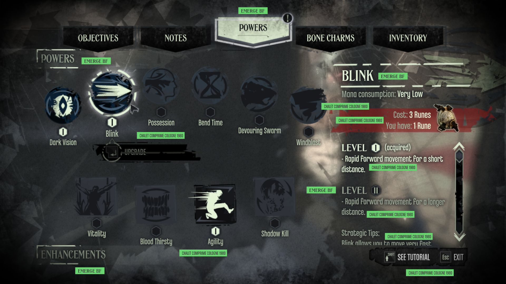
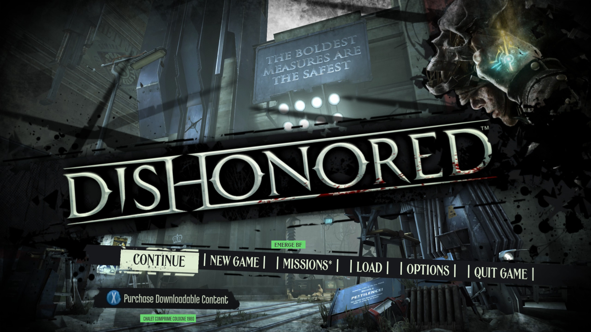
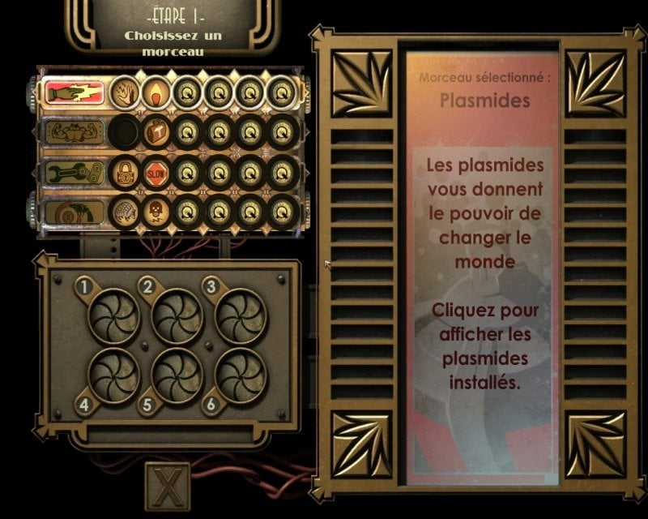
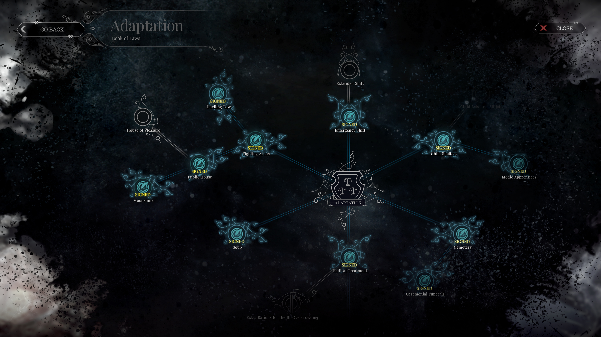
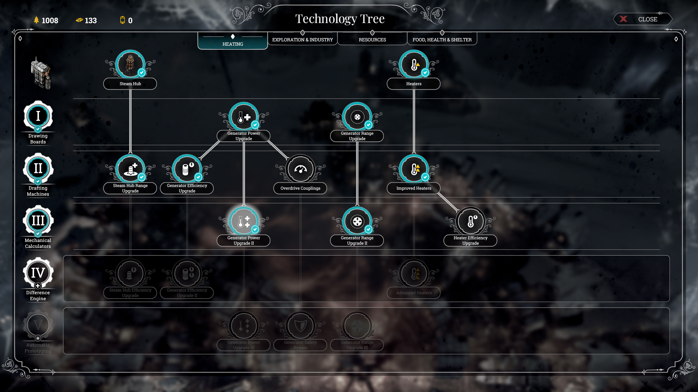

# Pesquisa de menus · Aetherforge v8

Referências visuais inspecionadas em 20/10/2026, adicionadas a pedido do usuário. Capturas de terceiros servem apenas para pesquisa; não são arte licenciada para importação no jogo. As observações abaixo descrevem estas imagens, não todos os menus ou a implementação dos jogos.

## Dishonored — poderes e hierarquia editorial

**Fonte:** [GameFontLibrary — Dishonored](https://www.gamefontlibrary.com/games/dishonored). Arquivos e hashes de origem em [ref-ui-fontes.json](../../docs/visual/referencias/v5/ref-ui-fontes.json). As etiquetas verdes são anotações do catálogo, não partes da interface do jogo.

**Observação:** abas em placas recortadas; título de caráter forte distinto do texto estreito; ícones grandes em silhueta; seleção clara por valor e aro luminoso; detalhe e custo agrupados à direita. O fundo tem colagem e textura, enquanto a informação principal ocupa faixas definidas.

**Levar para Aetherforge A:** placas com cortes oblíquos, títulos editoriais, ícones de habilidades em silhueta e uma faixa de detalhe para a habilidade selecionada. Manter a matriz compacta v7, sem copiar o menu full-screen, símbolos de poderes ou papel de parede. Reduzir a textura sob os números.

**Tipografia:** o catálogo identifica Emerge BF e Chalet Comprimé; a identificação não é confirmação direta do estúdio. Nossa prova usa Libre Caslon Text + Jost, arquivos OFL já presentes. Não alegar equivalência exata.

## BioShock — painel de plasmídeos / Gene Bank

**Fonte:** [Interfaces Notables, SensCritique](https://www.senscritique.com/liste/Interfaces_Notables/175348); [imagem hospedada no Jeuxvideo](https://image.jeuxvideo.com/images/pc/b/i/bisopc059.jpg). Registro anterior em [ref-ui-adicionais.json](../../docs/visual/referencias/v5/ref-ui-adicionais.json). É uma captura em francês do primeiro jogo; não misturar com o desenho do Gene Bank de BioShock 2.

**Observação:** a interface parece uma máquina institucional: encaixes circulares, fileiras de categorias, chassi de latão, fios, painel alto de explicação e leques Art Déco concentrados nos cantos. Slots ativos, vazios e bloqueados têm desenhos diferentes, não apenas outra cor. O texto descritivo é mais discreto que o chassi e a marca.

**Levar para Aetherforge B:** encaixes circulares nas habilidades, categorias legíveis, metal escalonado nas bordas externas e detalhe do item como ficha de catálogo. A bolsa continua com sete colunas quadradas por necessidade funcional. Não copiar mascote, propaganda, emblemas, máquina ou layout integral de BioShock.

**Tipografia:** Limelight nos títulos curtos e Jost no corpo e nos números; direção Art Déco com fontes livres, não identificação das fontes da captura.

## Frostpunk — Livro de Leis

**Fonte:** [Interface In Game — Book of laws](https://interfaceingame.com/screenshots/frostpunk-book-of-laws/). Imagem preservada localmente a partir da galeria. Fonte secundária de captura, não documentação interna do estúdio.

**Observação:** nós circulares com desenhos legíveis; conexões finas organizam dependências; ramos aproveitam o espaço sem formar uma bolsa de itens. Moldura e divisórias são claras sobre fundo escuro. A disponibilidade é comunicada pelo contraste e pelos estados dos aros. A decoração fica nas extremidades, sem ocupar todo o campo de leitura.

**Levar para Aetherforge C:** nós com estados distintos na rota de cinco etapas e conexão inequívoca entre elas. Não transplantar escolhas de leis, mecânica de ordem/fé ou bifurcações inexistentes no GDD.

## Frostpunk — árvore tecnológica / aquecimento

**Fonte:** [Interface In Game — Heating](https://interfaceingame.com/screenshots/frostpunk-heating/).

**Observação:** categorias no topo; níveis em coluna à esquerda; linhas horizontais delimitam faixas; ícones circulares têm texto de apoio separado; tecnologias indisponíveis são rebaixadas em contraste; a seleção tem contorno próprio. Há distinção entre título de exibição e informação funcional.

**Levar para Aetherforge C:** marcos laterais e faixas de habilidades com leitura imediata; placas frias e texto claro; indicador de seleção contido. Não criar sistema de temperatura, cidade radial ou árvore tecnológica nova só para imitar a referência.

## Comparação e decisão

| Papel na interface | A · Dishonored | B · BioShock | C · Frostpunk |
|---|---|---|---|
| Moldura | Placa editorial recortada | Chassi e degraus Art Déco | Aço frio, linhas utilitárias |
| Habilidade | Selo de tinta em silhueta | Encaixe circular de máquina | Nó com aro e estado |
| Informação selecionada | Tarja editorial | Ficha de catálogo | Registro de turno |
| Hierarquia | Título incisivo / dado simples | Letra de exibição / corpo geométrico | Título serifado / dado funcional |
| O que permanece v7 | Janelas independentes, bolsa 7 colunas, formação de três, rota separada e arena junto à barra | Idem | Idem |

A essência do Taskbar Hero está na relação entre **arena persistente e gestão sob demanda**, não no pergaminho ou na fonte pixelada. Os menus estudados orientam a linguagem visual; a v7 continua orientando a organização e a escala.
