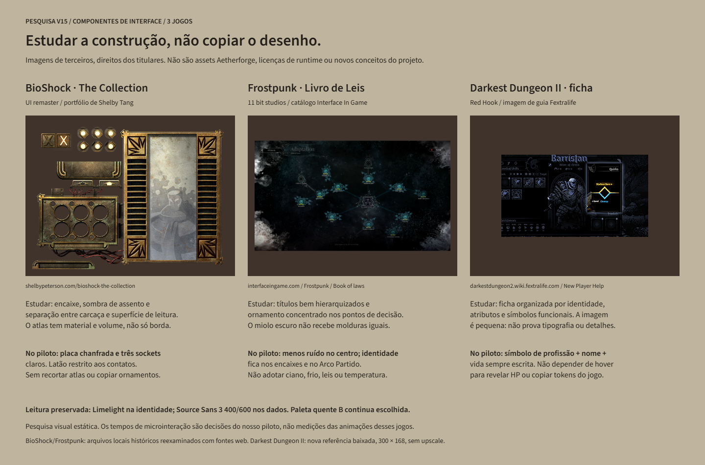
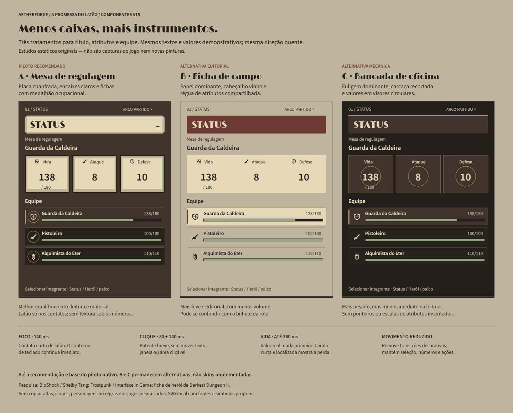
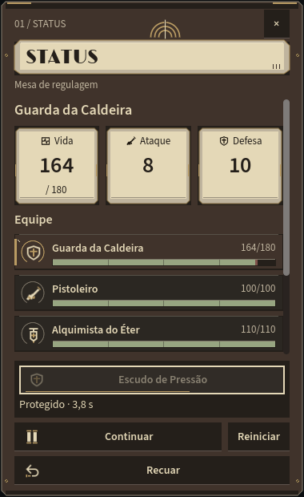
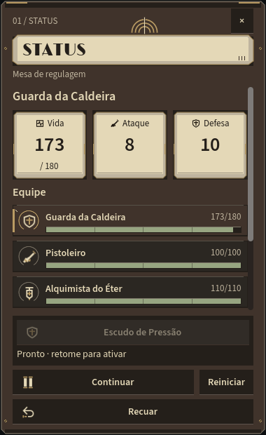
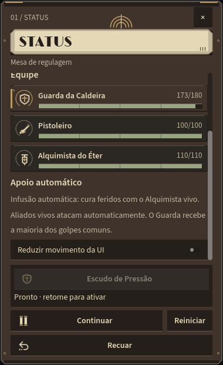
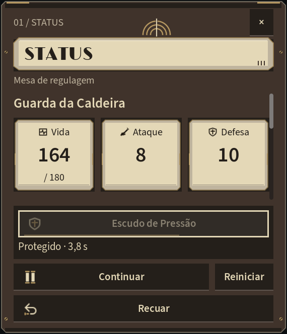
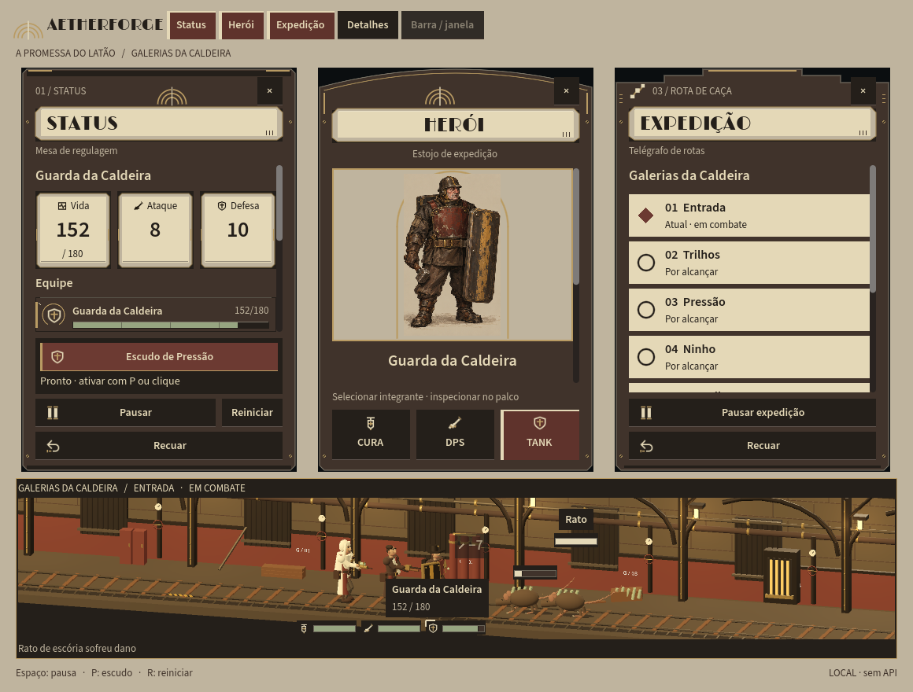

# V15 — componentes com caráter / pesquisa, propostas e piloto

## Entrega e escopo

Resposta aos componentes marcados na captura do usuário: **placa Status, Vida/Ataque/Defesa e linhas da equipe**. A direção continua **B — A Promessa do Latão**, com paleta quente v10 e personagens v12. Não houve nova rodada de pinturas, troca de fontes, alteração de combate ou expansão do inventário.

**Entregue:** pesquisa de três jogos, três tratamentos visuais comparáveis e o **piloto A implementado** no Godot. B/C são alternativas estáticas, não skins disponíveis. A aprovação artística final continua com o usuário.

- [Captura marcada original, sem edição](../../assets/concepts/brass-v15-ui/user-marked.png).
- [Entrega anterior V14](ui-v14-entrega.md), preservada como histórico.
- [Proveniência, dimensões e SHA-256](../../assets/concepts/brass-v15-ui/provenance.json).

## 1. Pesquisa na internet



### BioShock / The Collection — encaixe e superfície

**Fonte primária:** [portfólio de Shelby Tang](https://www.shelbypeterson.com/bioshock-the-collection). A artista descreve repintura/redesenho de recursos para o remaster; isso **não** atribui a ela toda a UI original. A página foi consultada nesta pesquisa e o atlas local histórico foi reaberto.

**Observado:** carcaça separada de uma superfície de leitura mais clara, encaixes circulares, sombra de assento, volume nas bordas e ornamento concentrado nas extremidades.

**Adaptar:** placa assentada e três sockets de atributos, deixando números em campos limpos. **Não copiar:** atlas, recortes, decoração, ícones ou identidade do jogo. O nosso desenho é nativo e autoral.

### Frostpunk — hierarquia e ornamento seletivo

**Fonte:** [Livro de Leis / Interface In Game](https://interfaceingame.com/screenshots/frostpunk-book-of-laws/) e [catálogo do jogo](https://interfaceingame.com/games/frostpunk/). Encontrados na busca atual; a captura local preservada foi reexaminada. O download direto da página deu timeout, não foi tratado como uma nova captura.

**Observado:** título hierárquico, conectores e ornamento concentrados em pontos de decisão, em vez de uma borda idêntica em todo conteúdo.

**Adaptar:** contatos pequenos, bordas de encaixe e espaços de leitura sem ruído. **Não adotar:** azul/ciano, neve, leis, temperatura ou outro sistema de Frostpunk. A pesquisa não reabre a direção fria C descartada anteriormente.

### Darkest Dungeon II — ficha e símbolos funcionais

**Fonte:** [New Player Help / Fextralife](https://darkestdungeon2.wiki.fextralife.com/New_Player_Help), com [imagem de ficha](https://static0.fextralifeimages.com/file/darkestdungeon2/0/08/Quirks-darkest-dungeon-2-wiki-guide-300px-min.png). Página e imagem baixadas nesta pesquisa. Direitos de Red Hook e demais titulares; uso de referência somente.

**Observado:** ficha separando identidade, atributos e símbolos funcionais. O guia explica o acesso à ficha e a informações adicionais por hover.

**Adaptar:** ícone ocupacional, nome e vida escrita na mesma ficha, com seleção clara. Aqui o HP **não** fica escondido atrás de hover. **Limite:** a imagem é de apenas 300 × 168; não foi ampliada nem usada para afirmar detalhes tipográficos, versão atual do jogo ou timings de animação. Não copiamos tokens, personagens, coroa ou sistemas de estresse.

Outros resultados de busca, como Disco Elysium e Pentiment, não foram promovidos a alvos visuais: não houve imagem de interface suficientemente verificada nesta rodada. Os tempos abaixo são decisões do nosso piloto, **não medições das animações dos jogos pesquisados**.

## 2. Três propostas



| Tratamento | Aparência | Vantagem e custo | Situação |
|---|---|---|---|
| **A — Mesa de regulagem** | Placa chanfrada; encaixes de esmalte claro; fichas com medalhão de profissão | Mantém leitura imediata e dá volume sem textura sob números | **Recomendação e piloto implementado** |
| **B — Ficha de campo** | Papel dominante, faixa vinho e régua compartilhada | Leve/editorial, mas aproxima demais o Status do bilhete da rota | Alternativa estática |
| **C — Bancada de oficina** | Fuligem dominante; caixas de máquina e valores em aros | Mais pesado, mas menos rápido de ler e com maior risco de ornamentação excessiva | Alternativa estática |

Os rótulos A/B/C desta comparação são **tratamentos de componentes dentro da direção Brass B já escolhida**, não as três direções globais v8. As pranchas usam dados de demonstração iguais (`138/180`, ataque `8`, defesa `10`) para comparação; não são capturas de combate.

Fontes continuam Limelight na identidade e Source Sans 3 400/600 nos dados. Papel, linho, tabaco, fuligem, vinho e latão envelhecido permanecem. Aro e contatos são ornamentais; **não** simulam um novo atributo, nível ou recurso.

## 3. Piloto nativo aplicado



- **Cabeçalhos dos três instrumentos:** placa chanfrada com assento escuro, lábio de esmalte e três pequenos contatos. Texto segue editável e nativo, não foi desenhado numa textura.
- **Atributos do Status:** sockets recortados com sombra, campo claro e símbolo funcional. Vida mantém atual/máximo; Ataque e Defesa não receberam barras ou escalas fictícias.
- **Equipe:** três fichas com medalhão ocupacional, nome, HP atual/máximo, régua encaixada e trava de seleção. As fichas agora acionam **a mesma seleção** já existente em Herói/palco; não reordenam a formação nem mudam alvo de combate.
- **Densidade corrigida após captura:** removida a legenda redundante “Integrante selecionado”; ícone e rótulo dividem linha; espaços ajustados sem reduzir as fontes. A 100%, as três fichas aparecem juntas no Status nativo 380 × 620.
- **Inventário, regras, modelos, formação e HUD de combate V14 preservados.** O nome “Caído” e HP zero continuam disponíveis para integrantes mortos; textos longos podem truncar na ficha, com nome/estado completos no tooltip.

A seleção permanece Guarda/Pistoleiro/Alquimista nos índices de domínio 0/1/2. O palco conserva a formação Alquimista atrás → Pistoleiro → Guarda à frente. A rota segue finita, local, sem XP, drops ou dinheiro inventados.

### Microinterações

| Evento | Resposta implementada | Limite |
|---|---|---|
| Hover/foco de botão ou ficha | Contato inferior de latão cresce/retorna em **140 ms**; foco de teclado continua com contorno imediato | Sem pulsação em repouso; um tween ativo por controle |
| Pressionar | Pequeno batente lateral e mudança de estado; entrada em **80 ms**, retorno em **140 ms** | Não desloca texto, hitbox, janela ou layout; não bloqueia input |
| Trocar integrante | Trava lateral e estados selecionados, com dados/retrato/HUD atualizados | Valor não faz contagem decorativa nem anima dados de outro integrante |
| Perder vida | Vida verdadeira atualiza no refresh de estado; rastro localizado da porção perdida dura **até 360 ms**, com 80 ms de retenção inicial | Rastro é decoração, não HP extra; pausa congela o rastro; cura preenche imediatamente |
| Reiniciar | Snap para vida da nova tentativa, sem dano/cura residual | Não altera o reset das regras |
| Reduzir movimento | Remove tweens decorativos e caudas; mantém estados e valores imediatos | Preferência desta execução, não persistida; não reduz animação 3D, flashes globais ou áudio |

O refresh dos instrumentos continua em cerca de 100 ms, como antes. “Vida imediata” significa **no mesmo refresh e antes do rastro**, não uma alegação de latência zero ou renderização a cada evento. Nenhum efeito mexe em `Engine.TimeScale`, regras ou posição dos atores.

**Configuração:** rolar o Status até **Reduzir movimento da UI**. Também existe `--reduce-ui-motion` no executável para iniciar com a preferência ativa. Esta é uma opção nova V15; não foi retroativamente atribuída à V14. Não adicionamos shake, flashes de tela, sons de clique ou animações longas de abertura.





## 4. Escala e contexto



Em 150% e altura 664, os atributos permanecem legíveis, mas as fichas exigem rolagem. Não reduzimos fontes para fingir que tudo cabe. Cabeçalho e ações continuam fixos. A mesma lógica já aprovada de reservar a faixa do palco foi mantida; três instrumentos altos não cabem sem sobreposição em todo desktop.



Overview continua sendo um arranjo de revisão. Pode mostrar menos conteúdo dos instrumentos de uma vez. As capturas antes/depois não têm o mesmo instante de combate, HP ou altura; não são experimento isolado de fonte ou benchmark.

## 5. Verificação executada

```powershell
powershell.exe -NoProfile -ExecutionPolicy Bypass -File scripts/Build.ps1
powershell.exe -NoProfile -ExecutionPolicy Bypass -File scripts/Test-UiV15.ps1 -Screenshots
powershell.exe -NoProfile -ExecutionPolicy Bypass -File scripts/Test-Expedition.ps1 -Screenshots
powershell.exe -NoProfile -ExecutionPolicy Bypass -File scripts/Test.ps1
powershell.exe -NoProfile -ExecutionPolicy Bypass -File scripts/Test-Integration.ps1
```

Todos terminaram com exit 0. Build de cliente/API/checks: **zero avisos e zero erros**; importação Godot concluída.

**21 casos UI/componentes**, com stderr final vazio:

- Suíte de input/layout compartilhada: três escalas headless, três nativas e nove capturas. Mantém a marca histórica `UI V14 INPUT PASS`, mas agora verifica também as três fichas V15, feedback acionado por input e a opção de reduzir movimento por mouse.
- Fixtures de componentes: 100/125/150%, início com redução ativa, mais dois casos gráficos. Checam vida antes da cauda, término, pausa, cura, reset, no máximo um tween em execução, retorno ao repouso e hit rectangle inalterado. Também observam dano de uma rota real.
- Fichas são clicadas pela automação nativa Win32; teclado usa `Viewport.PushInput`. As fixtures isoladas de microanimação emitem sinais deliberadamente para testar o componente. **Não confundir fixture de sinais, automação nativa e playtest físico humano.** O cursor é restaurado no fim.
- Capturas 100/150%, dano, opção, combate, chefe, conclusão, retrato e rota foram inspecionadas. A exportação inicial da prancha sofreu repetição/tiles pretos do compositor do Chromium; a entrega usa rasterização direta de SVG autocontido, inspecionada depois.
- Expedição completa: cinco vitórias, todos os seis tipos, 108 unidades reais de marcha e cerca de 137,45 segundos simulados. Pausa, escudo, recuo, reset, cura e regressões preservados.
- Suítes legadas e integração API/multiplayer/transferência/persistência passaram com arquivos isolados. `Expedition.cs` e `ExpeditionActor.cs` mantêm os SHA-256 do início V15; nenhum save manual foi editado.

Evidências locais: `artifacts/ui-v15/{build-final.log,test-ui-final.log,test-expedition.log,test.log,test-integration.log}`, `artifacts/ui-v15/qa/` e `final-audit.json`. A suíte V15 direciona os novos resultados para sua própria pasta, sem precisar substituir as capturas selecionadas V14.

**Não verificado/certificado:** avaliação humana das sensações/timings, input físico, DPI real do Windows, multimonitor, gamepad, leitor de tela, acessibilidade integral ou performance em outros equipamentos. 30 FPS configurados não são benchmark. A arte 3D segue técnica e a aprovação visual final do piloto é sua.

## 6. Arquivos e reprodução

- Componentes: `src/Aetherforge.Client/BrassStatusComponents.cs`.
- Preferência e feedback: `src/Aetherforge.Client/BrassMotion.cs`.
- Integração: `BrassUi.cs`, `ExpeditionView.cs`, `BrassIcons.cs`, `Main.cs`.
- Ícone original: `src/Aetherforge.Client/Assets/Brass/Icons/vital.svg`; [proveniência de runtime](../../src/Aetherforge.Client/Assets/Brass/PROVENANCE.md).
- QA: `UiV14Check.cs` ampliado, `UiV15Check.cs`, `scripts/Test-UiV15.ps1`.
- [Fontes editáveis das propostas/pesquisa](../../docs/visual/conceitos-v15/README.md): SVG autocontido gerado por scripts locais e esboço HTML comparável. São referência de revisão, não texturas do cliente.

Para jogar: **Jogar Expedicao.cmd**, abrir Status e clicar nas fichas. **Revisar Expedicao.cmd** mostra Overview. Não foi feita migração do cadastro Studio/MCP nem instalação global de fontes/ferramentas.
