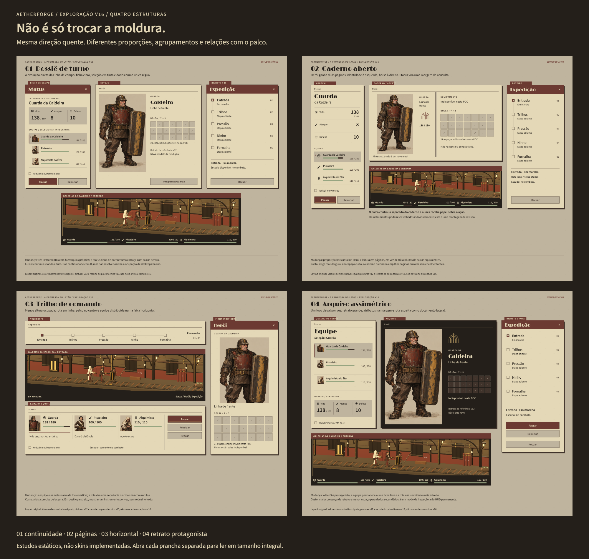
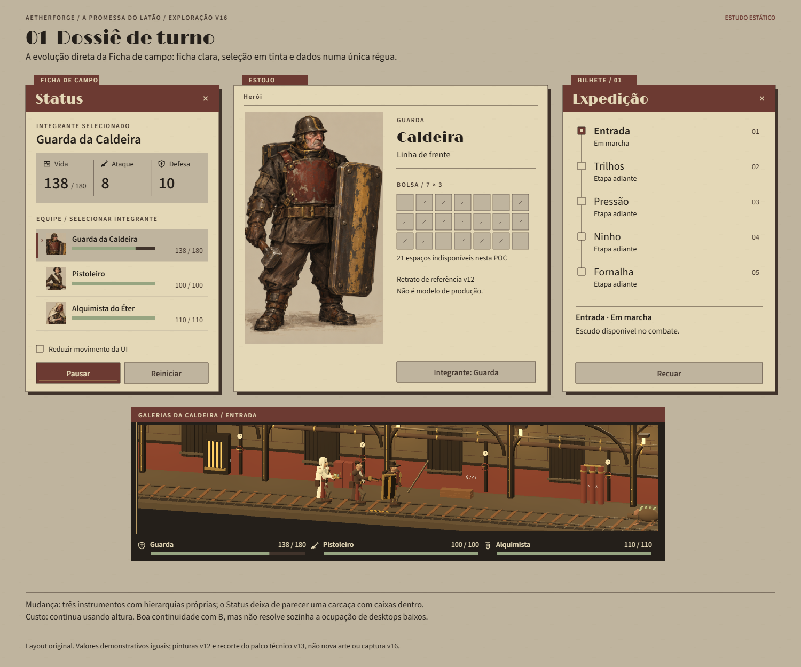
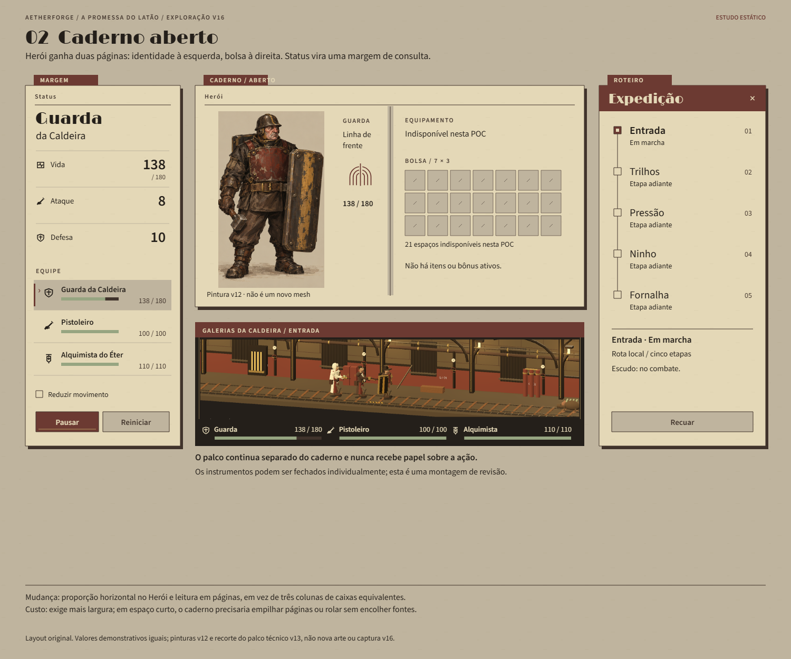
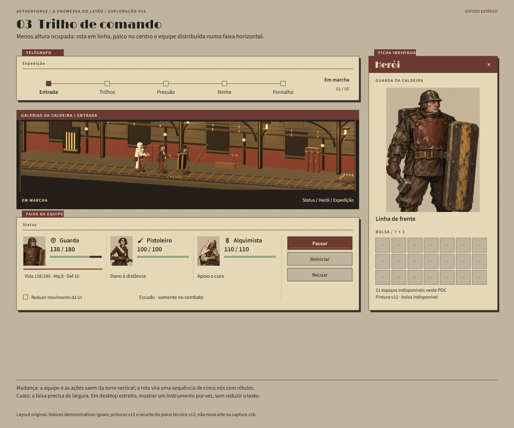
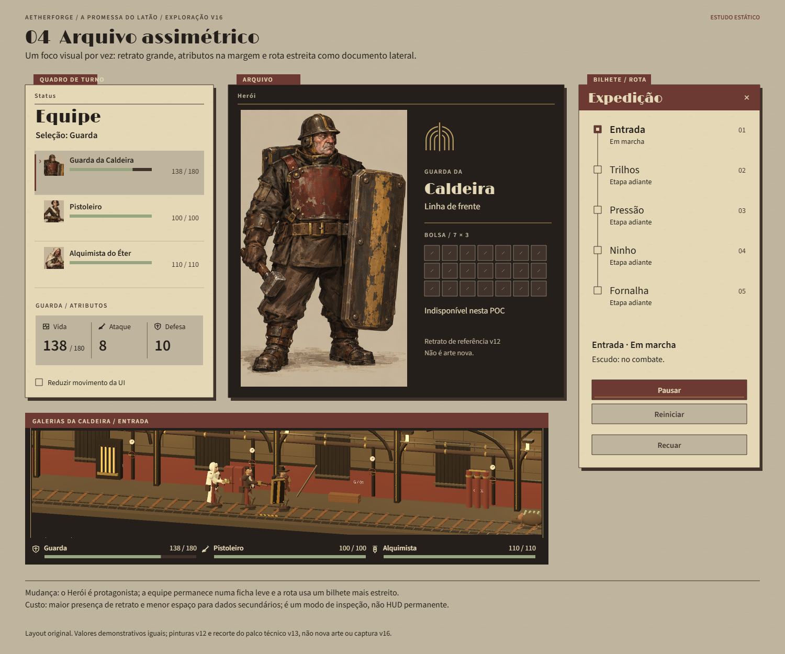
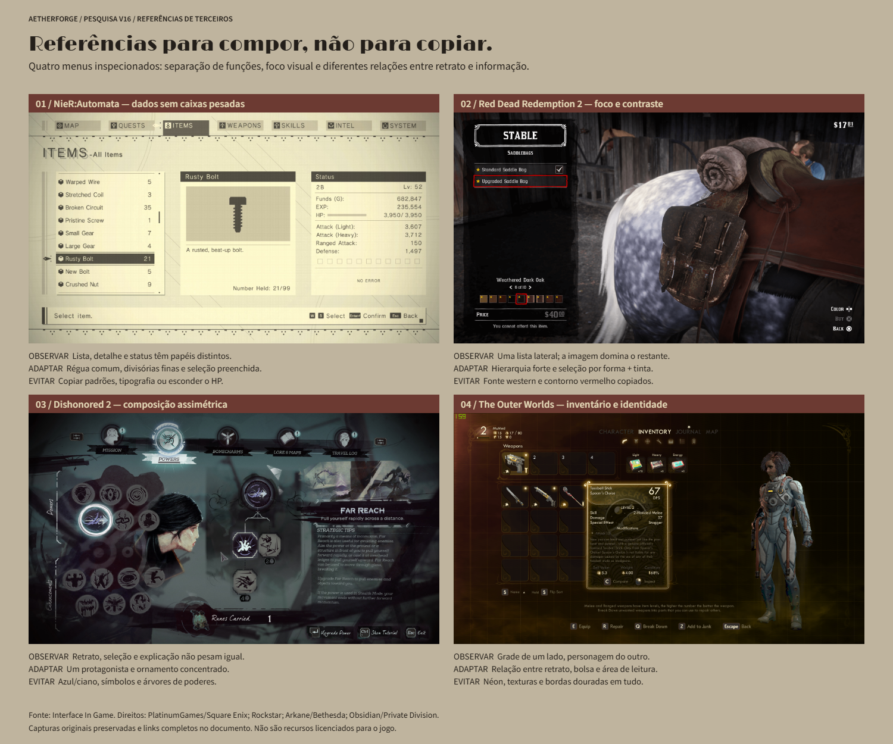
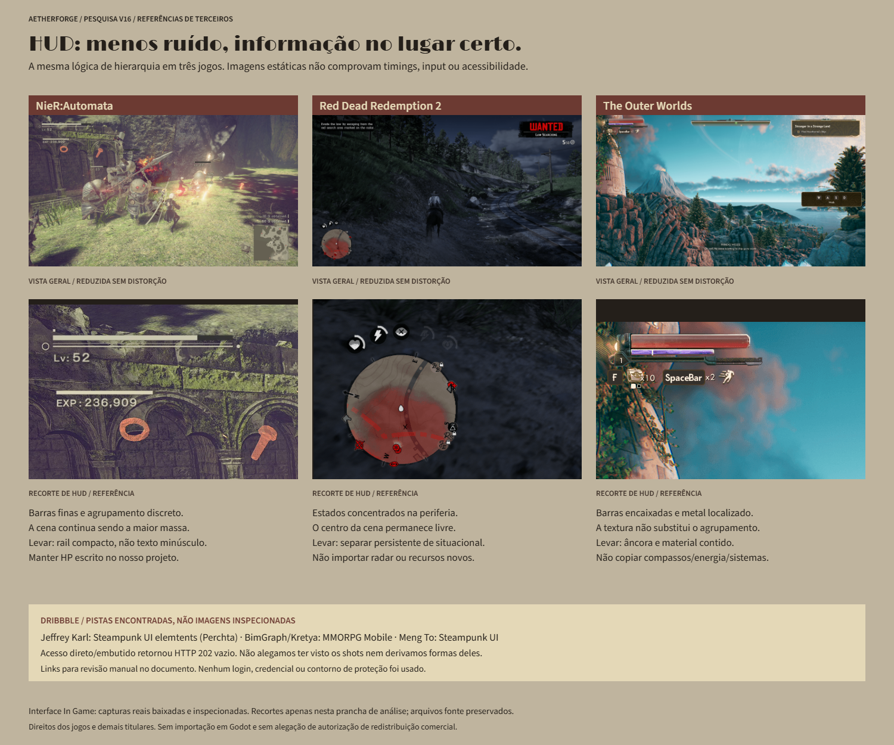

# V16 — quatro estruturas de interface / exploração após a Ficha de campo

## Pedido, escolha e estado real

Você preferiu a **proposta B — Ficha de campo** da V15, pediu mais inspiração em [Dribbble / game UI](https://dribbble.com/search/game-ui) e [Interface In Game](https://interfaceingame.com), e ampliou a liberdade: **“pode ser criativo e fazer mais tipos de mudanças de layout”**.

Esta rodada explora **estrutura**, não somente placa, borda ou textura: instrumentos verticais, duas páginas, faixas horizontais e composição assimétrica. A direção global permanece **B — A Promessa do Latão**. O B dos componentes V15 não é uma nova direção global.

**Entregue:** quatro estudos estáticos originais, comparação geral, duas pranchas de pesquisa e fontes editáveis. **Não substituí a interface no Godot.** O jogo e o commit anterior continuam com o piloto **V15 A**. A preferência por B não foi tratada como aprovação de A nem como B já implementado. A [entrega V15](ui-v15-componentes-microinteracoes.md) permanece como histórico.

## 1. Quatro composições para comparar

| Estudo | Mudança estrutural | Melhor uso | Custo / risco |
|---|---|---|---|
| **01 — Dossiê de turno** | Status claro com régua única; equipe em linhas editoriais; Herói com retrato e bolsa lado a lado | Continuidade mais próxima da Ficha B | Ainda ocupa altura; não resolve sozinho um desktop baixo |
| **02 — Caderno aberto** | Herói horizontal em duas páginas, Status estreito à margem, rota lateral | Inspeção de integrante e organização da bolsa | Precisa de largura; páginas terão de empilhar/rolar em área curta |
| **03 — Trilho de comando** | Rota horizontal acima; equipe e ações em faixa abaixo; Herói em ficha destacável | Acompanhamento compacto sem três torres verticais | A faixa requer largura; não se deve comprimir texto para caber |
| **04 — Arquivo assimétrico** | Retrato dominante e escuro localizado, equipe clara na margem, rota em bilhete estreito | Inspeção com identidade visual mais forte | Menos espaço para dados secundários; não é HUD permanente |

**Minha indicação para o próximo teste é 03 — Trilho de comando:** é a mudança mais significativa de organização, mantendo palco, Status, Herói e Expedição separados. O **02** é o contraponto mais útil para comparar. Isso é uma recomendação, não uma escolha feita por você ou autorização para trocar o runtime.

### 01 — Dossiê de turno

Atributos deixam de ser três aparelhos independentes: uma régua agrupa Vida/Ataque/Defesa. O integrante selecionado se reconhece por **trava, seta e preenchimento**, não só por cor. Retratos pequenos ajudam a localizar a equipe. O bilhete da rota conserva função e proporção próprias para não virar outra ficha de Status.

### 02 — Caderno aberto

O Herói vira uma janela horizontal com duas páginas: **identidade/retrato à esquerda, bolsa à direita**. O Status adota uma lista de atributos na margem, não uma régua espremida. Não são Status e Herói fundidos em uma única tela; continuam instrumentos distintos nesta proposta.

### 03 — Trilho de comando

A equipe é organizada em três blocos horizontais com HP escrito. A seleção do Guarda fica explícita por linha e atributos associados. A rota vira uma sequência de **cinco nós com nome**, sem caminhos alternativos ou recursos novos. Ações existentes são agrupadas ao lado da equipe; o recuo continua separado por espaçamento.

É possível fechar a ficha do Herói para acompanhar somente palco/faixas. **A montagem não demonstra que tudo cabe simultaneamente em qualquer monitor.** No projeto real, esta alternativa precisaria testar largura mínima, escala 125/150%, foco, rolagem e manutenção da seleção compartilhada.

### 04 — Arquivo assimétrico

Um retrato dominante concentra o interesse. Fuligem fica localizada no Herói, enquanto o Status segue papel/linho e a rota mantém bilhete claro. O Arco Partido é desenho vetorial do estudo, não emblema copiado das referências. Pausa/reinício/recuo aparecem no documento da expedição nesta composição; é uma redistribuição proposta, não novos comandos.

## 2. Pesquisa visual realmente inspecionada

Foram baixadas e abertas **oito capturas de quatro jogos** no Interface In Game, com originais preservados, dimensões e SHA-256 no [registro de fontes](../../docs/visual/conceitos-v16/sources.json). As pranchas reduzem imagens inteiras e usam recortes explicitamente identificados para análise de HUD. **Não copiamos ícones, texturas, padrões, personagens, tipografia ou atlas para o cliente.**

### NieR:Automata — separação de informação sem carcaças pesadas

- [Items](https://interfaceingame.com/screenshots/nierautomata-items/) — [original local](../../assets/concepts/brass-v16-ficha/references/nier-items.jpg).
- [HUD](https://interfaceingame.com/screenshots/nierautomata-dialoge-options-2/) — [original local](../../assets/concepts/brass-v16-ficha/references/nier-hud.png). Apesar do slug de diálogo, a página tem título **HUD**; o endereço foi verificado, não adivinhado como `/nier-automata/`.
- **Observado:** regiões com funções distintas, divisórias leves, seleção preenchida e espaço negativo. O HUD organiza barras discretas sem fazer cada dado virar uma janela.
- **Adaptar:** régua compartilhada, margem de consulta e separação persistente/contextual. **Evitar:** copiar o padrão gráfico e esconder vida em sinais sem números. Direitos: PlatinumGames / Square Enix e demais titulares.

### Red Dead Redemption 2 — hierarquia, seleção e imagem dominante

- [Stable](https://interfaceingame.com/screenshots/red-dead-redemption-2-stable/) — [original](../../assets/concepts/brass-v16-ficha/references/rdr-stable.png).
- [Progress](https://interfaceingame.com/screenshots/red-dead-redemption-2-progress/) — [original adicional inspecionado](../../assets/concepts/brass-v16-ficha/references/rdr-progress.jpg), não incluído na prancha de quatro menus.
- [HUD](https://interfaceingame.com/screenshots/red-dead-redemption-2-hud/) — [original](../../assets/concepts/brass-v16-ficha/references/rdr-hud.png).
- **Observado:** em Stable, lista lateral com seleção forte e grande região dedicada à imagem; em Progress, blocos editoriais de navegação; no HUD, sinais concentrados na periferia.
- **Adaptar:** um protagonista visual, estados por forma/preenchimento e centro de cena livre. **Evitar:** fonte western, moldura de pincel copiada, radar ou círculos que inventem energia/atributos. Direitos: Rockstar Games e demais titulares.

### Dishonored 2 — assimetria e ornamento focal

- [Powers](https://interfaceingame.com/screenshots/dishonored-2-powers/) — [original 3840 × 2160](../../assets/concepts/brass-v16-ficha/references/dishonored-powers.jpg).
- **Observado:** seleção, imagem e explicação não recebem o mesmo peso nem se repetem em caixas equivalentes.
- **Adaptar:** hierarquia assimétrica e ornamento concentrado. **Evitar:** azul/ciano, glifos e árvores de poderes; não há sistema novo de habilidades aqui. Direitos: Arkane Studios / Bethesda Softworks e demais titulares.

### The Outer Worlds — personagem e grade com funções claras

- [Inventory](https://interfaceingame.com/screenshots/the-outer-worlds-inventory/) — [original](../../assets/concepts/brass-v16-ficha/references/outer-inventory.png).
- [HUD](https://interfaceingame.com/screenshots/the-outer-worlds-hud-2/) — [original](../../assets/concepts/brass-v16-ficha/references/outer-hud.png).
- **Observado:** relação entre grade e personagem na ficha; no HUD, barras encaixadas e agrupamento localizado.
- **Adaptar:** identidade/bolsa em páginas e material somente nos pontos estruturais. **Evitar:** néon, bordas douradas em tudo e sistemas do jogo pesquisado. Direitos: Obsidian Entertainment / Private Division e demais titulares.

**Limites:** capturas estáticas não comprovam animações, tempos, navegação, versão atual dos jogos ou acessibilidade. A referência não concede licença de produção ou de redistribuição comercial. Estas imagens permanecem em pesquisa, fora de `src/Aetherforge.Client/Assets/`; revisão de direitos é necessária antes de qualquer publicação comercial de material de terceiros.

## 3. Dribbble — pistas encontradas, sem alegação de inspeção visual

A busca trouxe links e descrições indexadas, mas o acesso direto ao endereço solicitado e a um shot/visualização embutida retornou **HTTP 202 vazio**. O endpoint de oEmbed consultado retornou 404. O provedor de busca também atingiu seu limite durante a pesquisa. Não fiz login, não usei credenciais nem contornei proteção.

Links úteis para revisão manual:

- [Steampunk UI elemtents — Jeffrey Karl](https://dribbble.com/shots/4566535-Steampunk-UI-elemtents). O texto indexado associa os elementos a **Perchta** e menciona Photoshop/Illustrator.
- [MMORPG Mobile in Game Concept (Mini Study Case) — BimGraph / Kretya Studio](https://dribbble.com/shots/24766433-MMORPG-Mobile-in-Game-Concept-Mini-Study-Case). O texto indexado fala em simplificação e arredondamento seletivo.
- [Steampunk UI — Meng To](https://dribbble.com/shots/647020-Steampunk-UI). O texto descreve uma proposta de app, **não um HUD de jogo comprovado**.

Não há imagens desses shots nas pranchas, não descrevo pixels não vistos e não atribuo os layouts novos a uma suposta análise visual deles. A derivação visual verificada vem das capturas acima e dos nossos estudos anteriores.

## 4. O que fica invariável, mesmo nas alternativas mais diferentes

- Papel `#BFB49E`, fuligem `#241F1A`, tabaco `#40332B`, vinho `#6C3A32`, latão `#B99B63`, linho `#E4D8B7` e éter contido `#97A581`. Sem retorno à direção fria.
- **Limelight** para identidade, **Source Sans 3 400/600** nos dados. Marcas, linhas e ícones vetoriais; nenhum texto de UI novo rasterizado para runtime.
- Status, Herói e Expedição continuam reconhecíveis como **instrumentos independentes**, com palco separado. As montagens exibem todos para revisão; não são um fullscreen obrigatório.
- Três integrantes, cinco etapas e bolsa **7 × 3 indisponível**. Sem XP, dinheiro, equipamento ativo, bônus, drops, energia ou outro sistema inventado.
- Mesmos dados demonstrativos em todos os estudos: Guarda `138/180`, Pistoleiro `100/100`, Alquimista `110/110`, Guarda ataque `8` / defesa `10`. **Não são estados de uma nova execução do jogo.** O campo da rota indica marcha; a legenda de escudo deixa claro que a ação pertence ao combate.
- Pintura v12 reutilizada com recortes proporcionais, não repintada/esticada. O estudo 03 usa enquadramento parcial do Guarda; os outros mostram o corpo inteiro. Pequenos retratos da equipe são recortes de identidade, não novos personagens.
- Palco: recorte proporcional `0,62,1000,210` da [captura técnica V13](../../assets/concepts/brass-v13-godot/compact.png), reduzido ou em 1:1. O rail/legendas ao redor são composição estática. **Não é captura do HUD V16 funcionando.** Os modelos continuam protótipos.
- Uma futura implementação deve preservar seleção única, HP verdadeiro antes da decoração, foco visível, ações acessíveis, rolagem e redução de movimento já existentes. A prancha não comprova esses comportamentos.

## 5. Arquivos e verificação desta rodada

- [Galeria local com as sete imagens](../../docs/visual/conceitos-v16/index.html).
- [Reprodução e limites técnicos](../../docs/visual/conceitos-v16/README.md).
- [Proveniência das composições e hashes](../../assets/concepts/brass-v16-ficha/provenance.json).
- [Contrato dos layouts](../../docs/visual/conceitos-v16/layouts.json).

Saída: quatro pranchas e duas pesquisas em **1500 × 1250**, comparação em **2000 × 1900**. SVGs autocontidos com fontes/imagens locais, seis recortes derivados em pixels nativos, PNGs de revisão e HTML de galeria. **Sem geração de imagem por IA, novos workers ou chamadas Studio nesta rodada.**

Verificado: sintaxe dos scripts, rasterização, fontes carregadas, limites externos dos textos, sete imagens da galeria, dimensões/hashes, fontes de referência, separação dos instrumentos, links locais e integridade do Canvas. A inspeção encontrou placeholders intermitentes na rasterização inicial de SVG como imagem; apenas esperar após decode não bastou. A entrega usa replay explícito das primitivas em Canvas2D, com imagens decodificadas e fontes locais. Também corrigidos enquadramentos de retrato e gerados seis recortes locais em pixels nativos, sem alterar a folha v12 ou a captura v13.

**Não executados:** build/testes do jogo, pois só mudaram estudos/documentação/Canvas. O runtime, testes, scripts de execução e saves não foram alterados. Não houve novo commit/push. A aprovação visual e uma escolha de layout continuam abertas; ergonomia, input, DPI e escalas só poderão ser comprovados após uma implementação autorizada e testada.
