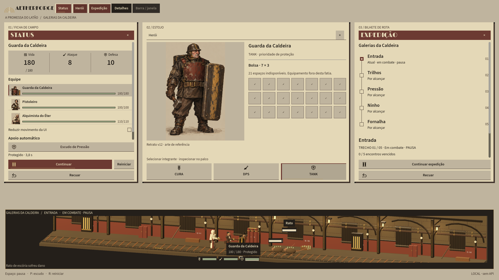
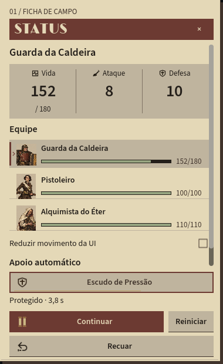
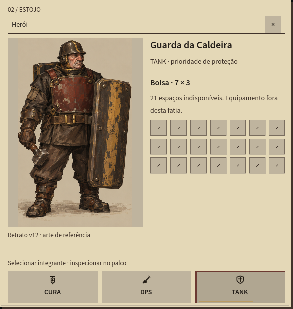
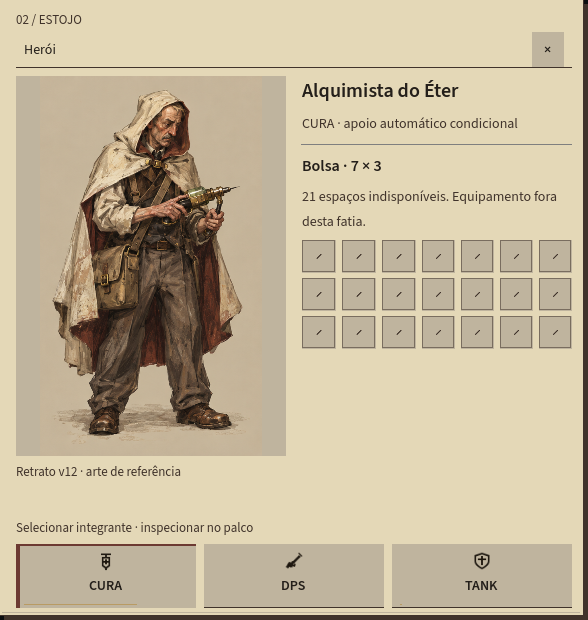
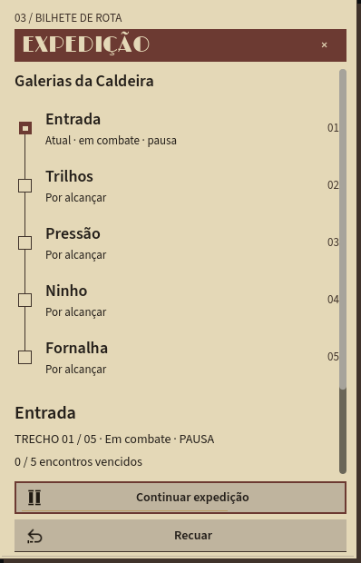
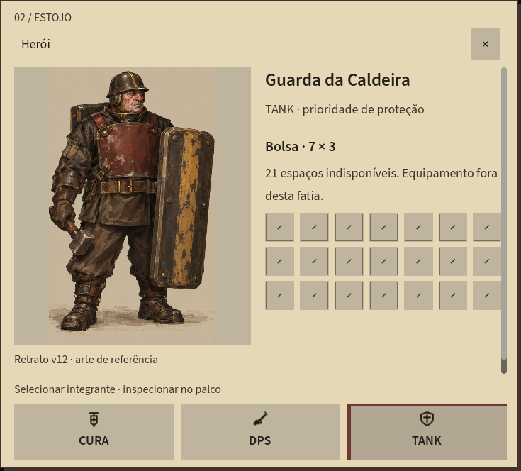
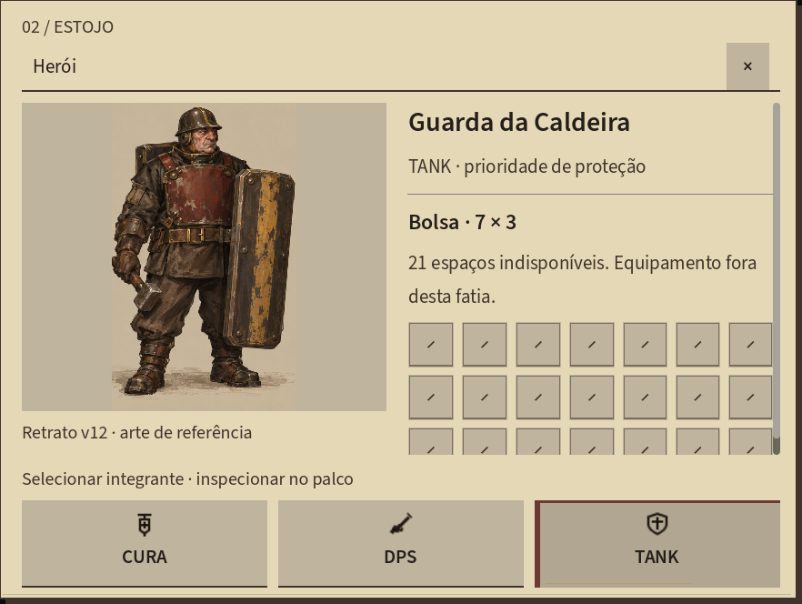
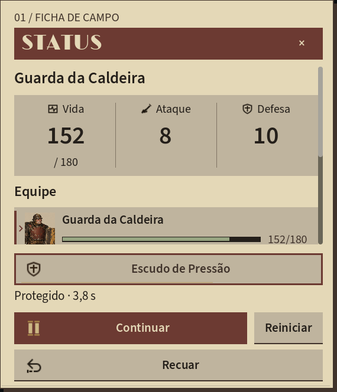
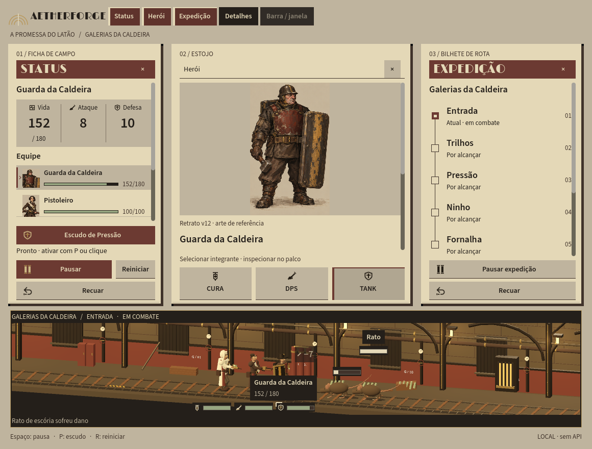
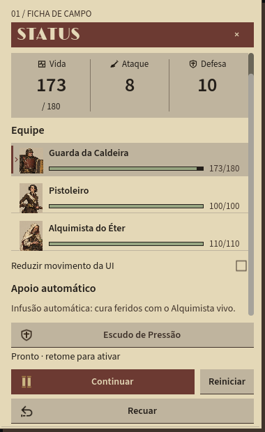

# V17 — Dossiê de turno implementado no Godot

## Escolha e escopo

Após a [exploração V16](ui-v16-layouts-exploratorios.md), você escolheu **01 — Dossiê de turno** (“gostei do primeiro”) e autorizou levá-lo ao jogo. Essa escolha prevalece sobre a recomendação anterior do assistente pelo estudo 03. A direção global continua **B — A Promessa do Latão**; o Dossiê evolui a preferência pela **V15 B — Ficha de campo**, não o piloto A anteriormente implementado.

**Agora é interface funcional em Controls/Containers do Godot, não uma prancha usada como textura.** V17 identifica esta implementação; V16 permanece como registro histórico dos estudos, inclusive suas declarações de que o runtime ainda era V15 A naquele momento. Não foram reescritos os estudos, nem relabeladas capturas antigas como resultado novo.



A imagem acima é o modo **Overview 1920 × 1080**, apenas para revisão. Não é o layout normal de desktop nem uma promessa de encaixe simultâneo em qualquer monitor. No modo normal, o palco compacto continua separado e os três instrumentos são janelas nativas independentes, inicialmente fechadas.

## 1. O que mudou para o jogador

### Status — ficha editorial e régua única



- Papel/linho claro, cabeçalho vinho, texto fuligem e contatos de latão pontuais; sem molduras pesadas em cada informação.
- **Vida, Ataque e Defesa compartilham uma régua**, com números nativos, HP máximo separado e legendas explícitas. Não são três medidores de progressão fictícia.
- Três linhas leves da equipe usam retratos recortados da pintura própria v12, vida escrita e barra real. Seleção combina **trava, seta e preenchimento**, além de foco de teclado.
- A seleção continua única: Status, retrato do Herói e identificação do palco acompanham o mesmo integrante. Não muda formação nem alvo dos ataques.
- Escudo/estado, pausa, reinício e recuo permanecem no rodapé fixo. Apoio automático e a preferência de movimento ficam no corpo rolável.

### Herói — retrato e bolsa lado a lado



O instrumento fica mais largo para mostrar identidade/retrato à esquerda e bolsa à direita. Em largura insuficiente, **as colunas empilham** e o corpo rola; o texto não é encolhido para forçar o encaixe. O retrato conserva a proporção e a figura inteira, com altura adaptada à área disponível. A legenda continua identificando a imagem como **arte de referência v12**, não modelo final.

A bolsa mantém **7 colunas, 3 linhas e 21 espaços indisponíveis**. Os espaços são Controls desativados, não equipamento funcional. Os seletores CURA/DPS/TANK continuam fixos abaixo do conteúdo, com a ordem visual correspondente à formação.



### Expedição — bilhete de rota



Cinco etapas ligadas por uma linha, com **marca de concluído, encaixe atual e nó por alcançar**, acompanhados de texto. O estado deriva da simulação existente. Bilhete da etapa e acontecimentos continuam no corpo rolável; pausa/recuo ficam fixos. Não foram criados caminhos, recompensas ou recursos novos.

## 2. Escala, largura e rolagem

Dimensões efetivamente registradas nesta máquina, para os viewports das janelas nativas:

| Escala interna | Status | Herói | Expedição |
|---|---|---|---|
| 100% | 380 × 620 | 588 × 620 | 398 × 620 |
| 125% | 475 × 664 | 735 × 664 | 498 × 664 |
| 150% | 570 × 664 | 882 × 664 | 597 × 664 |

São escalas configuradas **antes de construir a UI**, não redimensionamento de PNG ou testes de DPI físico do Windows. A janela do Herói usa duas colunas quando a largura do conteúdo alcança 480 unidades de UI escaladas; abaixo disso empilha. A bolsa não requer rolagem horizontal.







**Limite visível:** a 150% nesta altura, somente a primeira ficha da equipe aparece inicialmente por inteiro; as demais exigem rolagem. A terceira linha da bolsa também fica abaixo da dobra. Não afirmamos que todo o conteúdo cabe sem rolar. As três vidas do palco compacto continuam disponíveis no HUD preservado.



Essa captura de combate em **Overview 1160 × 880** mostra o fallback empilhado e a necessidade de rolagem. É uma composição de revisão, não fusão obrigatória dos instrumentos em um HUD fullscreen.

## 3. Tipografia, movimento e recursos

- **Limelight** nos títulos de identidade; **Source Sans 3 400/600 reais**, com pesos verificados nos RIDs do TextServer e dígitos tabulares. Sem negrito sintético, instalação global ou nova fonte baixada.
- Tema claro aplicado aos instrumentos; palco e HUD preservam sua linguagem. Campos, textos e estados permanecem editáveis/nativos, não rasterizações do SVG V16.
- Retratos completos e três recortes pequenos usam `AtlasTexture` sobre a mesma folha v12 já presente no cliente. Nenhuma pintura nova, imagem de pesquisa de terceiros, modelo ou rig foi adicionado ao runtime.
- Folha, régua, divisórias, conectores, slots e marca do checkbox são desenhos autorais em código. O checkbox usa SVG local construído em memória, não imagem externa.
- Microinterações V15 preservadas: contato de hover/foco aproximadamente 140 ms, pressão 80 ms e retorno 140 ms; **sem deslocar texto, hitbox, janela ou layout**, e sem pulso contínuo.
- HP verdadeiro é atualizado no refresh existente antes da decoração; rastro de perda tem limite de 360 ms, acompanha pausa e é limpo em reinício/redução de movimento. Isso não significa latência zero de atualização da UI.



**Reduzir movimento da UI** remove apenas as microtransições e o rastro nesta execução. Não é preferência persistida, controle de áudio/3D ou redução global de flashes. Teclado/foco, rolagem, fechar/reabrir e atalhos locais foram preservados.

## 4. Verificação executada

Na raiz do projeto:

```powershell
powershell.exe -NoProfile -ExecutionPolicy Bypass -File scripts/Build.ps1
powershell.exe -NoProfile -ExecutionPolicy Bypass -File scripts/Test-UiV17.ps1 -Screenshots
powershell.exe -NoProfile -ExecutionPolicy Bypass -File scripts/Test-Expedition.ps1 -Screenshots
powershell.exe -NoProfile -ExecutionPolicy Bypass -File scripts/Test.ps1
powershell.exe -NoProfile -ExecutionPolicy Bypass -File scripts/Test-Integration.ps1
```

Todos terminaram com **exit 0**. Build final: **0 avisos / 0 erros**. Foram **24 casos de UI**: 15 de entrada/fontes/layout/HUD compartilhados, 6 de componentes/movimento e 3 revisões amplas do Dossiê em 100/125/150%. Os **24 `.err.log` de UI estão vazios**.

A suíte verifica três folhas, uma régua, três retratos v12, 21 slots indisponíveis, alternância do Herói entre duas/uma colunas e limites horizontais da bolsa. Também cobre seleção sincronizada, foco/Tab/Enter/Escape, pausa/retomada, escudo real, recuo/reinício, Detalhes, opção de movimento, ações fixas e fontes reais. A revisão visual abriu capturas nativas nas três escalas, seleção dos personagens, opções/dano, Overview amplo/estreito, combate, chefe e conclusão.

**Métodos distintos:** mouse nativo automatizado via Win32, com restauração do cursor e liberação do botão; teclado injetado por `Viewport.PushInput`; fixtures isoladas de componentes emitem sinais deliberadamente. Não é playtest humano com entrada física. Fixtures de área útil 1366 × 728 / 1920 × 1040 / 2560 × 1400 não certificam DPI ou múltiplos monitores.

A expedição voltou a concluir **5 encontros**, com os **6 tipos de inimigo**, **108 unidades** percorridas e **137,45 s simulados**. Marcha/câmera/poses/cura/dano passaram, sem deslocamento em combate. HP final: **108/180, 52/100, 110/110**. API, dois clientes, colisão, transferência do mesmo item, dano 17 e persistência após reinício passaram novamente, com estados isolados de testes.

Evidências locais: `artifacts/ui-v17/` e `artifacts/ui-v17/qa/`; a suíte de rota também escreve em `artifacts/studio-godot/qa/`. A cópia selecionada de `route.json` está em `artifacts/ui-v17/`. Os marcadores históricos `UI V14 INPUT PASS` e `UI V15 COMPONENT PASS` são reaproveitamento dos checks, **não capturas antigas disfarçadas**; os caminhos/evidências desta rodada são V17.

## 5. Arquivos, preservação e limites

- Implementação: `BrassDossier.cs`, `BrassDossierEmptySlot.cs`, tema em `BrassUi.cs`, linhas em `BrassStatusComponents.cs`, composição em `ExpeditionView.cs` e rota em `ExpeditionMenuRoute.cs`.
- QA: `UiV14Check.cs`, `scripts/Test-UiV17.ps1` e parâmetro de diretório de saída em `Test-UiV15.ps1`, preservando as evidências históricas selecionadas.
- [Proveniência e SHA-256 das dez capturas](../../assets/concepts/brass-v17-dossie/provenance.json): cópias byte a byte dos PNGs Godot, sem crop, stretch, composição ou upscale.
- [Guia técnico/execução](../../docs/studio-godot/README.md) e [continuidade](../../docs/Desenvolvimento.md).

`ExpeditionView` continua sendo o único dono do avanço da simulação. Domínio, API, persistência, modelos/ator, palco e HUD não foram modificados por esta entrega. Nenhum save manual foi editado. Sem novas regras, XP/economia, inventário funcional, mineração, oficina, durabilidade, salvamento/offline da rota ou integração de recompensas; **M1 continua incompleto**.

Ainda não verificados: uso humano/foco no desktop real, arraste em uma matriz de monitores, DPI físico, gamepad, avaliação ampla de acessibilidade, áudio perceptivo e benchmark de hardware. Janelas podem se sobrepor em áreas restritas; preservamos texto e rolagem, não prometemos encaixe universal. Modelos e cenário seguem protótipos técnicos, não arte final v12.

Não houve novos workers, geração de imagens por IA, chamada/migração Studio, commit ou push nesta entrega. A escolha do layout está registrada; a avaliação visual do resultado implementado permanece com você.
