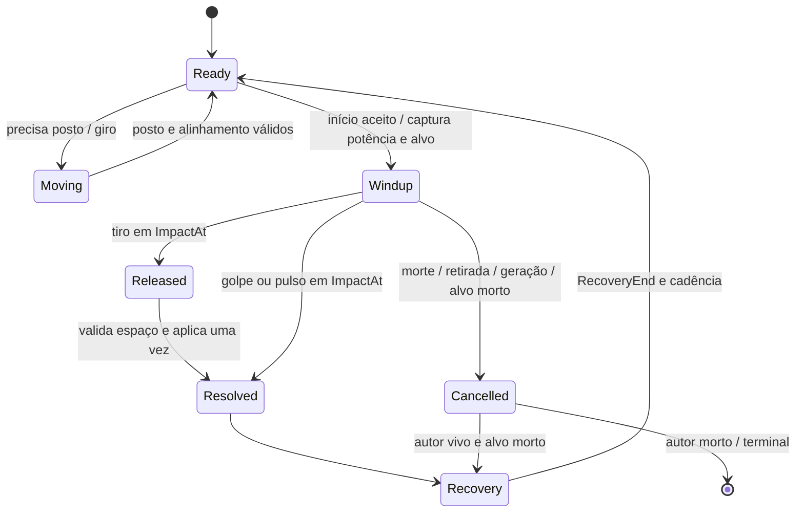
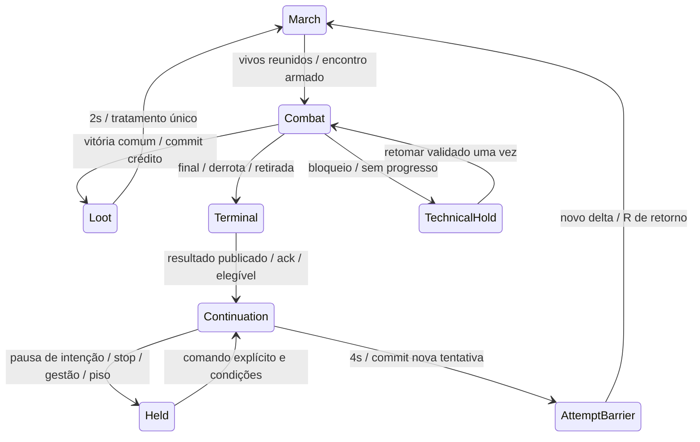

# Arquitetura de combate espacial e continuidade — C2

GAMELAB-63 · Technical Lead · 02/11/2026 · revisão C2.1 para o Game Director.

Este é o contrato de implementação proposto para C3, baseado em C1.1 aceita pelo Director. Não implementa navegador, scheduler, cena ou save. **Existente** descreve código inspecionado em `1fae8498af3ac7518fca4d11839366652e93250e`; **novo** descreve trabalho a executar. Os nomes novos abaixo são contratos semânticos, a traduzir para classes/structs C# compatíveis com netstandard2.1. Nenhuma interface proposta deve ser tratada como disponível hoje.

Decisões: manter `ExpeditionSimulation` como único dono do estado; ampliar sua porta transacional; usar navegação determinística em grade no domínio; aplicar efeitos somente em impacto espacial válido; apresentar um lote confirmado por um coordenador; versionar continuidade e preservar toda a sessão entre tentativas. C3 depende da decisão do Director sobre os gates 29/30, detalhada na seção 13.

## 1. Fontes normativas e precedência

1. Descrição vigente da GAMELAB-63, revisão 5 lida no início: somente C2 liberada. A promoção para `todo` autorizou esta execução. O histórico anterior de backlog não limita essa autorização.
2. C1.1: [combat-rules.md](combat-rules.md), [combat-blockout.md](combat-blockout.md), relatório e `verify-c1.py`, no ZIP autenticado `01a19e9a-8730-7523-9393-7e775445dcd0` da GAMELAB-62. ZIP SHA-256 `a7f46f6587ee246affd38bcae4fe554f95d9d8232b6b3a771f3f54910bef7e08`. Aceite documental do Director: GAMELAB-61, fio `01a19e9a-9be3-7a6b-89f0-797b34f98298`, resposta `01a19e9e-110b-79ed-9030-d0ffe0103854`, parecer anexo `01a19e9e-1011-771b-90fc-befe16f87275`.
3. Plano v2, anexo `01a19e5e-c4c8-7461-aaeb-77c47f0e6b96`, e complemento espacial `01a19e5e-c5af-7754-8ad6-bde2d447b038`, GAMELAB-61.
4. Contrato de impacto v1, anexo `01a19e58-8fbd-7c39-88f2-0c482dfc3949`, GAMELAB-63. C1/v2 substituem formação parada, irrelevância da distância e voo cosmético de 110 ms. Tiros iniciais têm `ReleasedAt=ImpactAt`; cura é pulso sem voo, exige visão.
5. Contratos e handoffs em `docs/implementation/equipment-{contract,architecture,domain-handoff,client-handoff}.md`, cadeia abaixo; GAMELAB-25/27/28 e gates GAMELAB-29/30. Nenhuma aprovação de checks equivale ao aceite visual desses gates.

Os hashes individuais de C1 foram conferidos contra seu manifesto: regras `ea36347ddd4039ae1e5aed50708678284eb2f330c6cac0c4d7eab1a5311ccf8e`; blockout `33648b187fc8f7fbe3560bafcaa281087d83a559c13a8a959fb4b95ee9b212d4`; relatório `a2a1d04eaacfb8fb2d4208c15389107833f0b17b7d346835656f4f16b4dc2b98`; verificador `97f718ef16437e75576e5c40b0b9527933e0cc06c82b0d6f519ab42b4af861ed`.

## 2. Base integrável e estado realmente verificado

Checkout Multica desta execução: branch `agent/technical-lead/c5390513d4f5`, HEAD `aca2d622ae590e0044a8e744f392fd6ed787161d`, árvore inicialmente limpa. `AGENTS.md` foi lido. A inspeção da cadeia foi feita em uma exportação por `git archive`, sem trocar a base, mesclar ou retargetar PRs.

| PR | Estado consultado | Head exato | Base exata / branch de destino atual |
|---|---|---|---|
| #2 | aberto, sem merge | `c8fcff01f5c15390c2c190108cee73c888c753d8` | `aca2d622ae590e0044a8e744f392fd6ed787161d` / `main` |
| #3 | aberto, sem merge | `4cc69d0eb4b1c33b96cfef4b4f57a2d4e1c4bd23` | `c8fcff01f5c15390c2c190108cee73c888c753d8` / `agent/gameplay-engineer/e200c54a9265` |
| #4 | aberto, sem merge | `b18ef0010b29edaf1c4b67f04823594283b9f12f` | `4cc69d0eb4b1c33b96cfef4b4f57a2d4e1c4bd23` / `agent/gameplay-engineer/456de55360c9` |
| #5 | aberto, sem merge | `1fae8498af3ac7518fca4d11839366652e93250e` | `b18ef0010b29edaf1c4b67f04823594283b9f12f` / `agent/gameplay-engineer/ec9591c60121` |

Links: [PR #2](https://github.com/arthur12087/Aetherforge/pull/2), [PR #3](https://github.com/arthur12087/Aetherforge/pull/3), [PR #4](https://github.com/arthur12087/Aetherforge/pull/4), [PR #5](https://github.com/arthur12087/Aetherforge/pull/5). Estado lido primeiro no vínculo Multica de GAMELAB-7/8/22/25; head/base confirmados pelo conector GitHub. `gh` não está no PATH; nenhuma consulta GitHub por esse executável ocorreu. O snapshot Multica de #5: `2026-11-02T23:33:30Z`, disponível, não antigo, 2/2 checks aprovados. Snapshots dos ancestrais são antigos; a consulta atual de metadados confirma aberto/sem merge, não certifica CI novo.

`git ls-remote` confirmou os cinco refs acima. `git merge-base --is-ancestor mainSHA chainSHA` retornou 0. O histórico liga `aca2d62 → 0686d28 → 947298b → c8fcff0 → 282ebeb → 74d384d → 4cc69d0 → b18ef00 → 1fae849`; não são implementações paralelas de equipamento. #5 é delta de apresentação sobre #4; não contém domínio novo.

**Base escolhida para a linha de combate:** `1fae849` e todos seus ancestrais, incluindo equipamento, gerenciamento, recibos e correção de identidade. Partir de `main` isolada perderia esses contratos. Antes de C3, o Director deve fixar o head resultante dos gates: (a) se 29/30 forem resolvidos antes, usar o descendente revisado de `1fae849`; (b) se incorporar os gates à migração, começar em `1fae849` com os critérios da seção 13 vinculados, sem declarar VFX-01 aceita. Se a pilha tiver sido integrada por outra estratégia, verificar equivalência por árvore/ancestralidade e registrar o novo SHA; não reaplicar a pilha por cherry-picks cegos. A PR de C3 deve mostrar apenas seu delta sobre a linha escolhida, seguindo a base real da pilha. Nenhum merge/retarget foi autorizado nesta etapa.

Stack preservada: `Godot.NET.Sdk/4.7.2`; cliente `net8.0`; Domain `netstandard2.1`; `global.json` fixa SDK `10.0.401`; API/Persistence/Checks `net10.0`. `scripts/Setup.ps1` fixa Godot mono 4.7.2 e SDK portátil. Neste checkout `.tools` está ausente; `dotnet --list-sdks` não produziu SDK. São versões declaradas pelo projeto, não uma instalação/build comprovada nesta execução. Não adicionar pacote de navegação ou referência Godot ao domínio.

## 3. Donos, interfaces existentes e versão nova

| Existente em `1fae849` | Uso e alteração necessária |
|---|---|
| `ExpeditionSimulation.ReadView`, `Compare`, `Execute(EquipmentCommand/RouteCommand)` | Manter portas, validação de intenção/recibos e guarda contra reentrada. Ampliar leitura com estados abaixo e comandos de combate/continuidade tipados. |
| `Advance(double)` / `AdvanceDetailed(double)` e `AdvanceResult` | Manter wrapper e resultados consumido/descartado. Um driver único converte tempo; novo avanço inteiro é núcleo interno/overload, nunca segundo simulador concorrente. |
| `CaptureCheckpoint`, `RestoreValidated`, `CloneState`, `CopyFrom`, `ValidateState` | Ampliar como uma unidade. Checkpoint atual é clone em memória, não codec de save. |
| `IExpeditionCheckpointSink.Commit(ExpeditionSnapshot): bool` | Preservar comandos e fronteiras significativas com candidato validado antes de publicação. Sem IO; `Volatile` não significa persistência. |
| `SessionId`, `AttemptId`, MemberId, ItemId, OperationId, revisões, ledger/RNG | Estender identidades, não substituí-las. Recibos de operação e de vitória continuam diferentes. |
| `ExpeditionEvent` com int Id/slots, ring de 128 | Criar envelope v2 tipado e adaptador de leitura para legado. Slots antigos servem apenas de projeção. |
| Stage/Vitals: época `(S,A,StageIndex,EncounterAt)`, composição e token de Node | Migrar para EncounterId/EntityId explícitos. Clones de DTO não recriam ator; geração nova aposenta atores antigos. |
| View, Stage, Vitals e Audio consomem/atualizam de formas separadas | Coordenador único passa a ser dono do avanço e do lote; retirar os consumidores autônomos gradualmente por subsistema. |

Novo `RulesetId="v19-spatial-combat-c1.1-c2.1"`, `CombatContractVersion=2`, `MemorySnapshotVersion=2`, `NavigationPolicyId="fornalha-grid-100mm-v1"`, `MapId="fornalha-c1"`, `MapRevision=1`. São identificadores de contrato propostos, não versões já implementadas. O snapshot existente anuncia `v19-equipment-1`; não aceitá-lo como se tivesse ações/espaço. Para checks legados, manter seletor explícito do ruleset antigo até a migração dos consumidores. Não mudar silenciosamente os oráculos antigos para fazê-los passar no ruleset novo. Save externo, migração de arquivo e offline continuam em GAMELAB-11/18.

`ExpeditionSimulation` mantém todo estado mutável. Helpers de geometria, planejamento e avaliação são puros sobre entradas imutáveis. Cliente possui somente composição visual, seleção/intenção e cursores de entrega. Eventos de domínio não chamam Godot nem observadores durante commit.

### 3.1 Identidades e envelope

| Campo novo/preservado | Contrato |
|---|---|
| SessionId | UUID N minúsculo existente. ResetSession cria outra sessão; nenhuma continuidade o invoca. |
| AttemptId | long checked, começa em 1 e cresce em reinício/continuação; preserva o namespace de peças/operações da sessão. |
| EncounterId | `(S,A,EncounterSequence)`; sequência checked por tentativa. Geração nova inclusive em reset de leash, mesmo StageIndex/composição/posição. |
| EntityId | Aliado: `(S,A,MemberId)`; hostil: `(EncounterId,SpawnSequence)`. Ordem de spawn é prioridade de empate, não slot reutilizável. MemberId persiste entre tentativas como identidade do integrante. |
| ActionId | `(S,A,ActionSequence)` long checked; autor e TargetId imutáveis. No máximo uma primária por vivo. |
| EventKey | `(S,A,EventSequence)` long checked, monotônico na tentativa. Envelope também traz EncounterId, autor/alvo opcionais, ActionId e ContractVersion/RulesetId. |
| TerminalResultId | `(S,A,TerminalSequence)`; resultado confirmado independente do ring, com estágio/motivo/recibo final/cursor de publicação. |
| OperationId | Contrato UUID existente, envelope imutável; manual/retry segue recibos da sessão. Auto usa ActivationKey interna determinística de tentativa/decisão, sem gerar comando público/Guid por tick. |

Timestamps inteiros, valores de posição e enums são dados; nenhum NodePath, nome traduzido, referência de objeto, índice de lista ou DTO é identidade. Contadores não fazem wrap: overflow rejeita o candidato inteiro. Adaptador legado de `int Id` tem contador próprio checked, sem truncar long; não é fonte da identidade v2.

### 3.2 Estado mínimo do agregado

`CombatState`: relógios e resíduos; próxima decisão/movimento; mapa/política e hash de geometria; contador de encontro/ação/evento; atores; ações; status; reserva/branch; continuidade; diagnóstico de bloqueio. Atores armazenam EntityId/MemberId, equipe/ordem, posição XZ, segmento e origem temporal, heading, raio/velocidade, objetivo, TargetId, destino/candidato, caminho/índice, compromisso até, perda de alvo desde, progresso/último replanejamento, intenção/indisponibilidade, próximo básico/cura, contador de ataques aceitos, leash/spawn/área e estado primário.

`ActionState`: ProfileId/versão, ActionId, EncounterId, ActorId/TargetId, StartedAtUs, ReleasedAtUs opcional, ImpactAtUs, RecoveryEndUs, NextEligibleAtUs, potência/estatísticas ofensivas capturadas, estado e resultado terminal opcional. Cancelamento de alvo conserva reserva de recuperação do autor vivo; não limpar o slot e atacar imediatamente.

`ShieldState`: ActivatedAt/ExpiresAt/ReadyAt, ActivationSequence/LastAutoDecisionKey, Origin(auto/manual/emergency), ReservedHeavyId/earliest impact, motivo da reserva, cobertura projetada e risco. `HeavyState`: due, início/impacto anunciado, alvo e próximo due. `ContinuityState`: modo avanço/cultivo, StartStage, FarmStage, AdvanceTarget, falhas[5], contagem de resets de leash sem vitória, StopAtEnd, resultado terminal, tempo de continuidade consumido, held/reason, ReturnAnchor, decisão de retorno, geração e acknowledgment de publicação. Campos concretos são novos.

## 4. Tempo, números e garantia de reprodução

### 4.1 Relógios

Todos os prazos de regras usam `long` em microssegundos checked. `SimulationUs` avança somente em March/Combat/Loot; congela no terminal/Hold/pausa/gerenciamento. `ContinuationUs` é progresso lógico de 0 a 4.000.000 após resultado terminal aceito e publicado; não altera SimulationUs nem recargas. Há um único driver/entrada de tempo; estes são dois eixos do mesmo agregado, não loops públicos independentes. `Elapsed`, cooldowns e PhaseRemaining antigos são projeções em segundos.

Driver converte delta finito não negativo com resíduo fracionário único: acumular `delta*1_000_000 + carry`, extrair parte inteira por floor e guardar carry em `[0,1)`. Nunca arredondar cada frame isoladamente. Testes do domínio entram por microssegundos inteiros. Pausa/gerenciamento/hold não acumulam dívida. Em barreira terminal/gerenciamento/reinício, o saldo inteiro e o carry daquele avanço são descartados e relatados; não transferir o restante à próxima tentativa. Deltas inválidos continuam recusados mesmo com simulação travada. Não usar Engine.TimeScale, UTC ou relógio de áudio para regras.

Decisões periódicas: 100.000 µs ancorados no início da tentativa, mais eventos exatos (fim de slot/recarga, morte, ameaça, caminho invalidado). Intenções de movimento: fronteiras de até 50.000 µs também ancoradas; **posição entre fronteiras é integrada analiticamente**, incluindo impacto em 120.000/240.000 µs. Horizonte de render apenas amostra; não dispara nova decisão, arredonda impacto ou reconstrói o segmento. Giro segue os mesmos intervalos lógicos.

### 4.2 Precisão e igualdade

Geometria/catalogue/candidatos: unidades inteiras de micrômetro (`1 m=1_000_000`); ângulo em miligraus (`360°=360_000`). Velocidades inteiras em µm/s. Distância de ação usa quadrado euclidiano entre centros; `d²<=range²` inclui igualdade, sem epsilon de render. Visão tangente a sólido é bloqueada. Clearance de navegação aceita `distância>=raio+0.10`; separação aceita `>=r1+r2+0.10`. Chegada `<=0.20` nunca amplia alcance. Geodésica de navegação usa custos conservadores do grafo, não distância em linha reta.

Movimento por segmento: endpoints P0/P1 inteiros; comprimento L é `ceil(sqrt(dx²+dz²))` em µm, com raiz inteira determinística. Antes da chegada, posição lógica é racional `P0+(P1−P0)*v*(T−T0)/(L*1_000_000)`; na chegada `ceil(L*1_000_000/v)` fixa P1 e abre próximo segmento. Guardar T0 e endpoints, não somar deltas arredondados por chamada. Consultas espaciais usam essa posição racional; converter para float Godot somente ao apresentar. Divisões/comparações usam inteiros largos/`System.Numerics.BigInteger` nos produtos cruzados; não usar float nem epsilon em predicados. Comprimento arredondado para cima reduz a velocidade em menos de 1 µm por segmento, nunca autoriza alcance adicional. Caminho de ação pode ser subótimo na grade; a mesma grade define custos/coerência da regra.

Ângulos de candidatos a cada 30° e heading usam rotina determinística de sin/cos/atan2 com constantes versionadas (CORDIC inteiro, 32 iterações, resultado em miligrau; empate de meia unidade para longe de zero). Não usar `Mathf`/float de engine em decisões. Antes de iniciar, erro angular quantizado `<=15_000`; giro 360.000/540.000 miligraus/s por origem temporal, caminho mais curto, empate de 180° no sentido positivo. C3 deve fixar constantes e vetores de referência em checks; nenhuma biblioteca nova é necessária.

HP/ATK/DEF continuam `float` IEEE-754 como na cadeia de equipamento, sem quantizar HP em inteiro/decimal nem curar frações ao comparar/equipar. Preservar ScaleBase, clamp e ordem de operações; multiplicações/subtrações explícitas com resultado float, sem FMA/agregação de dano reordenada. Pesado usa `31f*1.8f`, depois defesa, piso, depois escudo; não introduzir floor entre essas operações. UI arredonda apenas texto. Snapshot preserva os bits de HP. A garantia de HP bit a bit exige mesmo binário/runtime/configuração; portabilidade para outro runtime/ISA deve ser certificada em C5, não inferida.

### 4.3 Garantia e limites

Navegação/ordenação são reproduzíveis a partir de mesmo RulesetId, geometria/política/hash, seed, estado inicial e comandos ordenados nos mesmos T. Grade, heap, candidatos, reservas e orçamento são ordenados explicitamente; não dependem de hash iteration, frame, threads, navmesh/avoidance Godot ou tempo de CPU. Clone/restore inclui buscas em curso e próxima fronteira; tem o mesmo sufixo de posições/eventos/HP/ledger no ambiente certificado.

Particionar uma duração inteira em avanços menores não muda trace semântico, posições, ações, RNG ou ganhos. Revisões de publicação podem diferir porque o contrato existente invalida prévias a cada tempo publicado; não prometer igualdade de StateRevision sob partições diferentes. Replay literal de envelopes com ExpectedStateRevision requer registrar também as chamadas de avanço/publicação originais. Ensaio de FPS variável compara mesmas intenções em T, criando a prévia atual em cada execução, e separa isso de replay literal. Pausa, descarte de delta em barreira e mudança de inputs não são equivalentes a um avanço contínuo: são entradas diferentes.

Não há promessa de imagem/áudio bit idênticos, tempo de CPU fixo ou menor caminho contínuo global. A reprodutibilidade não prova ausência de deadlock nem vitória; C3/C5 precisam demonstrar progresso no blockout.

## 5. Scheduler e contrato de impacto

Fila pequena ordenada de prazos basta para cinco atores. A agenda é derivável das ações/status/decisão; snapshot guarda os campos fonte e validadores comparam a reconstrução (sem agendar duas vezes). Cada timestamp T segue C1:

1. Comandos já aceitos no driver, em InputSequence. Sem retrodatação; T futuro só por log de teste. Pausa/retirada impedem impactos do avanço interrompido. Manual elegível altera status antes dos impactos de T.
2. Travas/cancelamentos por morte, retirada, geração inválida; um resultado terminal por ação.
3. Integrar movimento até T e reconciliar ocupação. Comandos não leem posição velha: consultas espaciais avaliam o segmento em T, mesmo antes da materialização dessa etapa.
4. Expirar status (`T>=ExpiresAt`) e executar auto de escudo elegível.
5. Liberações devidas.
6. Impactos devidos, em ordem Guarda→DPS→suporte→spawn hostil→ActionId. Após **cada** impacto, aplicar HP/morte, cancelar dependentes e detectar fim imediato de encontro. Último inimigo morto encerra antes de cura/ataque ainda devidos em T.
7. Fins de recuperação; novas decisões/inícios elegíveis. Decisões novas não retroagem para vencer um impacto já devido.

Eventos de tempo zero não podem se reagendar infinitamente: cada ação resolve/cancela uma vez; cada decisão tem chave de fronteira/causa consumida; próximo prazo é estritamente futuro ou esgota uma chave pendente. Não executar rajada de ataques atrasados.



Pré-condições de início: Combat ativo, autor/alvo vivos na geração, primária livre, cadência/recarga, alcance/visão e alinhamento; healer sem cura prioritária antes de atacar. Capturar potência uma vez; defesa/status/posição são consultados em ImpactAt. Windup/Recovery plantam raiz, permitem giro. Perder alcance/visão durante preparação não cancela nem transfere alvo: resolução 0 com motivo e recuperação/cadência integrais. Autor morto/retirada/geração inválida cancela sem efeito; alvo morto cancela sem retarget e conserva RecoveryEnd do autor vivo. Resolução e cancelamento são mutuamente exclusivos; ActionCompleted só libera slot, não é segundo resultado.

| Perfil | Impacto / Released desde início | RecoveryEnd | Próximo início mínimo |
|---|---:|---:|---:|
| Guarda | 240.000 / sem Released | 540.000 | 1.600.000 |
| DPS | 120.000 / 120.000 | 340.000 | 1.250.000 |
| Suporte básico | 200.000 / 200.000 | 440.000 | 2.400.000 |
| Infusão | 360.000 / ausente | 600.000 | cura em 4.000.000 |
| rat | 240.000 / ausente | 490.000 | 1.800.000 |
| scavenger | 320.000 / ausente | 620.000 | 2.200.000 |
| sentry | 400.000 / ausente | 750.000 | 2.400.000 |
| drone | 180.000 / 180.000 | 400.000 | 1.700.000 |
| watcher | 240.000 / 240.000 | 500.000 | 2.300.000 |
| foreman básico | 380.000 / ausente | 730.000 | 2.500.000 |
| foreman pesado | 900.000 / ausente | 1.400.000 | básico 2.500.000; pesado ≥12.000.000 |

Guarda tem preparação de gesto 160.000 µs antes do golpe; infusão 220.000 antes do pulso. Esses marcos visuais não aplicam HP. Início dos aliados não antes de CombatAt+0.4/0.6/0.8 s; hostis +1.0/+1.35 s. Movimento/alinhamento podem adiar. Contador de terceiro ataque de drone/watcher incrementa no início aceito, inclusive erro posterior; rejeição não conta.

Alcances entre centros: Guarda/hostil melee/pesado 1.60 m; DPS/drone/watcher 5.00; suporte básico 4.50; cura 6.00. Visão obrigatória para todos, atores não ocluem tiro/cura. Tiro libera e resolve no mesmo T, traçador somente até alvo/primeiro sólido; sem objeto de voo autoritativo nesta fatia. Pulso de cura não usa projétil. Alvo cheio resolve `NoMissingHealth`, efetivo 0, sem reembolso/número positivo.

Suporte tem um slot primário e dois deadlines: NextBasic=lastBasic+2.4 s, NextHeal=lastHeal+4 s, ambos limitados por slot livre. Se ambos prontos e algum vivo HP<=72%, cura vence. Paciente por menor razão HP/max (comparação por produto, empate Guarda→DPS→suporte); busca posto por até 1 s, depois próximo necessitado alcançável, sem atacar durante o esforço prioritário. Ataque iniciado termina antes de nova decisão de cura; cura não zera nem adianta cadência básica.

### 5.1 Resultado atômico

Eventos novos são `ActionStarted`, `ActionReleased` (opcional), `ActionResolved`, `ActionCancelled`, `ActionCompleted`, `ShieldActivated`, `EncounterStarted/Reset`, `StageWon`, `TerminalResultPublished`, `AttemptStarted` e mudanças de pausa/hold/continuidade. Started compromete potência/tempos, Released não aplica HP, Resolved ou Cancelled é o único resultado terminal da ação e Completed libera recuperação. Reward/level/drop preservam recibos e ordenação existentes. Rejeição de início é resultado de comando/disponibilidade, sem ActionStarted e sem consumo de recarga.

Novo `ActionResolved` carrega IDs/AtUs/Profile/Outcome/Reason; posições lógicas do autor/alvo; origem/direção lógica; ponto/tipo do primeiro contato e ObstacleId opcional; HP antes/depois; RawAmount, PreventedAmount, EffectiveAmount, Overkill/Overheal e IsLethal. Magnitudes são não negativas. Raw é potência antes da defesa; Prevented é redução por defesa/status considerando piso atual; Effective é delta real limitado ao HP disponível/faltante. Excesso não é mitigação. Invalidade espacial resolve 0 com motivo e geometria; não inventar prevenção por escudo para erro de alcance. Cura Raw é potência capturada, Prevented=0, excesso é Overheal. Morte é consequência do mesmo resultado, não comando externo.

HP confirmado é publicado antes de reward/level/phase dentro do lote ordenado. Um último golpe letal pode ser seguido de nível que altera o máximo: manter os deltas distintos, sem mostrar cura de nível como se fosse o impacto. Recibos só vêm do domínio.

## 6. Escudo, reserva e pesado

Novo comando manual de escudo usa o mesmo executor transacional e recibos existentes. Wrapper `ActivateShield()` permanece para legado e delega à única operação `TryActivateShield`; auto chama o mesmo núcleo de validação/mutação dentro do candidato do scheduler. Duração 4.000.000 µs, ready=ativação+12.000.000; cobertura `[ActivatedAt,ExpiresAt)`. Uma aceitação altera imediatamente readyAt. Manual/auto no mesmo T: comando manual aceito primeiro; auto observa cobertura/recarga e não reativa. Retry do mesmo OperationId retorna Replay; outra operação inelegível retorna Cooldown. Não reiniciar duração por redraw.

Auto usa ActivationKey interna `(S,A,DecisionAtUs,CauseId)`, preservada em ShieldState com ActivationSequence; não passa uma string informal a ValidId nem acrescenta um recibo público ao histórico de operações a cada tick. O status/deadline e a última chave confirmada bastam para impedir repetição interna; eventos mantêm seu ring limitado. Falha de commit conserva sequência e chave anteriores para retry do candidato. Recibos manuais da sessão continuam intactos. Isso evita criar um segundo ledger crescente só para decisões automáticas.

Auto: pesado conhecido contra Guarda, ativar no deadline ImpactAt−600.000, ou imediatamente se anúncio entrou tarde; se já coberto, conservar. Fora disso emergência HP<=35% ou dano anunciado nos próximos 600.000 letal, desde que pronto. Avaliar dano previsto com defesa atual e ações conhecidas; não inventar cura futura. Próximo pesado previsto até agora+12.600.000 reserva uso; emergência só quebra se dano letal chega antes da próxima cura já iniciada/agendada (sem cura agendada, limite é infinito). Somar impactos na ordem autoritativa, interrompendo na morte prevista; é previsão para decisão, não dano confirmado. UI mostra reserva e risco após uso manual/emergencial.

HeavyDue inicial CombatAt+6.000.000; substitui próximo básico elegível, não ignora slot/alcance/visão/cadência. Após início aceito, próximo heavyDue=início+12.000.000; atraso não acumula cópias. Até anúncio, reserva usa impacto mais cedo=due+900.000. Anúncio fixa alvo/instante; escudo só protege Guarda, não outro sobrevivente. No exemplo sem atraso: pesados 6/18.5, impactos 6.9/19.4, auto 6.3/18.8, ready 18.3. No limite de 12 s exatos, segunda auto coincide com ready e pode proteger. Ativação manual intermediária pode retirar essa cobertura; não prometer cobertura universal nem reduzir recarga.

Em T=14 s, escudo [10,14) expirou; em 13.999999 protege. Em T=22, escudo pronto pode ser ativado por comando antes de impacto em 22; sem ativação não há proteção retroativa. Mitigação pós-defesa é 0.35, sem aplicar piso 1 outra vez.

## 7. Navegação mínima de `fornalha-c1`, revisão 1

**Escolha:** grade de 0.10 m com A* determinístico no Domain, restrita a este mapa plano e no máximo cinco atores. Não usar NavigationAgent3D/RVO/PhysicsServer como autoridade. Engine pode desenhar depuração; caminhos, posições e consultas usados por regras têm entradas/resultados do domínio. Isto evita incorporar resultados dependentes da ordem de atualização do motor ao replay. Não construir framework de mundo aberto/BT/steering genérico.

### 7.1 Uma geometria para três consultas

`CombatMap` novo guarda retângulos físicos inteiros A/B/N/S/C/D/F de C1, sólido da máquina, POIs/portais, spawns e áreas hostis, com IDs estáveis. Construir união por partição nos X/Z dos vértices; arestas internas compartilhadas desaparecem. Extrair somente bordas externas e sólidos. **Erodir a união**, testando clearance do disco contra essas bordas; nunca encolher cada retângulo e depois uni-los. A máquina `[23,31]×[8,20]` e todo exterior do piso bloqueiam caminho/visão. AABB de desenho 62×28 m não é piso retangular livre.

Três consultas puras sobre a mesma geometria/hash:

- `FindPath(map, policy, start, destination, radius, branch, area/leash, requestKey)` → caminho ou Pending/NoPath, custo e diagnóstico. Considera raio+0.10 m, reservas/destinos quando aplicável. Resultado não muda HP.
- `CheckActionSpace(map, fromAtT, toAtT, maxRange)` → alcance entre centros + visibilidade; atores não ocluem. Centro fora do piso é estado inválido, não atalho de visão.
- `FirstContact(map, segment)` → primeiro t racional em `[0,1]`, ponto/normal e ObstacleId. Interseção tangente bloqueia; empate de contatos usa menor t, depois ID ordinal da aresta. Validar subintervalos do segmento contra a união, inclusive sair e voltar ao piso; não basta verificar endpoints.

Distância a aresta e interseções são predicados inteiros/racionais. A máscara de clearance e o mesh visual são derivados do mesmo catálogo, com MapRevision/hash expostos no overlay. Diminuir altura/opacidade visual para câmera não muda sólido lógico. Geometria editada exige revisão nova e revalidação; não carregar checkpoint de mapa divergente silenciosamente.

### 7.2 Grade e desempates

Centros de grade `(0.05+0.10*i,0.05+0.10*j)` m dentro do mapa, `i=0..619`, `j=0..279` (173.600 candidatos antes do filtro). Essa origem inclui as bordas úteis de N: 20.45 e 21.15 m. Máscaras separadas para clearance 0.45/0.65 m; físico/visão continuam na geometria original. Nós na distância exata de clearance são válidos. Toda aresta também passa pelo teste de cápsula/clearance ao longo do segmento: diagonal não corta canto, mesmo com endpoints livres.

Vizinhança ordenada E, N, W, S, NE, NW, SW, SE. Custo por segmento em µm: ortogonal 100.000; diagonal `ceil(sqrt(2*100.000²))=141.422`; heurística octil com os mesmos custos. Heap ordena `(f,h,NodeId)`; atualização com custo igual prefere predecessor de menor NodeId. NodeId=`j*620+i`; comparações ordinais, sem dependência de Dictionary. Caminho reconstruído mantém esses waypoints; nesta versão não alisar por atalhos que mudem a garantia/custo.

Origem/destino arbitrários não são arredondados para o outro lado de uma parede. Ligar cada endpoint à união das quatro células que o contêm (centros à distância de até uma célula por eixo, no máximo nove candidatos em fronteira), somente com segmento de clearance válido; empate por custo, depois NodeId. Se nenhum conector cabe, retornar NoPath. Endpoint final mantém coordenada escolhida, não um slot de grade. Spawns/POIs de C1 devem passar esses conectores. Destinos de anéis são calculados em µm pela rotina angular versionada; geometria/ocupação são rechecadas após quantização.

Escolha macro N/S conserva os oráculos C1: no J0 comparar polilinhas de referência 25.6/28 m; verificar conectividade de cada ramo, menor custo viável vence, empate N. Todos usam BranchChoice até R3. A* recebe portais ordenados do ramo; não pode escolher um caminho híbrido nem cortar pela máquina. Comprimento A* individual pode diferir da polilinha macro; guardar ambos em métricas. N indisponível antes da entrada permite escolher S após recuperação; não dividir grupo entre ramos.

### 7.3 Consultas e custo limitado

Decisão a 10 Hz não implica A* para cada candidato. Por rodada, gerar/filtrar todos os candidatos (anéis de C1, 12 ângulos), ordenar prioridades sem custo, e usar uma busca multiobjetivo por ator para obter custos aos destinos viáveis. Prioridade do suporte: cobertura de vivos, tanque coberto, distância segura dos hostis/semiplano atrás do tanque quando possível; depois caminho, erro do anel e índices. Guarda reserva destino antes do DPS e suporte. Destino atual válido fica por 0.60 s salvo causas de C1. Replanejar somente se objetivo deslocou ≥0.50 m, segmento/rota invalidou, geração mudou ou recuperação solicitou. Movimento do alvo abaixo disso não invalida automaticamente todo caminho; alcance/visão no impacto continuam atuais.

Orçamento inicial por fronteira de 100.000 µs: até cinco novas buscas de rota (uma por ator), cacheadas por mapa/raio/restrições/origem/destinos; no máximo 8.192 expansões A* no total, rateio round-robin por EntityId após ordem funcional. Limites são unidades de trabalho determinísticas, **não milissegundos de CPU**. Busca excedente permanece Pending, com open/closed/g/parent e cursor no estado; não confundir orçamento com NoPath. Continuar próxima rodada; NoPath só quando a fila esvaziar. Pedidos obsoletos são cancelados por RequestKey, sem publicar caminho antigo. Nunca executar busca inteira extra em callback/frame lento.

Consultas curtas de alcance/visão/ocupação são síncronas: até cinco validações de impacto por T; cache por endpoints/geom somente dentro da rodada. Custos de coesão usam mapa/restrições e conectores do grafo, com cache de pares; máscara/distâncias estáticas são dados derivados imutáveis. Consultas auxiliares de destino/leash compartilham o teto de expansões, não abrem buscas ocultas. Pending permite conservar caminho válido, ou esperar com `PathPending`; espera pelo orçamento não conta como stuck. Se Pending persistir por 2 s lógicos sem resultado, entrar em Hold técnico `NavigationBudgetExceeded`, preservando busca e diagnóstico; revisar orçamento/mapa, sem declarar inacessibilidade. C3 mede p50/p95/p99, expansões/cache/filas, memória e pior fronteira. Os números são hipóteses iniciais e precisam caber no orçamento histórico do idle; não são benchmark desta entrega.

### 7.4 Movimento, ocupação, coesão e gargalo

Planejar deslocamento sobre o próximo segmento; novo estado move até a primeira de: fronteira de intenção de 50 ms, waypoint, início de ação que planta raiz, primeiro contato de discos/parede, limite de coesão/leash ou prazo exato. Em impacto entre intenções, avaliar cada segmento em T como na seção 4. Não alterar direção por causa da quantidade de chamadas de Advance.

Discos vivos mantêm soma dos raios+0.10 m; desejado comum 0.90, mínimo 0.80. Resolver intenção simultânea por prioridade: reserva já concedida/ator dentro de N → maior tempo de espera → Guarda/DPS/suporte/spawn/EntityId. Fazer swept-disc contra os segmentos dos outros atores, não somente endpoints. Descobrir primeiro microssegundo que violaria separação, parar no último válido; busca de contato por equação quadrática com predicados inteiros, refinamento para menor µs e verificação dos vizinhos. Não empurrar atores nem aplicar o callback de física Godot. Replanejamento por bloqueio ocorre na cadência/causa contratada; interromper por segurança não consome ataque. Caídos deixam de bloquear navegação e mantêm seu visual.

Coesão é máximo par a par entre aliados vivos de **8 m navegáveis**, não raio de 8 m do tanque nem distância euclidiana. Leash hostil: 6 m navegáveis do spawn e área B/C/D/F erodida, conforme C1. Definir métrica pelo menor custo navegável no grafo com conectores, excluindo corpos móveis, incluindo sólidos. Para o intervalo de movimento proposto, certificar que o teto vale durante todo o segmento: usar limite superior por comprimento dos deslocamentos somado à distância inicial; se ele não certifica, subdividir logicamente/consultar ou segurar o líder e mover somente o seguidor que reduz a maior separação. Igualdade aceita; falta de certificado segura movimento, nunca amplia teto. Subdivisões são derivadas do intervalo lógico, não do render. Essa política é conservadora e pode gerar espera; ensaio de C3 precisa provar progresso nos portais e evitar falso Hold. Leash usa a mesma certificação; retorno ao spawn é por caminho.

N reserva faixa X `[22.5,31.5]`, Z `[20,21.6]`, direção e lista ordenada, não um lock exclusivo de corredor inteiro. Primeiro por menor distância à entrada, empate Guarda→DPS→suporte→EntityId. Admitir seguintes quando separação longitudinal ≥0.90; mínimo geral nunca viola 0.80. Sem ultrapassagem/inversão enquanto ocupado. Pedido de retorno termina na direção atual, reúne em N0/N3 e depois inverte. Checkpoint conserva cada reserva/token/ordem/direção/admissão/posição. Último vivo com X≥31.5 no sentido leste (ou X≤22.5 no oeste) libera a reserva; mortos saem da fila. Em S não impor essa fila: destinos livres com separação. Fora de N, reunião/combate têm posições por função, sem formação permanente.

```mermaid
flowchart LR
    R0 --> R1 --> R2 --> J0
    J0 --> N0 --> N1 --> N2 --> N3 --> R3
    J0 --> S0 --> S1 --> S2 --> S3 --> R3
    R3 --> R4 --> R5
    N1 -. ordem / direção / 0.90m .-> N2
    R3 -. todos vivos em 2m / separados .-> E3[Armar E3 uma vez]
```

Stuck: queda de caminho restante <0.10 m em 1 s enquanto deveria andar; excluir pausa/slot/reserva/Pending/espera de coesão legítima. Replanejar uma vez, preservando prioridade de quem atravessa. Após mais 1 s, tentar posto/contorno alternativo e recuar perdedor até último ponto livre, no máximo 1.5 m por caminho. Persistindo 3 s após essa tentativa, reunir demais no último R seguro. Total 8 s sem progresso/rota → Hold `NavigationBlocked`, com T/ator/rota/reserva/obstáculo. Retomar valida e tenta uma vez; nova falha mantém Hold, não loop automático. Não usar teleporte, redução de raio ou colisão desligada.

Alvo mantém até 1 s sem posto alcançável; então alternativa por prioridade C1. Hostil além do leash ou 3 s sem alvo alcançável cancela e retorna ao spawn; reset do encontro só se não resta combate válido, com nova geração, inimigos restaurados, HP/recargas aliados preservados, sem crédito/cura. Dois resets sem vitória → Hold `LeashLoop`. Quinze segundos contínuos sem dano/cura efetivos por impossibilidade de contato iniciam recuperação `NoCombatProgress`; contar só Combat ativo, nunca tempo humano/espera autorizada. São falhas técnicas de progresso, não derrota/farm.

## 8. Continuidade, terminais e equipamento

O **resultado terminal** é imutável; o agregado terminal ainda aceita comandos autorizados de equipamento/pausa/reinício. Não confundir isso com snapshot inteiro congelado para toda mutação. Simulação de combate termina em T: ações canceladas, HP/mortes/recompensa/nível/fase confirmados numa transação. `AdvanceDetailed` retorna imediatamente com o resultado e descarta delta restante. Nenhuma nova tentativa começa nessa chamada.

### 8.1 Dois Holds distintos

| Situação | Fase/terminal | Permissão de equipamento | Próxima ação |
|---|---|---|---|
| NavigationBlocked / LeashLoop / NoCombatProgress / BudgetExceeded durante combate | `Phase=Combat`, `HoldKind=Technical`, `IsTerminal=false` | Sempre InCombat; pausa/hold não abrem janela | Retomar uma vez, retirada ou reinício explícito |
| Hold técnico em marcha | Phase=March, não terminal | Só após RequestManagement→Active, como antes | Gerenciar não remove Hold; concluir não retoma automaticamente |
| Segunda derrota no piso | `Phase=Defeat`, `HoldKind=DefeatFloor`, `IsTerminal=true` | Permitido no terminal, sem cura | Tentar avançar/reinício explícito; sem contagem automática |
| Complete/Defeat com repetição segurada | Terminal verdadeiro, ContinuationHeld | Permitido no terminal, sem cura | Continuar explícito ou reinício existente |
| Retreated | Terminal estável | Permissão terminal existente | Reinício explícito; nunca repetição automática |

Não acrescentar `Hold` à expressão de terminal usada pela autorização de equipamento. A ordem de ValidateEquipment continua: contexto/recibo → tentativa → fase segura → revisão/origem/capacidade. TechnicalHold não torna Combat seguro. RequestManagement em Combat, inclusive Hold, continua apenas Requested; não satisfazer o pedido até vitória válida. Reiniciar de Hold é transição explícita de tentativa, não correção de trajetória.

### 8.2 Contagem e publicação

Coordenador recebe resultado após commit e o publica em HUD/histórico; novo acknowledgment `AcknowledgeTerminalResult(ResultId, cursor)` do driver autoriza consumir **deltas seguintes** no eixo ContinuationUs. É operação idempotente de entrega, sem crédito/cura; identidade/revisão inválida rejeita. Não depender de animação terminar nem de `FramePostDraw` para regras. Em bind/restore, publicar resultado corrente antes de enviar acknowledgment; snapshot não pode fabricar apresentação já vista por outro consumidor. O resultado fica no read model até próximo resultado/arquivamento, independente dos 128 eventos.

Complete/Defeat elegíveis contam 4.000.000 µs sem ataque, movimento, cura ou avanço de cooldown. Pausa congela contagem **e** acabamento; stop/gerenciamento terminal segura contagem. Ao atingir 4 s, transação cria AttemptId+1, destino/HP/recargas novos e retorna barreira de tentativa; descarta excesso/carry e exige nova chamada para marchar. Falha do sink conserva terminal, resultado, contagem e RNG no último ponto confirmado; não aposenta atores ou publica AttemptStarted candidato. ContinuationUs consumido muda StateRevision e invalida prévia como tempo publicado, mesmo sem alterar HP.

Novo Attempt não chama RestartCore sem parâmetros e depois salta StageIndex: criar núcleo `BeginAttempt(startStage, mode, reason)` compartilhado com RestartRoute. Preserva SessionId, XP/nível, todos os ItemIds/slots/bolsa/pendentes, carteira, seed/RandomState/contador de itens, ledger, operações/recibos e séries de falhas autorizadas. Limpa créditos **da nova tentativa** por BeginAttempt; gera EncounterId/EntityIds novos, restaura HP ao máximo equipado, zera prazos relativos como RestartRoute e posiciona explicitamente no R de retorno com colocação não sobreposta. Reinício explícito legado preserva sua semântica de rota inteira, sem ResetSession. Pausa que impede contagem não é removida por transição automática.

`Victories==StageIndex` atual deixa de valer em retorno para E3 ou cultivo. No ruleset novo, Victories representa quantidade de créditos reais nesta tentativa, StartStage explicita início; StageIndex é estágio armado/ativo. Validação compara ledger/CurrentAttemptCredited e sequência de estágios realmente permitidos. Etapas puladas não são creditadas nem contam como vitórias. Complete só após E5 vencido em modo avançar; vitória em cultivo não usa Complete e não exige StageIndex=4/Victories=5. Acrescentar `FarmComplete` ao fim do enum v2, sem renumerar valores existentes, com `IsTerminal=true`, `Outcome=FarmVictory` e permissão terminal de equipamento. O adaptador antigo não dirige UI espacial e não deve interpretar FarmComplete como rota completa.

### 8.3 Tabela de transições fechada

Índices j/k são 0..4; E1 equivale a 0. Failure[j] zera só por vitória em j ou comando explícito de nova série.

| Entrada | Resultado / próximo destino |
|---|---|
| Vitória E1–E4 avançando | Crédito único `(S,A,j)`; Loot 2 s, tratamento final de vivos se healer vivo; próxima reunião. Pedido de gerenciamento é atendido antes do descanso com 2 s inteiros. |
| Vitória E5 avançando | Complete, crédito; acabamento até 0.70 s, contagem 4 s, nova tentativa em R0. Sem descanso/tratamento extra. |
| StopAtEnd ligado | Segura terminal Complete **e** recuperação após derrota. Desmarcar não dispara avanço; precisa Continuar explícito. Flag idempotente, não para na próxima vitória comum. |
| Gerenciar pedido na vitória final | Complete e nenhum Requested/Active artificial no terminal; ContinuationHeld com motivo Management. Equipamento permitido, Continuar explícito libera contagem. |
| Primeira derrota em j>0 | Falha[j]++; retorno k=j−1 em 4 s; nova tentativa começa no R de k, avança de k a j. Vitória em k não zera falha de j. |
| Segunda derrota em j>0 sem vitória em j | Falha[j]=2; cultivar k=j−1. Vitória em k não volta para j automaticamente. |
| Vitória cultivando k | Crédito por vitória nova; zera falha local[k], conserva modo/AdvanceTarget; 4 s e nova tentativa da mesma k. Sem fingir rota completa. |
| Derrota cultivando k | Primeira recupera/repite k; segunda baixa cultivo para max(0,k−1), sem oscilação para a barreira. |
| Segunda derrota sem vitória em k=0 | DefeatFloor; acabamento e terminal segurado, sem nova tentativa automática. |
| Tentar avançar em cultivo/DefeatFloor | Novo comando com alvo de avanço guardado; zera somente série explicitada, programa 4 s e percurso desde k. Não apagar ledger/RNG/ganhos. |
| Retirada | Retreated estável, sem recompensa parcial/repetição. Se vitória já confirmada, crédito permanece; retirada antes impede aquele impacto/vitória. |

Parâmetros de nova tentativa guardam ReturnAnchor e UpcomingStage. Geometria de reunião/spawns vem do mapa, nunca de distância linear. Mudança de geração/retorno pode fazer corte visual declarado (saída/entrada), com motivo no HUD; não é teleporte durante navegação.



### 8.4 Fronteira de comparação/confirmação

Abrir Herói/Status não pausa contagem nem concede janela. Comparação captura S/A/StateRevision/ExpectedEquippedItemId e SelectionEpoch como hoje. Todos os comandos e a barreira de tentativa entram na mesma fila: comando recebido no terminal antes de consumir o delta da fronteira é validado no terminal e altera o máximo do reinício; comando recebido após a transição encontra AttemptMismatch (ou Replay se já aplicado com mesmo envelope). Mesmo T não permite retrodatação. Callback de UI antigo recebe StaleComparison no controlador; não gerar nova prévia e confirmar automaticamente. Pausar explicitamente antes da comparação permite uma janela estável; equipamento limita HP ao máximo novo, nunca cura/revive nem reinicia recarga. RequestManagement no terminal continua NoChange; o held decorrente de pedido previamente solicitado é informação de continuidade.

## 9. Clone, checkpoint e restauração

Clone/CopyFrom/ValidateState/Snapshot/Restore devem mudar no mesmo patch de domínio. Tudo que determina próxima decisão precisa ser copiado: mapa/revisão/hash/política/ruleset; SimulationUs/ContinuationUs e resíduos; próximos ticks; segmento/origem racional/índice/destino/heading/odômetro de cada ator; ações e flags terminais, potência; status/recargas/heavy/swing; filas A*/g/parent/open/closed/tie order e orçamento/rodada; BranchChoice/reservas/direção/ordem/admissão; compromissos/perda de alvo/progresso/timeout/hold/retry; contadores/IDs/event ring/pisos de geração; resultado/ack/retorno/falhas/mode/stop; e todos os campos existentes de equipamento/reward/operações.

Dados derivados imutáveis do mapa podem ser compartilhados apenas com hash/versão verificados; coleções mutáveis nunca compartilham armazenamento com o vivo. Não guardar Godot Vector/Node/Resource, handles de áudio ou relógio de parede. Cursores visuais ficam no checkpoint **do consumidor**, vinculados ao snapshot/generation; não são autoridade de combate e não autorizam pular resultado em bind.

Validar ao restaurar: IDs únicos/gerações, tempos ordenados e não negativos, uma primária e um resultado terminal por ação; potência finita; posição/raio dentro do piso; segmentos/caminhos contínuos e índices válidos; reservas apenas para entidades existentes e direção única; limite de coesão/leash ou Hold explicitamente diagnosticado; status semiaberto; counters/ledger/partição de itens; resultado/continuidade coerentes; contadores suficientes para não reutilizar IDs. Falha rejeita inteiro, sem apagar item, curar, recomputar RNG ou teleportar. Snapshot de versão/mapa incompatível retorna erro explícito; migração externa não faz parte de C2/C3.

Commit: comandos usam sink como hoje; fronteiras de fase/vitória/terminal/início de tentativa/Hold/resume também. Passos ordinários continuam voláteis. Candidato de impacto e sua vitória ficam na mesma unidade; se a fronteira falhar, nenhum HP/cue/recibo candidato escapa. Não serializar toda expansão de A* em disco: não há adaptador de disco neste escopo. Controle de reentrada preservado; callbacks retornam somente depois da publicação.

Teste central: capturar no meio de N e durante Windup; avançar/restaurar produz o mesmo sufixo de eventos, reservas, HP, RNG e recibos, uma única vez. Sink que falha no último golpe/nova tentativa conserva prefixo confirmado; tentativa seguinte usa o mesmo RNG/IDs candidatos sem duplicar recompensa publicada.

## 10. Coordenador de apresentação, relógios e ring de eventos

Novo `CombatPresentationCoordinator`, composto pela ExpeditionView, é o único dono do frame de combate. Stage/Vitals/Audio tornam-se receptores de `PresentationBatch` imutável; não varrem três históricos nem avançam simulação por `_Process` próprio. O throttling atual de 0.1 s pode ficar em painéis de dados sem contato, nunca em HP principal/impacto. Seleção e equipamento continuam nas classes existentes.

Pipeline: receber comandos em sequência → executar comandos → avançar domínio uma vez → receber estado/eventos **confirmados** → reconciliar gerações/atores → reduzir eventos em ordem → amostrar raiz/pivô/pose → atualizar câmera → projetar HUD/retângulos/números/VFX → solicitar cues de áudio desse lote → registrar cursor/resultado publicado. Render não aplica dano. Uma migração desliga consumo antigo do subsistema ao ligar o novo, evitando cue duplo; adaptador `attack/hurt/heal/kill` é leitura temporária e não alimenta consumidores já migrados.

### 10.1 Correspondência temporal

Em March/Combat/Loot, PresentationUs=SimulationUs confirmado, sem atraso deliberado da barra e sem simular futuro. Movimento é amostrado no segmento atual; não usar raiz visual atrasada para validar ataque. Se um frame atravessa ImpactAt, o resultado informa posições e tempo exatos; amostrar contato nesse T para gerar âncora/efeito e então a pose no horizonte confirmado. Resolução não pode se perder só porque o horizonte já está em recuperação. Vários resultados no frame mantêm ordem e IDs; não existe garantia física de um frame exclusivo por resultado.

No terminal, marcador visual usa `TerminalAt+min(unpausedPresentationTailUs,700_000)`; SimulationUs continua T. Tail visual inicia após receber resultado, dura no máximo 0.70 s, congelando em pausa/gerenciamento/Hold que interrompa apresentação. ContinuationUs de 4 s avança no mesmo delta futuro autorizado, mas não é reutilizado como tempo de combate. Em Loot, tail de queda está contido nos 2 s lógicos. Mudança terminal para tentativa aposenta tail antigo. No DefeatFloor, tail pode terminar e depois permanece estável; não se libera equipamento por causa de callback de queda.

Congelar também número/queda/efeitos e pausar vozes ativas em pausa. UI continua operável. Retomar usa idade congelada, sem disparar contato novamente. Redução de movimento/flashes muda apresentação, nunca dano/cadência/retorno. Micro pausa visual opcional deve caber na recuperação sem deslocar contato e não altera Engine.TimeScale ou relógios do agregado.

### 10.2 Histórico, lacunas e minimização

Domínio retém 128 envelopes v2, com `FirstAvailableSequence`, `LastSequence`, Generation e resultado terminal separado. `AdvanceResult` retorna todos os eventos novos confirmados daquela chamada, inclusive se ela produzir >128; acumular os envelopes confirmados na lista de resultado antes de evictar do ring. Não construir o resultado apenas varrendo ring final como hoje. Nenhum evento aceito pode sumir antes do coordenador por overflow do ring. Não chamar consumidor durante Advance; ao retornar, coordenador pode reduzir a lista em lotes ordenados. Barreiras de terminal/Hold/gerenciamento limitam o trabalho e impedem cruzar tentativas. Resultado/ledger são autoridade **em memória**, mesmo sem animação de todos os eventos.

Consumidor mantém `LastAppliedSequence` por `(S,A)` e pisos por EncounterId/composição explícita, mais número de geração de bind. Como consumo é ordenado, basta watermark e uma janela limitada de pendências de até 128 chaves; não manter HashSet pela vida do app. Só dois contextos visuais coexistem: geração atual e saída limitada por 0.70 s. Repetição de lote antigo é ignorada; nova tentativa com T/seq iguais é outra geração. Guardar cursores independentemente do timestamp.

Se `cursor+1<FirstAvailableSequence` e não há lote completo do Advance: emitir diagnóstico Gap(from,to); reconstruir snapshot de HP/atores/status/ações ativas/resultado/ledger e posicionar cursor no LastSequence do snapshot. Não inferir golpes/sons ausentes, não reexecutar reward para reconstruir. Resultado terminal deve aparecer com ResultId/recibo no histórico e HUD mesmo quando o evento de resultado saiu do ring; acknowledgment não pode esconder um resultado não publicado. Adicionar indicador discreto de histórico resumido quando houve lacuna, para que a perda de animações seja explícita.

Bind em simulação andando: snapshot mais ação ativa amostra preparação/recuperação atual, HP/status atuais e último resultado; define cursor no snapshot. Não reapresenta sons/partículas/loot do histórico anterior. Eventos novos depois do cursor são elegíveis. Troca real de composição incrementa EncounterId/generation e aposenta somente feedback dos EntityIds substituídos; cura/efeito aliado válido é preservado. Nunca usar "piso=maxId no frame da troca" para descartar também um evento novo válido dessa geração: envelope e fronteira de composição dão a separação exata (gate 29).

Minimização não cria progresso offline. Driver não acumula delta de ausência; mantém último estado e ressincroniza ao voltar. Em frame realmente lento no foreground, domínio consome o tempo válido até a próxima barreira; coordenador aplica todo estado/resultado. Para eventos já com idade >250.000 µs (limiar visual inicial), resumir detalhes sem rajada sonora/partículas; armazenar contagem/razões do resumo. Evento terminal sempre publica resultado; HP/loot nunca são descartados. Cues já tocados não voltam no restore do consumidor. Não usar limiar visual para alterar combate.

### 10.3 HP, números, áudio e observabilidade

HP principal e texto passam ao valor confirmado no lote de impacto; barra residual continua decorativa. Número mostra EffectiveAmount>0, vida 650.000 µs; dano e cura separados. Resolução 0 pode mostrar motivo/contato bloqueado sem ganho fictício. Fallback/prioridade/layout vêm de GAMELAB-30; coordenador não resolve visibilidade deslocando atores nem enfraquecendo asserts. Saturação pode resumir detalhes por alvo/tipo com contagem de eventos e vínculo de identidade; último resultado relevante tem representação perceptível definida, sem prometer todos simultaneamente em qualquer área.

Preparação/disparo/contato têm cues distintos derivados dos eventos. Sintetizados/procedurais atuais são o fallback; não gerar assets finais. Coordenador solicita áudio no mesmo lote que pose/HP/número/VFX; audibilidade depende de mixer/dispositivo. Medir frame de solicitação separado de latência audível; não atrasar HP para compensar som. Pausa ativa mantém posições de reprodução e bloqueia cue novo; mute/redução não mudam domínio. Footsteps vêm do odômetro individual e estado Moving, com limite de vozes, não Distance do grupo.

Telemetria mínima por resolução: S/A/Encounter/Entity/Action/Event, Ruleset/Map/policy, T previsto/confirmado, HP antes/depois, motivo espacial/ponto, frame/timestamp de apresentação, fase de pose, âncora, áudio solicitado/suprimido e motivo. Por navegação: pedido, expansões/cache, waypoints, índice, reserva/ordem/direção, distância de coesão/leash, razão de espera. Capturas em C3/C5 incluem root/palco/escala/layout e clocks de simulação/parede separados. Meta visual inicial em execução normal: contato/HP/número/VFX mesmo frame ou até um frame de atraso devido (≈33 ms a 30 FPS). Não apresentar esse alvo como medição feita.

## 11. Ator procedural, rig futuro, mapa e câmera

Raiz lógica é a posição/heading do domínio. Um pivô visual filho recebe marcha, antecipação, reação e queda; lunge jamais move raiz/collider lógico nem atravessa parede para alcançar alvo inválido. Manter root motion do futuro rig desligado como autoridade. Pose é função de ActionId/fases/tempo/velocidade/heading e reação confirmada; morte tem prioridade, escudo/reação são camadas que não liberam outro ataque.

Novo `ICombatActorPresenter` conceitual: `Bind(EntityView,VisualProfile)`, `Sample(PoseSample)`, `GetAnchor(AnchorKind,PresentationAt)`, `Retire(Generation)`. `PoseSample` inclui raiz, heading, odômetro/distância realmente percorrida, velocidade, ação/segmento normalizado e reações; somente cliente usa Vector3/Transform. Procedural atual implementa esse contrato; futuro AnimationPlayer/AnimationTree é outro adaptador. Um único modo de avaliação controla tracks (manual pelo coordenador ou automático controlado, nunca ambos). Marcador de contato é metadado para validação/retiming; nenhuma method/audio track aplica regra.

Âncoras por entidade/perfil: WeaponOrigin/Muzzle, WeaponContact, BodyContact, HealReceive e UIHead/Feet. Coordenadas locais rotacionadas pelo heading da entidade substituem offsets absolutos +X/−X atuais. Fallback: arma ausente→mão→peito; cura ausente→BodyContact; UI ausente→altura declarada. Registrar fallback por perfil uma vez. Escala/altura/offset pertencem a VisualProfile, não alcance de regra. Contato lógico obstruído usa ponto do sólido; nunca mostrar traçador atravessando a máquina para chegar à âncora. Origem visual é clipada ao segmento lógico visível; se âncora ficou atrás de parede por pose, usar ponto lógico seguro e registrar divergência.

Perfil associa Started/gesture/Released/Impact/RecoveryEnd a curvas/clip. Contato deve ocorrer em ImpactAt; limites iniciais de retiming de cada trecho 0.5× a 2× da duração autorada. Fora disso, declarar perfil inválido e usar gesto procedural por segmento, sem alterar scheduler. Tiro instantâneo só muzzle+traçador+contato naquele lote, sem divisão por tempo de voo zero. Cura é pulso no paciente. Perfil balístico/obstrução dinâmica real exigem novo contrato, fora desta fatia.

ExpeditionStage deixa de posicionar raízes por Distance/EncounterAt e de reciclar cenário apenas ao longo de X. Construir blockout estático a partir de CombatMap/revisão; Distance/EncounterAt ficam projeções legadas sem autoridade de ativação. Cada ator anda em X e Z, gira com heading, e marcha usa seu odômetro; trocar DTO não reinicia passada/pose. Hostis só são ativos após reunião; POIs futuros são marcos sem HP/aggro. Não adicionar props colidentes ausentes do mapa.

### 11.1 Contrato de câmera de grupo

Câmera ortográfica oblíqua acompanha vivos em XZ e ameaça prioritária (ação anunciada contra suporte, foco tanque, pesado, objetivo da marcha). Usar bounding box dos vivos projetada na base da câmera, margem de 1.5 m no chão; incluir ameaça se couber. Manter lado de visão/yaw estável, pitch inicial 55° para ensaio. C3 calibra pitch/altura com placeholders, sem mudar regra de combate. Não seguir individualmente cada alvo ou alternar lado nas curvas.

Enquadramento usa **dimensões reais do SubViewport**, HUD seguro e proporção, não tamanho nominal da janela. Resolver extensão necessária pela projeção dos cantos do grupo/ameaça. Limitar maior extensão no chão inicialmente a `[8,14]` m; se o grupo não couber no limite, priorizar vivos/contato ativo e mostrar indicador com direção/distância/ID da ameaça fora do quadro. Não reduzir zoom indefinidamente. Coesão/reunião é do domínio; câmera não solicita teleporte ou muda destino para compor imagem. A hipótese 14 m não certifica leitura em palco de 180 px.

Deadzone inicial de 0.75 m por eixo no foco; look-ahead até 1 m na direção média de marcha, zero em combate estável. Suavização exponencial `1−exp(−6*dtPresentation)` após movimento/poses, congelada em pausa; zoom com taxa 4/s, limitado antes/depois da suavização. Ao entrar em tentativa/bind cortar para novo foco e zerar acumulador, sem varrer o mapa. Limites usam polígono/bounding local do mapa e frustum do chão; junto a salas estreitas, completar fundo visual sem inventar piso transitável. Câmara pode ver além do piso, mas geometria/indicadores distinguem parede/exterior. Limite não desloca ator.

Props oclusores entre câmera e atores recebem fade/recorte visual com restauração determinística por frame; regra de visão e sólido não muda. Testar curvas N/S, pátios e chefe, troca de aspect e modo curto. UI/UX valida tamanho perceptível, nomes/HP/números/indicadores; visibilidade de Node não é legibilidade. GPU/CPU/memória de cenário/câmera/queries devem ser medidos no ensaio, respeitando orçamento histórico. Sem promessa de FPS/custo medida nesta C2.

## 12. Plano por arquivo, dono e sequência de integração

Gameplay Engineer é único integrador dos arquivos de produção compartilhados após liberação de C3. Technical Lead revisa domínio/contratos; Game QA valida independentemente; UI/UX define legibilidade/feedback em C4. Não iniciar trabalho/atribuir ninguém por esta tabela. Mudança de dono exige checkpoint de branch/SHA/diff no fio coordenado pelo Director, sem edição concorrente de ExpeditionStage/Vitals/View.

| Arquivo existente (E) / novo proposto (N), relativo ao repo | Mudança concreta | Dono e etapa |
|---|---|---|
| E `src/Aetherforge.Domain/Expedition.cs` | Despachar ruleset; extrair TickCombat imediato para ações; reunião/spawn/derrota/descanso; manter wrapper legado | Gameplay, C3 |
| E `src/Aetherforge.Domain/ExpeditionTransactions.cs` | Ampliar Clone/Copy/Validate/AdvanceDetailed, autorização de Hold e publicação atômica | Gameplay, C3; revisão TL |
| E `src/Aetherforge.Domain/ExpeditionSnapshot.cs` | Snapshot v2 e read model com ações/espaço/continuidade; restore validado | Gameplay, C3 |
| E `src/Aetherforge.Domain/ExpeditionCommands.cs` | Envelopes escudo/continuar/stop/tentar/retomar/ack e códigos, sem renumerar enums antigos | Gameplay, C3 |
| E `src/Aetherforge.Domain/ExpeditionRewards.cs` | Reusar CreditVictory/BeginAttempt; validar retorno/cultivo/ledger sem etapas fictícias | Gameplay, C3 |
| N `src/Aetherforge.Domain/CombatContracts.cs` | IDs/envelopes/perfis/estados imutáveis e RulesetId | Gameplay, C3 |
| N `src/Aetherforge.Domain/CombatTimeline.cs` | Scheduler em µs, primárias, impactos/status e prioridades de C1 | Gameplay, C3 |
| N `src/Aetherforge.Domain/CombatMap.cs` | Catálogo `fornalha-c1` e queries de união/clearance/visão/primeiro contato | Gameplay, ensaio C3 |
| N `src/Aetherforge.Domain/CombatNavigation.cs` | A*, caches/filas/orçamento, candidatos/reservas/movimento/coesão/leash | Gameplay, ensaio C3 |
| N `src/Aetherforge.Domain/CombatContinuity.cs` | Barreiras/contagem/retorno/cultivo/hold/flags | Gameplay, C3 |
| E `src/Aetherforge.Domain/Party.cs`, `src/Aetherforge.Domain/Progression.cs`, `src/Aetherforge.Domain/ExpeditionStats.cs`, `src/Aetherforge.Domain/ExpeditionEquipment.cs` | Reutilizar fórmulas/propriedade/HP; alterar somente se interface exigir, com oráculos preservados | Gameplay, C3; TL verifica delta |
| N `src/Aetherforge.Client/CombatPresentationCoordinator.cs` | Driver, conversão do delta, lote/cursor/gap/bind/terminal e entrega de cues | Gameplay, C3 |
| E `src/Aetherforge.Client/ExpeditionView.cs` | Compor coordenador, roteamento de comando e fluxo de continuidade; retirar avanço paralelo | Gameplay, C3 |
| E `src/Aetherforge.Client/Main.cs` | Compor Audio como receptor do coordenador, substituindo Bind direto ao histórico da simulação | Gameplay, C3 |
| E `src/Aetherforge.Client/ExpeditionView.Equipment.cs`, `src/Aetherforge.Client/EquipmentIntent.cs` | Conservar seleção/intenção; invalidar em tentativa/publicação; motivos de hold/countdown | Gameplay, C3; UI/UX revisa |
| E `src/Aetherforge.Client/ExpeditionStage.cs` | Raízes XZ por entidade, mapa estático, receptores de lote/identidade; retirar histórico próprio | Gameplay, C3/C4 serializados |
| E `src/Aetherforge.Client/ExpeditionActor.cs` | Pivô/heading/âncoras/curvas pelos tempos e odômetro individual | Gameplay, C3; UI/UX C4 |
| N `src/Aetherforge.Client/CombatVisualProfile.cs`, `src/Aetherforge.Client/CombatGroupCamera.cs` | Perfis/fallback e câmera com limites/oclusão/indicadores | Gameplay, C3; UI/UX C4 |
| E `src/Aetherforge.Client/ExpeditionVitals.cs` | HP/número do lote, identidade/geração, fallback/prioridade com gate 30 | Gameplay, gate 30/C4; UI/UX |
| E `src/Aetherforge.Client/ExpeditionStatusPanel.cs`, `src/Aetherforge.Client/BrassStatusComponents.cs` | Entregar HP crítico sem throttle; residual amostrado/congelado pelo relógio de apresentação, sem delta autônomo concorrente | Gameplay, C3/C4 |
| E `src/Aetherforge.Client/ExpeditionAudio.cs` | Receptor de cues do coordenador, pausa/idade/vozes; retirar scan autônomo | Gameplay, C3; Audio Designer revisão de cues quando liberado |
| E `src/Aetherforge.Client/ExpeditionPresentationCheck.cs`, `src/Aetherforge.Client/EquipmentUiCheck.cs` | Fixtures existentes preservadas + v2, transform/cursor/retângulo; gate 29 separado | Gameplay instrumenta, QA valida |
| E `tests/Aetherforge.Checks/{ExpeditionChecks,EquipmentChecks,ProgressionChecks}.cs` | Manter legado/E/F; acrescentar seleção explícita do ruleset, sem relaxar invariantes | Gameplay, C3; QA C5 |
| N `tests/Aetherforge.Checks/CombatTimelineChecks.cs`, `tests/Aetherforge.Checks/CombatNavigationChecks.cs`, `tests/Aetherforge.Checks/CombatContinuityChecks.cs` | Oráculos da seção 14 e sufixos restore/rollback | Gameplay, C3; QA audita |
| E `scripts/Test-Presentation.ps1`, `scripts/Test-EquipmentUi.ps1` | Preservar sondas/equipamento e acrescentar oráculos por versão | Gameplay, C3; QA C5 |
| N `scripts/Test-Combat.ps1` | Sondas opt-in/headless/gráfica, fixtures e exportação de evidências; processos encerrados | Gameplay, C3; QA C5 |
| N `docs/combat/combat-rules.md`, `docs/combat/combat-blockout.md`, `docs/combat/combat-architecture.md` | Importar anexos exatos e registrar revisão acordada; não fingir que já estão em main | Gameplay na linha C3; TL/Director revisão |

API/Persistence/IntegrationStore, saves `data/`, cena multiplayer, economia/loot/raridade/capacidade e assets finais não recebem delta por este plano. `.uid`/imports de arquivos cliente novos seguem convenção do projeto quando criados. Manifesto documental `d619bdd` não está integrado à pilha; mudanças futuras em receitas procedurais requerem conciliação de hashes com seu dono, sem declarar manifesto atualizado.

Sequência sugerida dentro de C3: importar contratos/fixtures → geometria+navegação+câmera sem dano, provar N/S e gargalo → timeline/ação+snapshot/rollback → escudo/suporte/continuidade e equipamento → lote visual/legado desligado → handoff C4/C5. Um ensaio pode revelar necessidade de ajuste de representação/orçamento; registrar revisão do contrato antes de expandir. Não entregar cena "bonita" como substituto dos gates.

## 13. Gates GAMELAB-29/30 e decisão antes de C3

Consulta desta execução: 29 e 30 `backlog`, sem comentários; 25/27/28 `in_review`. Comentários de entrega e pareceres foram lidos; as contagens de testes anteriores são evidência herdada, não execução desta C2. GAMELAB-27 não recomenda aceite integral de VFX-01 em `1fae849`: P2 de visibilidade e P2 de cobertura. GAMELAB-28 reproduziu primeiro número ativo/oculto e não certificou todos os casos. Nenhum novo teste de domínio elimina esses P2.

**Recomendação ao Director:** resolver o suplemento 29 na base intacta antes de C3 e aprovar uma solução mínima de 30 antes de substituir o consumo de eventos/layout. Isso conserva comparação causal com `b18ef001` e evita perder o caso conhecido durante a migração. Depois, fixar novo head descendente da pilha e serializar C3. Alternativa aceitável somente por decisão explícita do Director: incorporar 29/30 como gates internos da migração, capturando baseline equivalente antes de editar Stage/Vitals e retendo seus IDs/responsáveis/aceite. C2 não promove, fecha, duplica nem aciona esses responsáveis.

| Requisito/gate | Base e arquivo | Responsável existente / etapa recomendada | Evidência exigida |
|---|---|---|---|
| 29-A evento antigo retido não consumido na composição | `1fae849`, ExpeditionStage.SyncEnemies/Present, ExpeditionVitals.ConsumeEvents; harness PresentationCheck | Game QA / pré-C3, reaplicar v2 em C5 | Pré-condições de feedback inimigo ativo e evento pendente, piso/cursor/IDs antes/depois; antigo não chega à formação nova |
| 29-B novo hurt/kill após troca | Mesma base/arquivos | Game QA / pré-C3 + v2 | Evento novo válido da nova geração chega uma vez; não usar reset total para esconder supressão por piso |
| 29-C cura aliada na composição | Stage._effects/Present e Vitals.ResetEnemyFeedback | Game QA / pré-C3 + v2 | HP, número e VFX aliados separados; preservação/retirada justificada; distinguir fixture/ocorrência natural, produto/expectativa |
| 29-D visibilidade equivalente base/head | `b18ef001` versus `1fae849`, Vitals.TryPlace/PlaceNumbers e observador isolado | Game QA / antes de alteração de layout | Mesmo alvo/relógio/layout root1160×880/palco1114×180; ativo/visível/faixas/ocupação, captura e hashes de restauração. Negativo de identidade não é essa comparação |
| 30-A fallback/prioridade | Descendente de `1fae849` fixado após 29; Vitals.PlaceNumbers/TryPlace | Gameplay Engineer, apoio UI/UX / pré-C3 ou gate interno aprovado | Solução mínima e prioridade explícitas; caso reproduzido legível no alvo correto; nomes/HP/equipamento preservados |
| 30-B caso reproduzido e caso curto | Mesmo head, Vitals/Stage/câmera e harness | Gameplay + QA independente / correção e C5 | Root1160×880/palco1114×180 e root1000×320/palco974×184 como caso curto inicial; registrar dimensões efetivas se UI alterar. Retângulos/canais/capturas ao longo de 0.65 s, pausa/retomada/queda/novo encontro |
| 30-C leitura real | Capturas/render do head final na escala escolhida | UI/UX + QA / C4/C5; aceite Director/Arthur | Número perceptível, alvo inequívoco, sem corte/sobreposição; Node ativo/Visible não basta. Anotar limite de DPI físico/compreensão humana se não testado |

A ocultação histórica: em QA #28, primeiro kill slot0 em Elapsed≈11.016667, ativo em 30 amostras/visível 0; segundo visível 33/33. São parâmetros do caso legado, não prazo esperado no combate espacial. Se C3 mudar duração/posicionamento, manter fixture legada comparável e adicionar nova ocorrência espacial; não declarar o gate obsoleto. Ausência de comparação equivalente não prova regressão nem equivalência.

GAMELAB-26 (cues de equipamento) e GAMELAB-11 (save) não são liberadas por este contrato de áudio/estado. FigCraft continua pausado. C3–C5 e o pai não mudam de status por esta proposta.

### 13.1 Esforço e dependências

C2 reestimada em **3–5 dias úteis de esforço técnico total**, incluindo leitura/contrato espacial, revisão cruzada dos gates e uma rodada de ajustes; é faixa de planejamento, não tempo medido deste agente nem SLA. A estimativa histórica de 1–2 dias não cobria busca/reservas/movimento contínuo e continuidade transacional. Esta entrega conclui a especificação C2 para revisão; não transforma toda a faixa em trabalho restante.

Antes de comprometer C3 completo, reservar ensaio de navegação/câmera de **1.5–3 dias de esforço**, somente quando liberado: medir progresso N/S, orçamento/restore e enquadramento nos dois viewports, com placeholders. Ao sair, Gameplay Engineer e TL reestimam o restante de C3 com os achados; UI/UX e QA reestimam C4/C5 com build/fixtures reais. Não somar um prazo global agora: a decisão 29/30 é predecessor e não há medição do navegador/coordenador. Os 7–12 dias globais antigos estão retirados, não renovados.

| Porta | Dependência / quem decide | Saída necessária |
|---|---|---|
| Liberação C3 | Director revisa C2 + tratamento 29/30 + head | SHA/base/donos/gates explícitos, sem conflitos em arquivos compartilhados |
| Ensaio espacial C3 | Geometria/grade/reservas+câmera | N/S, gargalo, coesão/leash/restore, tempos/memória e limites reais; reestimativa |
| Integração C3 | Ensaio satisfatório + timeline/rollback | Automaticidade funcional sem assets finais e oráculos determinísticos |
| C4 | Contrato/lote/âncoras e caso 30 preservado | Contato legível, feedback/fallback/oclusão em espaço compacto |
| C5 | Head de C3/C4 fixado, gates herdados rastreados | QA independente, ritmo e vitória automática medidos, aceite Director/Arthur |

## 14. Matriz de testes e oráculos de aceite

Todos abaixo são **testes requeridos, ainda não executados no runtime novo**. Domínio: Gameplay Engineer implementa, TL revisa, QA reconfere em C5. Gráficos/áudio: C3 instrumenta, C4 trata leitura e C5 valida independentemente, com desktop exclusivo e processos próprios encerrados. Fixture não é playtest; print de Visible não é prova de leitura. Preservar testes legados por versão e E01–E15/F01–F10/equipamento nativo; quando uma regra muda deliberadamente, adicionar oráculo v2 em vez de remover o anterior.

| ID / tipo / etapa | Entrada/instante | Oráculo verificável |
|---|---|---|
| T01 domínio C3 | Guarda inicia em 10 s, impacto 10.24; Advance até 10.239999, depois +1 µs, depois +1 µs | HP intacto antes, uma resolução em 10.24, nenhuma segunda mutação depois; RecoveryEnd10.54/Next11.60 |
| T02 domínio C3 | Dividir delta em 1/30, 1/60, 1/144 s convertidos pelo driver, e entrada inteira equivalente | Trace/eventos/posições/HP/RNG equivalentes no mesmo horizonte inteiro; reportar carry e revisão separadamente, sem exigir soma de double idêntica |
| T03 domínio C3 | Guarda (10,10), alvo 1.50→2.10 m em 0.24 s; variante regressa a 1.60 | Primeiro OutOfRange=0, segundo igualdade acerta; autor plantado, cadência sem reembolso, alvo não puxado |
| T04 domínio C3 | Potência capturada; alterar defesa/status do alvo antes do contato por fixture autorizada | Ofensiva usa snapshot, defesa/status atuais. Mudar referência DTO não muda ação/autor/alvo |
| T05 domínio C3 | DPS (23.9,20.65), rat (22,19.5)→(22,19.2) em 0.12 s, fixture C1 | Início válido, tiro occluded em ImpactAt, HP preservado; primeiro contato na máquina, velocidade do alvo 2.50≤2.60 |
| T06 domínio C3 | Alvo morre antes do contato; outro ocupa mesmo slot | ActionCancelled(TargetDead) uma vez, sem retarget; autor vivo guarda recuperação original; novo ocupante não recebe efeito |
| T07 domínio C3 | Autor morto/retirada/reset antes de ImpactAt; ou letal aliado empatado com pesado | Cancelamento único; impacto hostil não acontece após morte. Ordem de empate C1, sem morte mútua artificial |
| T08 domínio C3 | Tiro/liberação no mesmo T; cura em T+0.36 | Tiro ReleasedAt=ImpactAt; nenhum projétil viajante pós-dano. Cura sem Released/voo, HP só no pulso |
| T09 domínio C3 | Cura paciente 5.8→6.2 m, variante visão bloqueada/cheio/morto | OutOfRange/Occluded/NoMissingHealth=0, ou cancel TargetDead; sem ressurreição/ganho fictício, recarga permanece |
| T10 domínio C3 | Suporte básico/cura prontos, ferido ≤72%; depois ferimento durante Windup de básico | Cura vence próximo slot; ação básica já comprometida termina. NextBasic e NextHeal independentes, um slot |
| T11 domínio C3 | Dois efeitos de cura preparados por fixture, mesmo paciente perto de cheio; outro efeito enche antes da infusão | Ordenar, limitar cada HP real; segundo efetivo0 se cheio; Raw/Overheal corretos, sem cura duplicada no replay |
| T12 domínio C3 | Paciente mais ferido inacessível por 1 s, segundo alcançável; DPS ameaçado por watcher/drone | Alternativa conforme C1, sem ataque durante busca prioritária. Terceiro ataque conta início aceito, não rejeição |
| T13 domínio C3 | Escudo ativa10, Impact13.999999/14.000000; nova operação14 recusada até22 | Semi-aberto exato; dano pós-defesa×0.35 antes da expiração, normal na igualdade, duração não prorrogada |
| T14 domínio C3 | ReadyAt=ImpactAt=22; manual e auto no mesmo T e replay manual | Uma ativação; comando aceito protege antes de impacto; auto não reinicia; retry Replay sem nova recarga |
| T15 domínio C3 | Pesados aceitos separados por12/12.5/15 s | Auto em impacto−0.60, 4s de cobertura/12s de recarga; exemplo6.9/19.4 coerente. Sem rajada por atraso |
| T16 domínio C3 | Manual/emergência consome antes de pesado reservado; cura agendada antes/depois de letal previsto | Reserva quebrada só pela política, risco visível; não certificar cobertura seguinte nem prever cura não iniciada |
| N01 geometria C3 | Construir união/portais, ambos os raios | Portais A/B8m, B/N e N/C1.6m, S4m, C/D/F12m abertos; erodir união. Visão tangente bloqueia, caminho de clearance exato válido |
| N02 geometria C3 | Conectores de todos POIs/spawns; forçar N e S por fixture | Caminhos válidos por ambos; J0→R3 reto proibido; macro25.6/28, N default, empateN. Sem mistura de ramos |
| N03 domínio C3 | Candidatos/alinhamento/compromisso; alvo move0.49/0.50 m | Postos por função/prioridade, giro limitado e erro≤15°; replanejamento só por causas; sem ficar em fila fora de N |
| N04 domínio C3 | Três vivos atravessam N, dois pedem retorno; checkpoint no meio | Ordem/direção/admissão conservadas, espaço longitudinal0.90/mínimo0.80, sem ultrapassagem/inversão ocupada/teleporte |
| N05 domínio C3 | Movimento em T=0.12 entre intenções0.10/0.15, colisões entre atores | Posição racional exata emT, sem tunneling e sem alteração por partição/FPS. Raiz plantada durante ação |
| N06 domínio C3 | Coesão navegável8 e acima, alvo do outro lado da máquina; leash6 e acima | Distância por caminho, igualdade válida; líder espera/reúne, hostil retorna por caminho/área. Sem atalho euclidiano |
| N07 domínio C3 | Simular falta de progresso com/sem reserva autorizada | Recuperação nos prazos1+1+3/total8 de C1; reserva/pausa/slot/Pending não gera falso stuck; Hold com diagnóstico |
| N08 domínio C3 | Leash reset duas vezes, ou15 s sem efeito por falta de contato | Sem loot/cura aliada; nova geração; HP/recargas aliados preservados; LeashLoop/NoCombatProgress técnicos, não derrota |
| N09 domínio C3 | Estourar8.192 expansões, invalidar request e restaurar busca pendente | Mesma fila/resultado determinístico, sem caminho antigo. Pending≠NoPath, timeout2s BudgetExceeded explícito |
| N10 domínio C3 | Variante desconecta objetivo, tenta retomar | Sem teleporte; Hold mantém ações/HP/recargas. Retomar uma tentativa, falha permanece segurada; revisão de mapa divergente rejeita restore |
| C01 domínio C3 | Checkpoint em marcha, N, Windup, Recovery e escudo | Restore tem mesmo sufixo de ações/eventos/posições/reservas/RNG/loot. Checkpoint destacado não muda com o vivo |
| C02 domínio C3 | Sink recusa/lança na vitória ou início de tentativa, depois aceita | Prefixo confirmado preservado; zero cue/HP/crédito candidato; retry publica uma vitória/transição. Sem reentrada |
| C03 domínio C3 | Cinco vitórias por rota via N e via S, replay de lotes/operações | Cinco oportunidades reais; ledger `(S,A,j)` idempotente, RNG/contador/item não duplicados por caminho/replay |
| C04 domínio C3 | Exemplo C1 A7 falhaE4→A8 venceE3/falhaE4→A9 | Failures[3]2, cultivoE3 sem oscilação, XP/itens/ganhos/slots/recibos/RNG preservados, só vitórias novas pagam |
| C05 domínio C3 | Duas derrotas em cultivo e no piso; vitória local; comando Tentar avançar | Baixa cultivo; segunda no piso DefeatFloor sem repeat. Vitória local zera só local, comando zera só série autorizada |
| C06 domínio C3 | Terminal confirmado; delta1000 s; próximo delta4 s+excesso | Primeiro para na barreira e descarta excesso; contagem só após publicação/ack e novos deltas, sem combate/cooldown; próximo Attempt também barreira |
| C07 domínio C3 | Pausa em terminal0.3 s, espera de parede, retoma | SimulationUs estável; ContinuationUs e tail congelados durante pausa; sem catch-up e sem impacto repetido |
| C08 domínio/UI C3 | ManagementRequested na vitória comum/final; fechar painéis | Comum para emLoot com2 s; finalComplete segurado até Continuar. Abrir painel não pausa. Finish mantém pausa prévia |
| C09 domínio/UI C3 | Equipar em Combat pausado/TechnicalHold, depois em DefeatFloor | InCombat nos dois primeiros; terminal permite sem cura. Gestão emMarch Hold não remove hold |
| C10 domínio/UI C3 | Confirmação válida antes/depois da barreira deAttempt | Antes altera máximo do reinício sem curar terminal; depois AttemptMismatch/StaleComparison, sem retry. Replay aplicado devolve recibo original |
| C11 domínio C3 | Retreat antes/depois de crédito; StopAtEnd e desmarcar | Sem parcial, ganho confirmado preservado; Retreated estável; Stop seguraComplete/Defeat, desmarcar não retoma sozinho |
| C12 regressão C3/C5 | E01–E15/F01–F10, APIs/saves legados e bolsa cheia21/FIFO | Sem regressão de fórmulas/HP fracionário/propriedade/revisão/replay/rollback/compatibilidade. Diferenças de regra v2 isoladas por versão |
| P01 apresentação C3/C5 | ≥20 impactos comuns e≥10 pesados/curas, inclusive letais | Overlay porIDs/T/frame; pose/contato/HP/número/VFX no mesmo lote, ≤um frame normal de atraso. Gravar quedas terminais até0.70s |
| P02 apresentação C3/C5 | Pausa durante marcha/ação/número/queda/terminal | Transform/idade/áudio ativo congelam, retomada continua sem cue duplicado; clocks de parede/sim separados |
| P03 protocolo C3 | Mais de128 eventos num Advance e consumidor atrasado além do ring | Lista de retorno completa; gap detectado/reconstruído; resultado/ledger exibidos sem recreditar nem replay sonoro |
| P04 apresentação C3/C5 | Bind/restore/minimização, tentativa nova com mesmo T/seq | Estado/ação atuais, sem rajada antiga; cursor por geração limitado; terminal sempre publicado; ausência não vira offline |
| P05 gate29 pré-C3/C5 | Evento retido+novo após composição e cura aliada | Todos os oráculos29-A/B/C/D da seção13, sem trocar por reset total/ativo apenas |
| P06 gate30 C4/C5 | Caso1160×880/1114×180 e curto1000×320/974×184 | Fallback/prioridade, retângulos/captura/canais/visibilidade e leitura real; manter comparação equivalente base/head |
| P07 apresentação C3/C5 | Percorrer N/S em XZ, giro180°, marcha individual, morte e perfil sem âncora | Sem deslizamento grosseiro/raiz artificial; pivô/âncoras rotacionam; fallback registrado; VFX não atravessa parede |
| P08 câmera C3/C5 | Grupo nas bordas/salas/contorno, ameaça fora do quadro, resize/compacto | Maior extensão≤14m, indicador, vivos/contato legíveis, sem teleporte; oclusão visual não muda consultas; registrar viewport e custo |
| P09 áudio C4/C5 | Disparo/contato/cura/mute/pausa e retorno lento | Pedido no mesmo lote, latência audível registrada à parte; sem som de impacto no início/sem replay atrasado |
| R01 ensaio C3/C5 | Fixtures referência e starter de C1, progressão habilitada | Registrar preparação efetiva em cada encontro, vitória/derrota, marcha/espera/combate/cura e cobertura; nenhum HP ajustado para forçar12–25/35–60s |

Fixtures a transportar literalmente: Nv1 equipado comum compatível por função (fixture de teste, não itens grátis no produto): Guarda190/10/12, DPS110/20/6, suporte120/8/7, infusão44; controle starter180/8/10,100/18/4,110/6/5, infusão42. Todos cheios/sem recarga, seed padrão da cadeia, modo avançar/auto ligado. Composições/spawns/HP e recompensas de C1 ficam iguais; nível/itens efetivos de entrada são medidos, não mantidos artificialmente no Nv1.

Métricas de ritmo separadas: tempo de marcha sem combate; espera por caminho/coesão/visão/giro; duração Combat entre ativação e resultado; tempo ocupado em ações de cura; tempo de dano sustentado e pausas; saúde/cobertura/derrotas. Categorias de ocupação por ator não devem ser somadas como se fossem duração global (ações se sobrepõem). Hipóteses12–25s comuns/35–60s chefe continuam pendentes. Conta nominal `(7/1.6)+(17/1.25)+(5/2.4)=20.05833 HP/s`, `420/dps≈20.939s`, exclui drone, movimento/cura/progressão. Calibração posterior é coordenada pelo Director com evidência de C3/C5, sem abrir economia nova aqui.

## 15. Verificações desta entrega e limites

Evidência própria desta C2: checkout/AGENTS e árvore inicial; metadados dos projetos/scripts; leitura do domínio/cliente e contratos na exportação exata `1fae849`; referências dos PRs via vínculo Multica e head/base pelo GitHub; refs remotos e cadeia de pais Git; issue/catch-up em duas etapas; download autenticado/SHA do ZIP C1 e quatro arquivos; inspeção do verificador C1 antes de executá-lo. O relatório [combat-architecture-validation.txt](combat-architecture-validation.txt) registra comandos e resultados documentais.

O verificador C1 foi reproduzido: conectividade discreta por N/S (97.755/99.891 nós), reta proibida, clearance/reuniões/posições, gargalo, escudo e exemplos de alcance/visão passaram. Ele usa BFS de4 vizinhos/grade0.10 m com origem0, não é implementação/teste do A* proposto nesta C2 (origem0.05/8 vizinhos). Não provar liveness de reservas ou custo de runtime por esse passe. Seu relatório regravado ficou com o mesmo SHA original. O Python imprimiu aviso de descoberta do executável, sem impedir as asserções; a validação registra exit e saída separadamente. Uma chamada auxiliar de timestamp usou `Get-Date -AsUTC`, indisponível no PowerShell5.1; isso não foi um teste de produto e foi corrigido para `DateTime.UtcNow` no registro.

Validação documental adicional: hashes, links locais do pacote, arquivos existentes/propostos da matriz, ancestralidade e contas exatas de tempo/escudo/retorno são conferidos pelo verificador de entrega, sem simular gameplay. Assinaturas novas, constantes CORDIC, predicados racionais, navegador, agenda, câmera e coordenador ainda precisam ser implementados/testados em C3. Não há build/teste de gameplay, playtest, medição de FPS/CPU/GPU/RAM, áudio audível ou asset produzido nesta execução. O ambiente não recebeu ferramentas/dependências novas; nenhuma API/salvamento/branch remota foi alterada. Arquivos entregues são documentação e verificadores documentais.

Entrega por anexos autenticados: documento, fontes C1 preservadas, relatório de validação, metadados resumidos e manifesto de hashes em ZIP com caminhos. Não há PR necessário para especificação documental. Não há SHA de implementação nova a certificar. C2 vai para `in_review`, aguardando revisão do Game Director; não `done`. GAMELAB-61 continua `in_progress`; C3–C5 `backlog`; 29/30 abertos; FigCraft pausado. Revisão solicitada uma única vez no pai61 com referência à entrega e decisão pendente dos gates, sem promoção de etapas.
