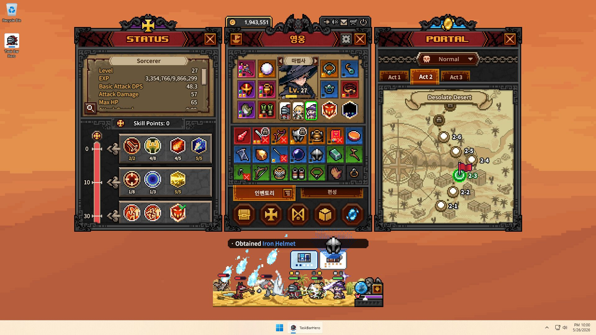

# Menu de Status

Data: 23/10/2026. Versão instalada: 1.3.0. [Índice](README.md) · [Evidências](Evidencias.md) · [Proposta para nosso jogo](Adaptacao_Aetherforge.md).

## Função do painel

O Status reúne a leitura do personagem selecionado com sua progressão de habilidades. Isso é sustentado pela declaração `TaskbarHero.UI.UI_Status`, pelos objetos da cena e pelas tabelas de atributos. Há referências de nível/EXP, estatísticas, pontos, detalhe de habilidade, alocação e equipamento. A correspondência completa entre cada clique e cada método ofuscado permanece não resolvida. [M01, U01, D01]

Na captura histórica já existente no projeto, Status, Herói e Portal aparecem lado a lado acima do combate. O painel esquerdo contém atributos, pontos e fileiras de habilidades. Essa imagem é referência visual histórica, não captura da instalação examinada em execução. [V01]



## Geometria da cena instalada

`level0` contém três áreas de gerenciamento com **318 × 468 unidades locais**. A esquerda fica em x = −322; centro em x = 0; direita em x = +322. Os números são de `RectTransform`: não representam automaticamente pixels físicos, tamanho da janela ou medidas em todos os níveis de zoom. Com essas dimensões locais, há um intervalo nominal de quatro unidades entre colunas. [U01]

| Elemento | GameObject pathID | O que foi lido |
|---|---:|---|
| `Canvas_Main/Main/Left` | 9978 | 318 × 468; posição (−322, 0), âncoras centrais |
| `…/Left/UI_Status` | 10551 | Preenche a área esquerda por âncoras 0…1 |
| `UI_Status/Top Panel` | 8571 | Âncoras no topo; `sizeDelta` (−16, 148); posição (0, −76) |
| `Top Panel/StatusPanel/Left Panel` | 5463 | Identificação, classe, nível e slider de EXP |
| `Top Panel/StatusPanel/Right Panel` | 4457 | Lista de status e botão de detalhe |
| `UI_Status/Bottom Panel` | 1173 | Área esticada; `sizeDelta` (0, −220), deslocada para baixo |
| `Bottom Panel/Skill Panel` | 11949 | Conteúdo de habilidades com Scroll View |
| `Bottom Panel/Detailed Stats Panel` | 8797 | Lista extensa de estatísticas com Scroll View próprio |
| `UI_Status/SkillPoint Panel` | 569 | Elemento de pontos, `sizeDelta` 145 × 21 |
| `UI_Status/TeamStatsButton` | 5241 | Controle de equipe, 28 × 28 |
| `UI_Status/TeamStatus` | 6379 | Área de estatísticas de equipe |
| `UI_Status/Button_Close` | 10845 | Controle de fechar, 28 × 28 |

`sizeDelta` só é tamanho absoluto quando as âncoras coincidem. Em elementos esticados ele é um ajuste relativo ao espaço dos pais. Algumas dimensões filhas excedem o tamanho de um pai nominal; layouts, escala e visibilidade podem ser ajustados em execução. Não concluir sobre recorte final somente com esses valores.

## Organização recuperada

```text
UI_Status
├─ título, decoração, fechar, controle de equipe
├─ Top Panel
│  ├─ StatusPanel
│  │  ├─ Left Panel: classe, nível, EXP
│  │  └─ Right Panel: resumo rolável + mostrar detalhe
│  └─ AttributePanel
│     ├─ nome, ícone, nível, seleção/bloqueio da habilidade
│     ├─ descrição, DPS/cooldown e requisito
│     └─ alocar / reembolsar / equipar / desequipar
├─ SkillPoint Panel
└─ Bottom Panel
   ├─ Skill Panel: grupos, slots e régua de pontos
   └─ Detailed Stats Panel: lista rolável por seções
```

Essa é uma árvore estrutural simplificada de objetos existentes. Ela não afirma que todos os blocos estejam visíveis simultaneamente. A versão instalada apresenta uma organização diferente do topo visto na captura histórica. [U01, V01]

## Estados

O enum `EStatusUIState` declara estes estados: [M01]

| Nome recuperado | Leitura sustentada pela estrutura | O que falta confirmar |
|---|---|---|
| `Default` | Apresentação padrão | Quais campos ficam visíveis por classe |
| `StatDetail` | Estatísticas detalhadas | Ordem final, filtros e retorno |
| `AttributeDetail` | Detalhe de atributo/habilidade | Clique, hover ou outro gesto de entrada |
| `SkillEquip` | Equipamento de habilidade | Fluxo exato e restrições |
| `SkillSlot` | Escolha/gerenciamento de slot | Transições, cancelamento e confirmação |

Existem controles de fechar específicos para estatísticas, detalhe de habilidade e equipamento. Isso sustenta a existência de subestados, mas não permite recuperar a máquina de transições completa. Não foi observado se Escape, clique externo ou clique repetido têm comportamento equivalente. [U01]

## Resumo de atributos

Campos da classe `UI_Status` apontam para nível, EXP, DPS, dano, vida máxima, velocidade de ataque, chance e dano crítico, redução de cooldown, movimento, armadura e velocidade de conjuração. Há também `m_hpStatText`, cuja apresentação exata não foi recuperada. A cena inclui slots nomeados `StatSlot_Level`, `StatSlot_Exp`, `StatSlot_DPS` e slots numerados. [M01, U01]

Na localização, `NormalAttackDPS` recebe o rótulo **DPS de Ataque Básico**. O binding exato desse texto ao campo genérico de DPS não foi recuperado; a captura histórica também mostra esse conceito. Seu significado precisa ser preservado: não comprova DPS total da build, dano real médio contra qualquer inimigo ou contribuição total de habilidades. A fórmula e os modificadores incluídos não foram recuperados. [L01, V01]

A lista usa pares separados de rótulo e valor (`Text_StatLabel` e `Text_StatValue`) dentro de uma área rolável. É uma solução apropriada para comparar vários números com alinhamento comum, sem transformar cada atributo em um cartão. [U01; a avaliação de adequação é interpretação de design]

## Estatísticas detalhadas

A classe de UI possui campos para estas famílias, além do resumo: [M01]

| Família | Exemplos de campos recuperados |
|---|---|
| Ofensiva | Dano físico/fogo/frio/raio/caos, multistrike, projéteis, dano corpo a corpo, de projéteis, de área e de invocações |
| Defesa | Vida, armadura, resistências, esquiva, bloqueio, esquiva/bloqueio elemental, regeneração, absorção e redução de dano |
| Sustentação | Vida por acerto, vida por abate, roubo de vida e aumento de cura |
| Utilidade/progressão | Movimento, área de efeito, duração de habilidade, níveis adicionais de skills, EXP |

Há tooltips declarados para armadura, resistências, esquiva, bloqueio, cooldown e redução de dano. Os textos localizados contêm placeholders; não assumir os limites numéricos a partir do texto do template. [M01, L01]

`StatViewInfoData`, TextAsset pathID **2488** de `sharedassets0.assets`, tem **17 linhas de overrides**: `STATTYPE`, `SectionType`, `Order`, `IsShowStatus` e `IsShowZero`. Seus grupos são `Offense`, `Defense` e `Misc`. Essa tabela não é a lista completa de atributos; ela ajusta a apresentação de alguns deles. [D01]

Exemplos: `BossDamage`, `FullHpTargetDamage`, `LowHpTargetDamage` e `OnReviveAttackDamage` são marcados para aparecer em ofensiva; `AttackAndCastSpeed` não. `GoldAmount` em `Misc` permite exibir zero. Portanto, a exibição é seletiva e não se resume a listar todos os valores diferentes de zero. A execução dessas regras não foi observada. [D01]

## Pontos e grupos de habilidades

`AttributeGroupInfoData` contém requisitos de pontos alocados **0, 10, 20, 30, 40, 50, 60 e 70**. A cena inclui `AllocatedPoint Panel`, um slider e marcadores `Level Divide Panel_0`, `_10`, `_20` etc. As duas fontes convergem para uma progressão agrupada por investimento acumulado. [D01, U01]

`AttributeInfoData` relaciona `AttributeKey`, `HeroKey`, `GroupKey`, `ATTRIBUTETYPE`, `Value`, `RequiredPoint`, `MaxLevel` e `AvailableDemo`. Há opções `PASSIVESKILL` e `ACTIVESKILL`. Exemplo: chave 101001 pertence ao herói 101, grupo 10001, custo 1 e nível máximo 3; chave 101003 usa uma habilidade ativa, custo 1 e máximo 5. São exemplos do conteúdo instalado, não parâmetros sugeridos para Aetherforge. [D01]

A distinção entre pontos livres e pontos já alocados torna a progressão legível: o contador informa o que gastar; a régua informa o que já foi investido e quais grupos estão adiante. Isso é interpretação de design sustentada por nomes, tabela e apresentação histórica, não uma fórmula de obtenção de pontos. A taxa de pontos por nível e regras completas de reembolso continuam desconhecidas.

## Detalhe contextual e equipamento

O `AttributePanel` contém: [U01]

- `AttributeNamePanel`: ícone, nome/nível, seleção, lock, efeitos de level-up/reembolso, equipar e desequipar.
- `AttributeDescriptionPanel`: descrição, requisito, DPS/cooldown, alocar e reembolsar.
- Slots de habilidade com camadas `GradeBg`, `TypeBg`, `IconBG`, `Select`, `Lock` e texto de nível.

Isso permite reutilizar uma região para explicar a opção escolhida, em vez de abrir uma descrição completa para cada ícone. O gesto que escolhe a opção e a atualização dos valores não foram rastreados até corpos de métodos. [Inferência baseada em U01/M01]

Há tooltips de habilidades com variantes `Normal`, `Detail` e `Detail_Passive` em `Canvas_Tooltip/SkillTooltip_Status` (GameObject 3410), incluindo descrição, nível, DPS, cooldown e indicador de uso. A referência `ZKey/Text_KeyLock` demonstra um elemento de UI associado a uma tecla; não comprova o atalho completo nem seu comportamento. [U01]

## Equipe e feedback

`UI_Status` referencia `_teamStatPanel` e `_teamStatusButton`; `TeamStatPanel` tem `_teamMoveSpeed`. Isso evidencia uma apresentação de estatística de equipe, mas não autoriza atribuir a ela um painel completo de todos os membros. A seleção visual de heróis também existe no painel Herói e em classes `HeroSlot`/`HeroSmallSlot`. [M01, U01]

Há referências a `_defaultStatColor`, `_buffStatColor` e `_debuffStatColor`. São papéis de cor declarados; os valores exatos e quando são aplicados não foram recuperados. Efeitos `LevelUpEffect`, `RefundEffect`, indicador de seleção, bloqueio e `RedDot` aparecem na cena. Duração, curva, som e regras de exibição permanecem não verificados. [M01, U01]

## O que realmente aproveitar

A contribuição principal da referência é a hierarquia: identificar um personagem, ler poucos números, escolher uma melhoria e consultar detalhes no mesmo contexto. Moldura, ornamento e pixel art reforçam o tema, mas copiar apenas esse acabamento não produz o fluxo do Status.

Para Aetherforge, a proposta é um painel de personagem com resumo e aprofundamento, seleção de equipe clara e progressão adicionada somente quando houver regras reais. O desenho proposto e seus critérios estão em [Adaptação](Adaptacao_Aetherforge.md).
