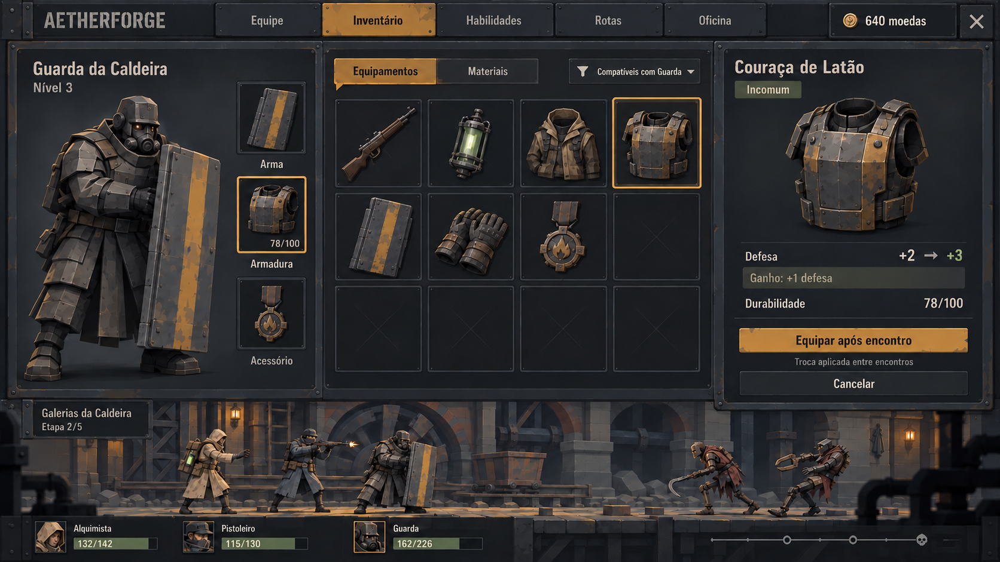
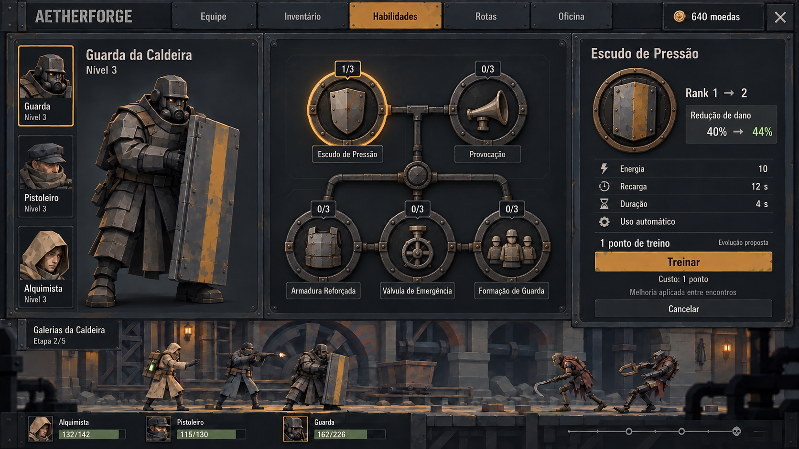
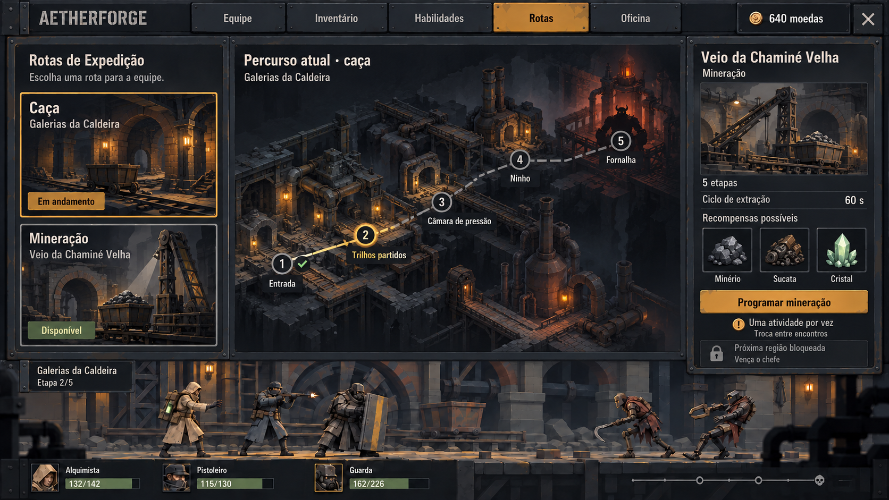
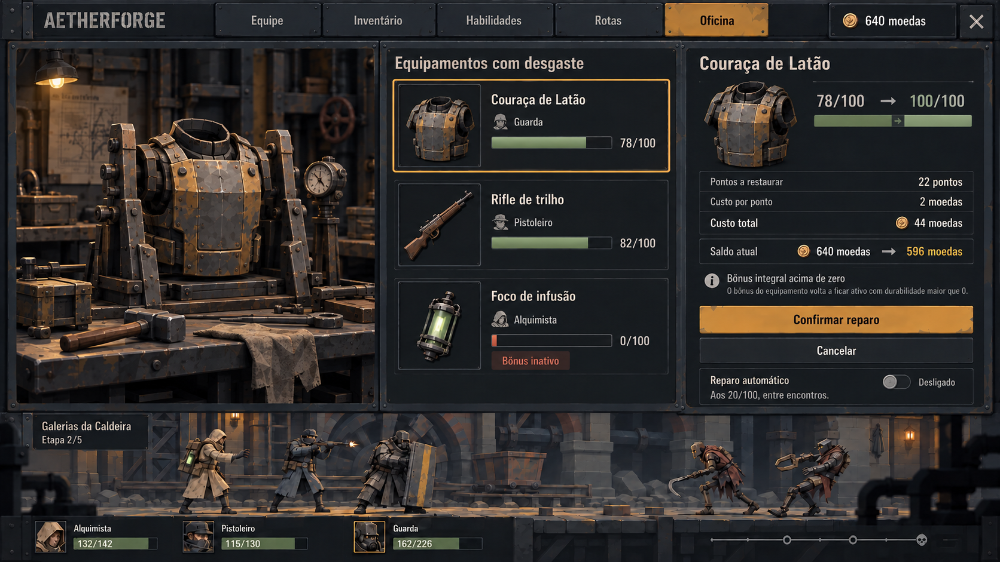
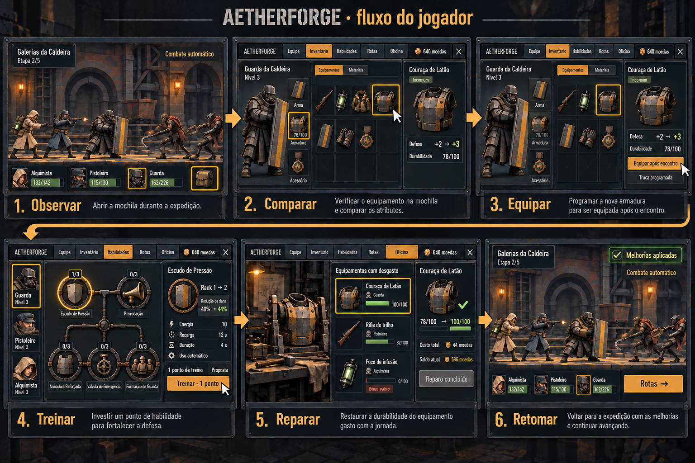

# Aetherforge: conceitos de arte das telas idle

Esta revisão trata das telas dentro do jogo: suas ilustrações, materiais, composição, ícones e decisões do jogador. São cinco pranchas raster produzidas com GPT Images pela ferramenta integrada, com referência nos personagens e cenário v3 aprovados. Open Design não foi utilizado nesta rodada.

O painel de gerenciamento se ancora acima da faixa de expedição. Os integrantes continuam presentes como contexto, e o jogador pode voltar à faixa por Fechar. A interface combina aço escuro, lona, texto em osso e seleção ocre, com personagens adultos facetados e equipamentos de trabalho.

## Inventário

O jogador escolhe um integrante, inspeciona uma peça e compara seu efeito antes de equipar. A Couraça de Latão, guardada com durabilidade 78/100, troca DEF +2 por +3: ganho de +1. O botão comunica aplicação após o encontro. O rifle permanece na bolsa; o slot de arma do Guarda mostra o escudo compatível.

## Evolução de habilidades

O jogador seleciona o integrante, escolhe a habilidade, lê o efeito atual e o próximo rank, depois confirma o treinamento. A prancha apresenta Escudo de Pressão de rank 1 para 2, redução de dano de 40% para 44%, por um ponto fictício. Energia, recarga e duração permanecem visíveis; o uso continua automático.

**Proposta nova:** ranks, pontos, ramificações e curvas de treinamento ainda não estão definidos no GDD. Os outros mecanismos desenhados são possibilidades visuais de especialização, sem habilidades novas aprovadas. Nós com rank zero não devem retirar ações-base já disponíveis na POC. Origem dos pontos, requisitos, bloqueios e consequências devem ser definidos antes da implementação.

## Rotas de expedição

O mapa mostra o percurso atual da caça. À direita, a mineração está em avaliação antes de programar a mudança. A equipe tem uma atividade por vez; o encontro inferior mantém o contexto atual. A próxima região depende do chefe, e a mudança entre caça e mineração ocorre entre encontros.

O mapa e as miniaturas são ilustrações de interface; não representam módulos 3D já produzidos nem comprovação de desempenho do cenário.

## Oficina

O jogador confere a peça, a durabilidade restaurada e o saldo antes de pagar: 78 → 100 custa 44 moedas; a carteira de 640 ficará em 596. Esta tela mostra a cotação antes da confirmação. A manutenção não aumenta o bônus da armadura. O foco zerado permanece na lista com bônus inativo, e o automático começa desligado.

## Fluxo ilustrado do jogador

**Observar → comparar → equipar → treinar → reparar → retomar.** Inventário e treinamento comunicam a mudança pendente até o intervalo. A última cena volta à expedição com as melhorias aplicadas. O acesso Rotas permite mudar de atividade depois; a escolha também pode acontecer antes, sem tornar essa sequência uma obrigação.

No quadro Reparar, o recibo principal mostra 596 e a peça restaurada em 100/100. O contador pequeno do cabeçalho permaneceu em 640 na imagem gerada, apesar das tentativas de correção. Na interface final, ele deve mostrar 596 junto com o recibo. A prancha serve de orientação visual; os números finais seguem o fluxo documentado.

## Arquivos e continuidade

As cinco imagens selecionadas estão em `docs/visual/conceitos/`, numeradas de 07 a 11 com sufixo `idle-v4.png`. As versões v1–v3 permanecem preservadas.

- [Fluxo do jogador, estados e regras](Fluxo_Jogador_Artes_Idle.md)
- [Prompts exatos, referências e refinamentos](Prompts_GPT_Images_Telas_v4.md)
- [Direção artística aprovada](Direcao_Artistica_v3.md)

Nesta rodada não foram alterados o cliente Godot, as regras compartilhadas, os protótipos HTML ou os saves. As artes ainda precisam de adaptação a controles reais, textos definitivos e tamanhos de janela. Modelos 3D, rigs e animações continuam pendentes de produção.
