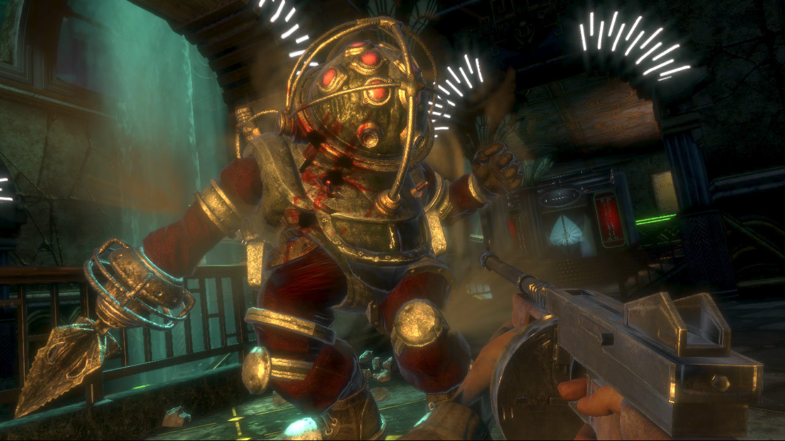
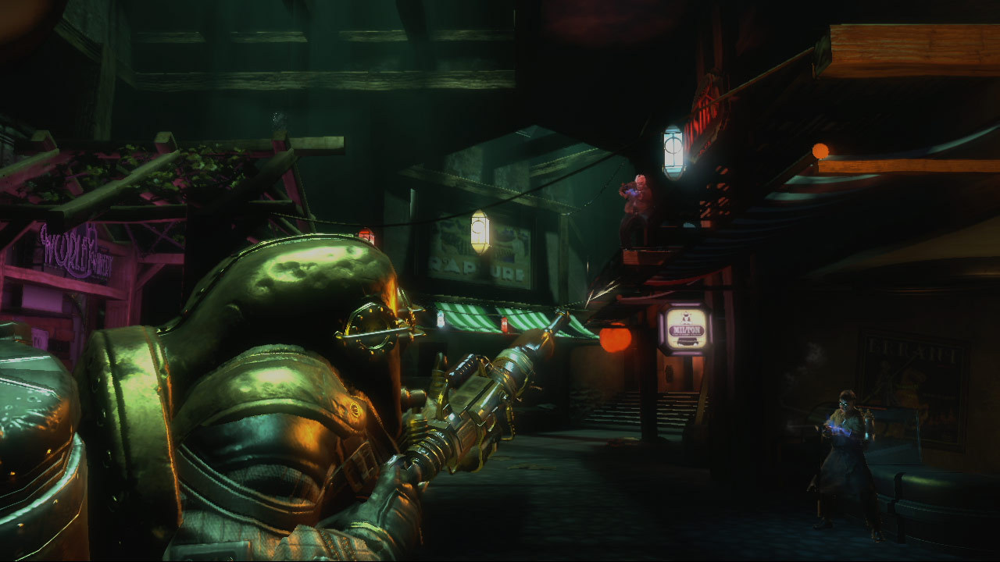
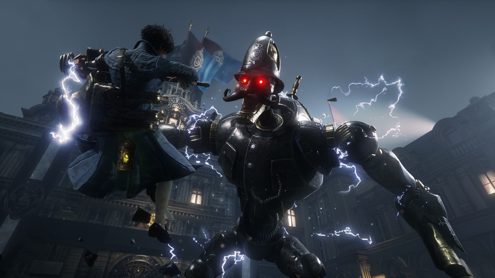
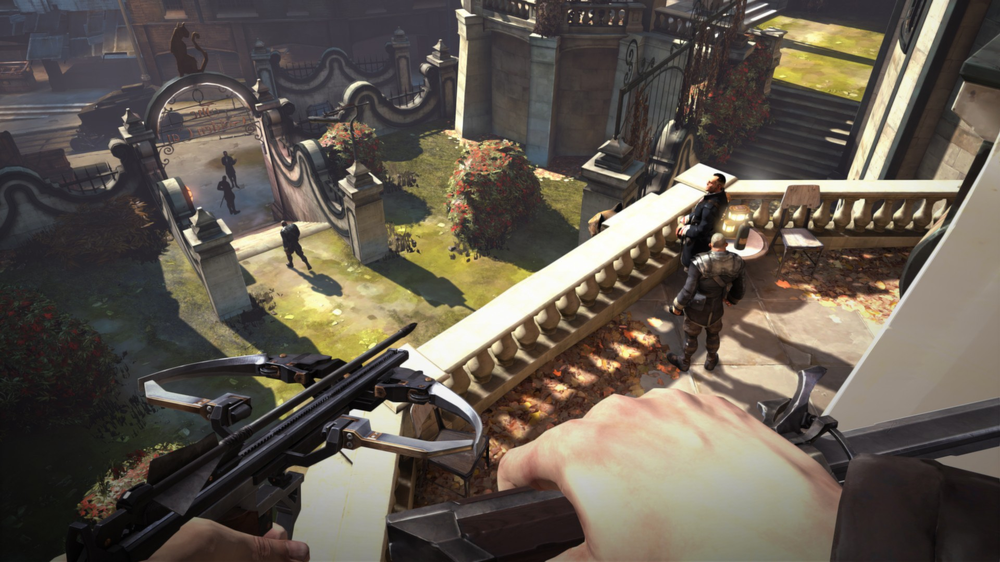

# Aetherforge: estudo de referências artísticas v5

Pesquisa em 14/10/2026 para orientar personagens e cenários do idle 3D leve. Foram examinadas imagens oficiais de **BioShock, BioShock 2, Lies of P e Dishonored**, mantendo cada jogo como referência distinta. Este documento trata de forma, volume, cor, material e luz. Tipografia e organização das telas pertencem ao estudo de interface desta rodada.

**Proposta para a próxima direção:** usar a organização de formas de Dishonored como base; a sensação de equipamento pesado de BioShock 2 para o Guarda e as máquinas; e o contraste entre tecido, metal e luz de Lies of P. BioShock contribui com a memória de uma indústria que já prometeu uma vida melhor. Esta combinação é uma decisão proposta para Aetherforge, não uma conclusão atribuída aos autores dos jogos.

## Método e evidência

- **Fonte primária confirmada:** informação explícita de publicadora, desenvolvedora ou artista responsável. Falas são parafraseadas e ligadas à fonte.
- **Leitura visual:** observação própria das imagens indicadas; não representa uma declaração da equipe original nem cobre todos os cenários do jogo.
- **Aplicação proposta:** decisão nossa, sujeita a desenho, modelagem e teste no tamanho real do idle.

As nove capturas foram obtidas das galerias oficiais publicadas na Steam, baixadas e inspecionadas visualmente. O [registro de arquivos e fontes](referencias/v5/ref-art-fontes.json) contém a página de origem, a URL de cada imagem, a data e o hash SHA-256. São referências de pesquisa, sem licença presumida para uso no runtime.

## 1. BioShock: uma promessa industrial arruinada

**Fonte primária confirmada.** A [página da 2K](https://store.2k.com/da/game/buy-bioshock) apresenta Rapture como um refúgio intelectual que se tornou uma distopia. A [galeria oficial de BioShock na Steam](https://store.steampowered.com/app/7670/) fornece as duas imagens examinadas abaixo. O estudo usa as capturas do jogo original, sem confundi-las com BioShock Infinite ou com cenas de BioShock 2.

**Leitura visual.** Na [captura do saguão](referencias/v5/ref-art-bioshock1-1.jpg), o anúncio otimista e iluminado contrasta com a escada escura e o ambiente gasto. Repetições verticais e linhas em degraus organizam grandes superfícies. A cor não é apenas ferrugem: há dourado envelhecido, verde-água e pequenos acentos violeta. Na imagem do Big Daddy, a cabeça arredondada se funde ao torso largo; a broca estabelece uma assimetria imediatamente legível. A ameaça depende primeiro de massa e gesto, antes dos pequenos componentes.

**Aplicação proposta.** Nas Galerias da Caldeira, um painel antigo de segurança ou uma placa de serviço pode sugerir uma instituição que falhou. Usar uma única mensagem ambiental e uma forma arquitetônica dominante por trecho. O Guarda conserva seu escudo retangular e sua faixa desgastada: a lição é a leitura da massa, sem transplantar capacete, broca ou silhueta reconhecível do Big Daddy.

## 2. BioShock 2: proteção, carga e assimetria

**Fonte primária confirmada.** A [2K identifica Subject Delta como protótipo Big Daddy](https://store.2k.com/game/buy-bioshock-2) e mantém Rapture como contexto. O artista [James Ku documenta Big Sister e Ceiling Crawler](https://www.jameskuart.com/bio2), mas especifica que seu trabalho mostrado é da **cinemática**: não é prova da malha, dos shaders ou do orçamento de gameplay. A análise visual abaixo usa a [galeria oficial do jogo na Steam](https://store.steampowered.com/app/8850/), não esses renders cinematográficos.

**Leitura visual.** A figura à esquerda ocupa um bloco pesado de torso, ombro e arma. Mangueira, placas sobrepostas e cilindro explicam o trabalho mecânico, com assimetria funcional. Reflexos verde-amarelados descrevem a curvatura do metal; o tecido permanece mais escuro. Na [segunda captura](referencias/v5/ref-art-bioshock2-2.jpg), arcos e colunas dominam o espaço e as figuras se separam por postura, escala e luz localizada. Há calor, mas o ambiente frio e grandes regiões sem iluminação mantêm a tensão.

**Aplicação proposta.** O Guarda pode carregar o equipamento com joelhos flexionados, pescoço comprimido e ombro inclinado para o escudo. O sentinela precisa parecer uma máquina de pressão antes de parecer um monstro: reservatório, junta e ponto de apoio bastam para construir sua função. Marcas de uso devem surgir nas bordas de contato, não como uma camada uniforme de sujeira em todas as superfícies.

## 3. Lies of P: elegância fria e violência mecânica

**Fonte primária confirmada.** O diretor Ji Won Choi descreve o mundo como uma Belle Époque sombria em sua [publicação no PlayStation Blog](https://blog.playstation.com/?p=381029). A [página oficial PlayStation](https://www.playstation.com/en-ph/games/lies-of-p/) também identifica Krat como uma cidade inspirada nesse período, tomada por loucura e fantoches assassinos. As imagens examinadas são da [galeria oficial na Steam](https://store.steampowered.com/app/1627720/).

**Leitura visual.** Na cena do policial mecânico, torso e antebraços têm volumes largos, enquanto cabeça, chapéu e bigode preservam uma identidade inquietante. O protagonista é separado por tecido azul; o inimigo usa metal quase preto e olhos vermelhos. A luz fria e os poucos pontos quentes não dependem de uma névoa marrom uniforme. No [Hotel Krat](referencias/v5/ref-art-lies-of-p-1.jpg), madeira e iluminação âmbar produzem abrigo e solenidade, enquanto o azul pontual interrompe a unidade quente. As superfícies têm papéis diferentes: tecido absorve, metal recorta, vidro concentra luz.

**Aplicação proposta.** Separar Guarda, Pistoleiro e Alquimista por material e silhueta, preservando a paleta estabelecida. Reservar um azul acinzentado discreto para o tecido do Pistoleiro e lona mais clara para o Alquimista pode evitar três personagens igualmente castanhos. Éter deve ser um pequeno foco, não contornar toda a silhueta. O calor da oficina pode indicar cuidado precário, em contraste com o corredor frio da expedição.

## 4. Dishonored: formas esculpidas e mundo contextual

**Fonte primária confirmada.** Em [The Art of Arkane](https://bethesda.net/en-US/news/the-art-of-arkane), o diretor de arte Sébastien Mitton relaciona as escolhas visuais ao contexto e ao gameplay. Ele defende estilização consistente, gerenciamento do detalhe e silhuetas legíveis; também associa a presença dominante de metal no primeiro Dishonored à opressão de Dunwall. É uma entrevista sobre a prática do estúdio, não uma receita de low poly. As três capturas examinadas vêm da [galeria oficial do primeiro Dishonored na Steam](https://store.steampowered.com/app/205100/).

**Leitura visual.** Os guardas têm casacos divididos em planos e mãos com presença; seus corpos e posturas não parecem bonecos arredondados. O metal das armas usa arestas fortes. A [vista do rio](referencias/v5/ref-art-dishonored-1.jpg) separa massas por distância e valor, com paredes extensas e manchas grandes. A [cena do Golden Cat](referencias/v5/ref-art-dishonored-4.jpg) reforça o desenho angular dos rostos e gestos contidos. A varanda iluminada mostra que opressão não exige esconder todas as formas no escuro: o desconforto também está nas proporções, no vazio e na organização social do espaço.

**Aplicação proposta.** Esta é a base mais útil para reduzir a aparência genérica dos conceitos: rostos com planos e assimetria, ombros e mãos com intenção, tecido construído em poucas quebras largas. Evitar um filtro de pintura sobre um rosto fotográfico liso. O model sheet deve definir perfil, proporção e gesto de repouso antes de introduzir ferrugem, rebites ou costuras.

## Síntese para Aetherforge

As decisões abaixo são propostas próprias de produção. Não afirmam que os jogos estudados tenham usado estes mesmos limites ou técnicas.

| Elemento | Direção concreta | O que retirar da próxima arte |
|---|---|---|
| Guarda da Caldeira | Torso largo, cabeça parcialmente protegida, escudo retangular, uma faixa gasta e centro de gravidade baixo | Capacete copiado de mergulhador, armadura cheia de engrenagens sem função, pose heroica ereta |
| Pistoleiro | Corpo mais estreito, casaco em planos largos, rifle com massa clara, cabeça ligeiramente avançada | Arma ornamentada com muitas saliências, couro brilhante em toda a roupa |
| Alquimista | Lona de valor mais claro, mochila de trabalho, mão voltada ao aliado, ampola única | Frascos luminosos por todo o corpo, proporções infantis, sorriso de mascote |
| Rostos | Assimetria discreta, testa e mandíbula desenhadas como planos, olhos em sombra controlada, sinais de cansaço | Beleza publicitária, pele encerada, excesso de microdetalhe |
| Inimigos | Distinguir gancho/pinça, reservatório e máquina de apoio pela silhueta e pelo ritmo | Mesmo robô repetido com cor diferente e pontas aleatórias |
| Cenário | Um arco, uma passarela e um marco mecânico dominante; vazio onde faltar presença humana | Cidade inteira modelada atrás de cada encontro, sucata preenchendo todo espaço |
| Cor | Base carvão/aço; separação local de lona, azul frio e calor âmbar; manchas amplas | Tudo marrom, tudo dourado, todas as bordas com brilho |
| Materiais | Aço fosco, lona absorvente, madeira escura e vidro pontual, com resposta visual diferente | A mesma textura de sujeira aplicada a todos os materiais |
| Luz | Massa fria de fundo e foco quente contido; actor separado pelo valor local | Névoa densa sobre o personagem, contraluz que apaga os equipamentos, bloom contínuo |

O sentimento triste deve surgir da relação entre corpo e trabalho: postura sob carga, um assento vazio, roupa reparada e ferramenta que continua funcionando sem seu operador. Não é necessário pôr caveiras, sangue ou fumaça em todos os objetos para comunicar isso.

## Tradução para 3D leve e critério de aceitação

Começar por uma equipe em material cinza e uma câmera fixa lateral em três quartos. Em seguida, aplicar poucas massas de cor e verificar Guarda, Pistoleiro, Alquimista e inimigos no tamanho previsto da faixa. Os retratos ampliados das telas podem mostrar mais expressão, mas devem manter as proporções do mesmo modelo usado na expedição.

| Prova antes de detalhar | Pergunta de revisão |
|---|---|
| Silhuetas em preto, aproximadamente 48–64 px de altura | A função e a orientação de cada ator continuam reconhecíveis? |
| Cena em cinza | Corpo, arma e fundo se separam sem depender do brilho do éter? |
| Três massas de material por integrante como ponto de partida | É possível distinguir equipamento, roupa e a parte humana? |
| Repouso, caminhada e impacto com o mesmo personagem | O peso vem da pose e da animação, ou só do detalhe pintado? |
| Um módulo de corredor e a mesma equipe em luz fria e quente | A identidade sobrevive à mudança de ambiente? |
| Build real com equipe e inimigos | A aparência cabe no custo medido e mantém o ritmo de animação? |

O envelope técnico da [direção v3](Direcao_Artistica_v3.md) continua sendo hipótese a medir. Este estudo não recomenda reproduzir shaders, reflexos, fumaça, densidade de cenário ou número de texturas dos jogos AAA. Os jogos fornecem decisões de forma e composição; o desempenho só será conhecido após o trecho real rodar no Godot.

Uma próxima arte bem resolvida deve conseguir mostrar **a mesma pessoa** na faixa e no retrato do inventário, em vez de produzir um herói detalhado no retrato e um boneco sem relação no combate. O objetivo imediato é consolidar uma linguagem coerente, antes de gerar muitas variações de equipamentos.
