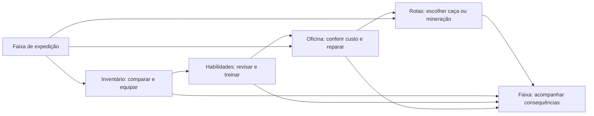

# Aetherforge: artes das telas e fluxo do jogador idle

## Escopo desta rodada

Esta rodada propõe a arte das telas **dentro do jogo**: inventário, treinamento de habilidades, rotas e oficina. São imagens conceituais para avaliar a experiência de quem joga, com uma prancha que conecta as ações. A direção mantém os personagens 3D adultos, o cenário 3D leve e a atmosfera industrial pesada da [direção artística v3](Direcao_Artistica_v3.md).

Os protótipos HTML anteriores permanecem como outro meio de estudo. As novas pranchas não são telas integradas ao Godot nem substituem os modelos, rigs e animações pendentes. Nenhum código de runtime foi alterado nesta rodada.

## Sequência de uso

1. **Observar a expedição na faixa.** A equipe atravessa as Galerias da Caldeira. O jogador vê etapa, estado do encontro e um aviso de equipamento ou de treinamento disponível. A faixa oferece acesso a Inventário, Habilidades, Rotas e Oficina.
2. **Abrir o Inventário.** O painel sobe a partir da faixa e mantém a expedição como contexto. Selecionar o Guarda da Caldeira, escolher uma armadura da bolsa e comparar com a equipada. Confirmar a troca; a aplicação fica indicada para o intervalo entre encontros.
3. **Abrir Habilidades.** Manter o Guarda selecionado. Escolher Escudo de Pressão, ler o efeito atual e a melhoria proposta, revisar o custo e confirmar Treinar. A tela mostra o novo rank e o ponto consumido. A habilidade continua automática no combate.
4. **Atender o alerta de desgaste.** Abrir Oficina com a peça já selecionada, conferir o custo e reparar. Voltar ao contexto anterior sem perder a seleção do integrante.
5. **Escolher a atividade.** Abrir Rotas, comparar caça e mineração, selecionar uma rota disponível e confirmar a troca. Se houver extração parcial, apresentar a consequência antes da confirmação.
6. **Retornar à expedição.** Fechar o painel devolve o jogador à faixa. Um aviso curto identifica a mudança aplicada ou pendente. O encontro continua sendo automático; abrir uma tela não cria outra equipe nem outra atividade produtiva.

Essa sequência é um exemplo de sessão, não uma obrigação de visitar todas as telas. Cada painel também é acessível diretamente pela faixa. Fechar ou voltar é sempre possível sem realizar a ação oferecida.

## Pranchas e leitura visual

| Prancha | O que o jogador precisa compreender | Composição proposta |
|---|---|---|
| [Inventário](conceitos/07-inventario-idle-v4.png) | Quem recebe a peça, o ganho real, o desgaste e quando a troca será aplicada | Guarda em 3D ao lado dos três slots; bolsa com poucos itens; comparação junto à peça selecionada; Equipar como ação principal |
| [Habilidades](conceitos/08-habilidades-idle-v4.png) | Qual habilidade será treinada, qual efeito muda e qual recurso será gasto | Integrante selecionado; poucos mecanismos conectados; Escudo de Pressão em foco; comparação de rank e confirmação legível |
| [Rotas](conceitos/09-rotas-idle-v4.png) | Qual atividade está ativa, as cinco etapas e a consequência da mudança | Mapa industrial simplificado; caça e mineração claramente distintas; etapa atual; rota selecionada e ação contextual |
| [Oficina](conceitos/10-oficina-idle-v4.png) | Qual peça será reparada, quanto falta restaurar e quanto será debitado | Bancada e peça em destaque; antes/depois de durabilidade; custo e saldo resultante próximos ao botão |
| [Fluxo de jogador](conceitos/11-fluxo-jogador-idle-v4.png) | De onde vem cada ação e como ela retorna à expedição | Faixa compacta, inventário, habilidades e oficina ligados por ações curtas; Rotas acessível ao retornar, sem transformar o fluxo em uma página de produto |

Carvão e aço dominam as superfícies. Osso dá contraste aos textos; lona identifica o Alquimista. Âmbar aparece em calor, atenção ou seleção, com uso contido. Formas facetadas e materiais foscos aproximam os retratos da produção 3D. Ornamentos não ocupam o espaço necessário para números, efeitos e botões.

## Inventário: comparação útil

O jogador seleciona o Guarda e uma **armadura incomum com DEF +3 e durabilidade 78/100**. A armadura equipada é comum, com **DEF +2**. A comparação mostra **ganho de +1 defesa**, sem inventar afixos, bônus de conjunto ou aumento por desgaste. São três slots por integrante: arma/foco, armadura e acessório.

Enquanto a durabilidade estiver entre 1 e 100, o bônus funciona integralmente. A peça selecionada em 78/100 ainda concede +3 defesa. Em zero, mostrar **Bônus inativo — reparar**; a peça não é destruída, e atributos-base e habilidades do integrante continuam funcionando.

Depois de Equipar, mostrar **Troca pendente — aplica após este encontro** quando necessário. A peça escolhida permanece identificada até a aplicação. Trocas só entram em vigor entre encontros, conforme o GDD.

## Habilidades: proposta visual a validar

O [GDD, seção 15.4](../GDD_Aetherforge.md#154-atributos-experiência-e-equipamentos), define as habilidades automáticas e a progressão de nível, mas **não define ranks de habilidade nem pontos de treinamento**. Esta prancha introduz uma proposta de interface, sem alterar as regras aprovadas ou a economia.

| Campo | Atual | Após o treinamento conceitual |
|---|---|---|
| Habilidade | Escudo de Pressão | Escudo de Pressão |
| Rank | 1 | 2 |
| Redução de dano | 40% | 44% |
| Custo de energia | 10 | 10 |
| Recarga | 12 s | 12 s |
| Duração | 4 s | 4 s |
| Recurso de treinamento | 1 ponto disponível | Consumo de 1 ponto; saldo 0 |

Os valores de rank e treinamento são **exemplos fictícios para comunicar o fluxo**. A fonte dos pontos, seus limites, a curva de melhoria, o vínculo ao nível e o momento de aplicação ainda precisam ser definidos. Não mostrar compra por moedas, gemas ou materiais como se essa regra já existisse.

A comparação destaca somente o efeito alterado: **40% → 44% de redução de dano**. A confirmação informa o gasto de um ponto. A tela não oferece um botão de conjurar durante a luta; mantém o uso automático, priorizando golpe pesado avisado e depois vida abaixo de 50%, conforme o GDD.

XP e nível continuam separados de rank. O limite de nível da POC é **20**; receber XP por vitória não significa ganhar um ponto de treinamento neste estudo. Em nível máximo, não sugerir XP acumulada para níveis futuros.

## Oficina: custo previsível

A armadura escolhida está em **78/100**. Restaurar 22 pontos custa duas moedas comuns por ponto: **44 moedas**. Com carteira de **640**, a confirmação mostra **640 → 596** e **78 → 100**. O reparo restaura durabilidade; não aumenta o bônus DEF +3 e não consome sucata na POC.

O reparo automático aparece como opção **desativada inicialmente**. Se ativado, respeita o intervalo entre encontros, o limiar de 20 e saldo suficiente para a peça inteira, com a ordem definida no GDD. Um alerta em zero encaminha à mesma oficina e explica o bônus inativo.

## Rotas: uma decisão por vez

Mostrar **Galerias da Caldeira — Caça** e **Veio da Chaminé Velha — Mineração** como atividades distintas da mesma equipe. As cinco etapas ficam visíveis; chefes, bloqueios e etapa atual têm símbolos e texto, evitando depender só de cor.

A mudança é aplicada entre encontros. Em mineração com extração parcial, o aviso deve dizer: **Trocar de atividade cancela a extração em andamento. O progresso parcial não gera recompensa.** Recursos de extrações já concluídas e recompensas anteriores permanecem registrados.

Rotas bloqueadas explicam a condição de desbloqueio, sem botão de compra. Vencer o chefe desbloqueia a próxima rota e repete a atual; mudança automática de região permanece desativada por padrão. A tela não sugere caça e mineração simultâneas.

## Estados e retorno

| Estado | Resposta da tela |
|---|---|
| Seleção inicial | Item, habilidade ou rota selecionado de forma clara; a ação descreve seu alvo |
| Cancelar comparação | Voltar à bolsa mantendo o Guarda selecionado; nenhuma troca ou cobrança |
| Cancelar confirmação | Preservar seleção e valores originais; não consumir ponto nem moeda |
| Confirmar equipamento | Mostrar aplicação entre encontros e depois a peça equipada |
| Confirmar treinamento | Mostrar rank proposto atualizado e o recurso consumido; regras finais ainda pendentes |
| Pontos insuficientes | Treinar indisponível com motivo legível; permitir consultar e fechar |
| Moedas insuficientes | Mostrar custo e saldo; nenhuma cobrança parcial nem reparo parcial automático |
| Peça em zero | Aviso de bônus inativo e acesso à oficina; não mostrar equipamento destruído |
| Rota bloqueada | Mostrar motivo; manter atividade atual |
| Troca durante extração | Expor perda do progresso parcial antes de confirmar |
| Fechar painel | Voltar à faixa e devolver foco ao controle que abriu a tela |
| Reconectar | Exibir tempo contabilizado, vitórias, derrotas, recursos e reparos pendentes antes de voltar à faixa; teto offline de oito horas |

Para teclado e controle, o foco deve ser visível e percorrer os elementos em ordem previsível. Enter confirma o botão em foco; Esc fecha primeiro a confirmação e depois o painel. Na abertura de uma confirmação com gasto ou perda de progresso, começar no texto de revisão ou em Cancelar, evitando confirmar acidentalmente. Feedback usa texto e símbolo junto à cor.

## Limites do conceito

As pranchas demonstram hierarquia, materiais, enquadramento e estados do jogador. Texto gerado em imagem pode exigir composição manual na produção. A navegação descrita, os exemplos de carteira e os ranks propostos não são prova de integração ou de balanceamento.

As regras existentes de moedas, XP, durabilidade, equipamento, offline e troca de atividade permanecem as do [GDD](../GDD_Aetherforge.md). A progressão de habilidades precisa de uma decisão de design antes de implementação. A produção deve validar legibilidade no tamanho real do painel, entrada por teclado/controle e comportamento da expedição enquanto o jogador navega.
