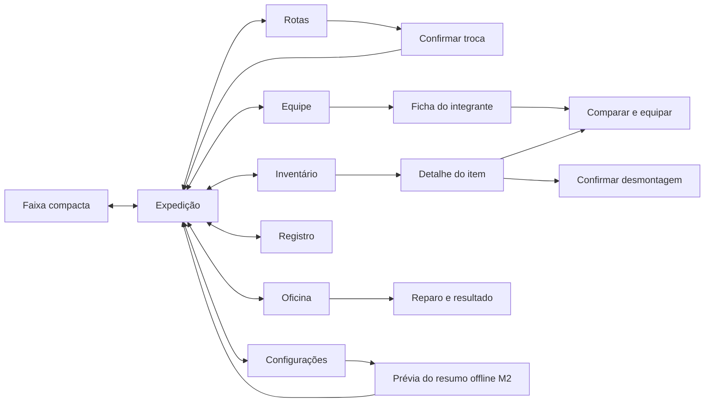

# Aetherforge: fluxos do protótipo idle

**Data:** 13/10/2026. **Status:** protótipo navegável de interface, separado do runtime Godot. A direção visual v3 foi aprovada; personagens e cenário de produção serão 3D leves. As imagens do protótipo representam essa direção, sem constituir modelos, rigs ou benchmark.

Este mapa foi conferido com o [GDD, seções 4.6 e 15](../GDD_Aetherforge.md), os [critérios M1/M2](../POC_Producao.md) e a [prioridade de desenvolvimento](../Desenvolvimento.md). Os números são hipóteses de design da POC. O protótipo não fecha os marcos de produção.

## Escopo desta entrega

Sete telas do idle M1: Expedição, Rotas, Equipe, Inventário, Oficina, Registro e Configurações. A faixa compacta é uma apresentação da Expedição, não uma oitava experiência. O resumo offline é uma prévia M2 acessível como demonstração.

Login real, autenticação, compartilhamento de lotes, MMORPG, quest, crafting do Regulador e marketplace não fazem parte desta entrega. Não criar navegação para destinos vazios. A obtenção do projeto vinculado faz parte das regras do futuro runtime; sua ficha narrativa não precisa se tornar um fluxo de quest nesta demonstração.

## Cobertura entregue na interface

A [demonstração navegável](prototipo/index.html) usa arquivos HTML/CSS/JavaScript e dados fictícios em memória. Recarregar a página restaura os dados. Os controles de revisão selecionam cenários manuais; não são comandos que existirão para vencer encontros ou gerar recursos no jogo.

| Área | Cobertura do protótipo | Continua pendente no runtime ou em outra revisão |
|---|---|---|
| Expedição | Cenários de combate, chefe, derrota, recuperação e mineração; faixa compacta | Combate real e animação de modelos; geração aleatória de drops comuns |
| Rotas | Duas atividades, confirmação, mudança pendente/cancelamento e percurso atual | Conteúdo da próxima região; migração automática entre regiões |
| Equipe e inventário | Três fichas, comparação por slot/função, troca pendente, filtros de equipamento e desmontagem | Lista detalhada de materiais, projeto narrativo e capacidade do inventário |
| Oficina | Reparos individuais com confirmação e saldo; peças a zero; preferência automática | Telemetria e comportamento do worker autoritativo |
| Registro | Histórico das ações e resumo offline demonstrativo | Filtros de histórico e links para cada evento |
| Configurações | Faixa compacta e movimento reduzido; preferência de reparo | Áudio e demais preferências de produção |
| Offline M2 | Fixture de ausência de 12 h, teto de 8 h, lote fictício creditado uma vez | Cenários de 0/1/8 h, cálculo autoritativo, XP e desgaste reconciliados com o resumo |
| Mineração | Crédito fracionário a cada ciclo manual concluído | Sorteio e resolução automática de emboscadas |

Reiniciar a demonstração é uma ferramenta de revisão que restaura imediatamente o estado fictício. Não deve ser interpretada como um controle de exclusão de conta ou save. A amostra offline tem 32 minérios, 12 sucatas e um cristal; esses valores não são uma projeção das taxas máximas por oito horas.

## Mapa de navegação

Diálogos devolvem o jogador à tela de origem. Fechar uma ficha não reinicia a expedição. Quando o contexto exigir uma escolha, Cancelar ou Escape preserva o estado anterior. Navegação de gerenciamento não simula outra equipe ativa.

## Telas, ações e estados previstos

O mapa abaixo também registra estados necessários à produção. A tabela de cobertura acima delimita quais já são exercitáveis nesta entrega.

| Tela | Informação prioritária | Ações funcionais | Estados a representar |
|---|---|---|---|
| Expedição | Missão, etapa, vitórias/ciclos, vida e energia dos três integrantes; recursos; objetivo atual | Abrir gerenciamento; alternar faixa/central; avançar uma situação demonstrativa | Combate comum, chefe, vitória, derrota e recuperação; mineração e emboscada; alteração pendente |
| Rotas | Galerias da Caldeira e Veio da Chaminé Velha, cinco etapas e recompensas | Inspecionar rota; selecionar missão; confirmar mudança | Ativa, disponível, próxima região ainda não detalhada; troca pendente; extração incompleta descartada |
| Equipe | Guarda da Caldeira, Pistoleiro e Alquimista do Éter; funções fixas | Abrir ficha; inspecionar arma/foco, armadura e acessório; comparar e equipar | Item compatível/incompatível; já equipado; substituição pendente; bônus inativo por desgaste |
| Inventário | Equipamentos e materiais; quantidade, compatibilidade, raridade e durabilidade | Filtrar; abrir detalhe; equipar item compatível; confirmar desmontagem | Filtro vazio; peça equipada; projeto vinculado; item desmontado; estoque atualizado |
| Oficina | Peças desgastadas, custo e saldo; ordem de prioridade do reparo automático | Reparar peça; reparar conjunto se aplicável; alternar automático | Reparo disponível, saldo insuficiente, peça íntegra, sucesso e saldo atualizado |
| Registro | Histórico de encontros, desbloqueio, recuo, equipamento e manutenção | Filtrar por categoria; consultar evento; encontrar destino relacionado | Lista com eventos e filtro vazio; primeira obtenção de projeto; mudanças de missão/equipamento |
| Configurações | Apresentação compacta, movimento e preferências da expedição | Alternar movimento reduzido e modos visuais; abrir prévia offline; restaurar demonstração com confirmação | Preferências ligadas/desligadas; confirmação de reinício; offline explicitamente demonstrativo |
| Resumo offline, prévia M2 | Ausência, tempo processado/teto, recursos, XP, vitórias/derrotas e desgaste | Alternar exemplos de duração; fechar e voltar à expedição | 0, 1, 8 e 12 horas; acima do teto; manutenção pendente; já contabilizado |

Os controles da apresentação compacta e de movimento são preferências do protótipo, não integração efetiva com a barra do Windows. Um controle que apenas muda o layout deve dizer isso. Não apresentar um botão de renderização 3D ou de desempenho como capacidade já implementada.

## Regras que a interface deve preservar

### Expedição e combate

- Uma única equipe de três integrantes, com tank, DPS e healer fixos; uma atividade ativa por vez.
- Quatro etapas comuns exigem cinco vitórias cada. A quinta etapa contém o chefe. A vitória no chefe desbloqueia a próxima região e reinicia a atual. Avanço automático de região está desligado inicialmente.
- Derrota significa os três integrantes caídos. Recuar para `max(1, etapa anterior)`, zerar o progresso dos cinco encontros dessa etapa e recuperar vida e energia por dez segundos. Não retirar XP, moedas ou drops obtidos antes.
- Um integrante caído não revive durante o encontro. Uma vitória recupera a equipe antes do encontro seguinte; a duração dessa recuperação não foi definida no GDD.
- Trocar missão ou equipamento entra em vigor entre encontros. Mostrar a intenção pendente antes da aplicação. Evitar que a troca visual aparente conceder atributos durante um combate em andamento.
- No chefe, o aviso do golpe pesado dura dois segundos. A defesa é automática; não exigir QTE ou clique para o jogador continuar produzindo.
- XP é integral para cada integrante, inclusive quem caiu. Não dividir o valor por três. A derrota não remove XP.

### Mineração

- Extração de 60 segundos por ciclo, seguida de 20% de chance de emboscada. O protótipo pode mostrar um evento escolhido para demonstração, sem afirmar que fez um sorteio autoritativo.
- Cada etapa comum exige cinco ciclos concluídos e eventuais emboscadas vencidas. Na quinta, cinco ciclos precedem o Guardião do Veio.
- Conservar acumuladores fracionários e creditar apenas unidades inteiras. Trocar missão descarta somente a extração parcial em andamento; não descarta frações provenientes de ciclos já concluídos.
- A extração concluída permanece creditada mesmo se a emboscada seguinte derrotar a equipe. Extração sem combate não desgasta equipamento.
- Emboscada concede metade da XP da etapa de caça, arredondada para baixo; não concede moedas, materiais ou equipamentos extras. O Guardião concede 50 XP e desbloqueio, sem lote adicional de recursos.
- Não apresentar taxa de extração como rendimento real garantido: combates, derrotas, chefes e reparos reduzem a produção.

### Equipamento e manutenção

- Três slots por integrante: arma/foco, armadura e acessório. Arma de outra função não equipa. Armaduras e acessórios apresentam sua compatibilidade.
- Comum: +2 ataque/defesa ou +10 vida. Incomum: +3 ou +15 vida. Raro: +4 ou +22 vida. O foco do healer acrescenta seu bônus também à cura.
- Durabilidade máxima 100. Cada combate vencido remove um ponto de todas as peças equipadas; derrota da equipe remove dois. Peças guardadas não desgastam.
- Durabilidade 1 a 100 mantém o bônus integral. Em zero, somente o bônus da peça fica inativo. O item permanece no inventário; atributos-base e habilidades continuam funcionando.
- Reparo custa duas moedas por ponto restaurado por peça. Não debitar uma parcela quando faltar saldo para o reparo solicitado. A POC não cobra materiais.
- Automático desligado inicialmente. Quando habilitado, reparar entre encontros ao atingir 20, até 100, apenas com saldo para a peça inteira. Ordem: armadura do tank, foco do healer, arma do DPS e demais peças por ID.
- Desmontagem concede 1/2/4 sucatas por comum/incomum/raro. Exibir item e resultado antes de confirmar. Bloquear desmontagem de peça equipada é uma proteção proposta da interface; o GDD ainda não define essa condição explicitamente.
- Equipar vincula a peça à conta e bloqueia transferência enquanto estiver em uso. Isso não impede substituir o equipamento localmente.

### Offline M2

- Oito horas é o teto por ausência após a última presença online confirmada pelo servidor. Checkpoints não renovam esse teto. Retornar após 12 horas processa no máximo oito e informa quatro horas excedentes.
- Online e offline devem usar as mesmas regras de sobrevivência, chefe, XP e desgaste. O resumo não deve sugerir multiplicação de uma taxa máxima por oito horas.
- Recompensas serão contabilizadas pelo servidor. O botão do resumo apenas reconhece e fecha a informação; não concede o mesmo lote novamente.
- Nesta entrega, durations e recompensas são dados de demonstração. O navegador não é autoridade de tempo nem prova de equivalência com o worker. Não solicitar credenciais reais.

## Exemplos numéricos conferidos

Os exemplos abaixo são isolados; não exigem que todos coexistam no mesmo estado inicial. O saldo de 640 moedas é uma carteira fictícia para demonstrar reparos, não produção diária de 640 pelo idle. O limite de emissão idle permanece 500/dia.

| Situação | Entrada | Resultado correto |
|---|---|---|
| Reparo da Couraça de Latão | Durabilidade 78; carteira 640 | 22 pontos × 2 = 44 moedas; durabilidade 100; carteira 596 |
| Reparo sem saldo | Durabilidade 78; carteira 30 | Custo 44; manter carteira 30 e durabilidade 78; explicar insuficiência |
| Item zerado | Armadura incomum +3 defesa, durabilidade 0 | Bônus +3 inativo; peça preservada; reparar até 100 custa 200 |
| Desmontagem | Uma peça incomum guardada; 18 sucatas | Consumir exatamente essa peça e adicionar 2 sucatas; estoque 20; repetição não concede mais |
| Nível seguinte | Nível 3, XP 48/120; vitória da etapa 3 | +20 XP por integrante; XP 68/120; não somar 60 à barra individual |
| Subida de nível | Nível 3, XP 110/120; vitória da etapa 3 | Nível 4 com XP 10/150; excedente conservado |
| Derrota na etapa 3 | Progresso 4/5; todos caídos | Etapa 2, progresso 0/5, recuperação dez segundos; XP e recursos anteriores preservados |
| Derrota na etapa 1 | Progresso 2/5 | Permanecer etapa 1, progresso 0/5; sem etapa zero |
| Chefe da caça | Capataz derrotado | +50 XP por integrante, +35 moedas respeitando cap diário, +5 sucatas, +1 componente e 1 equipamento; desbloquear próxima região e repetir atual |
| Duas extrações na etapa 1 | Acumuladores iniciais zero; taxa 30 minérios/h | 0,5 minério por ciclo; após dois ciclos creditar 1 minério; conservar demais frações |
| Extração na etapa 3 | Acumuladores iniciais zero; um ciclo completo | Acumular 0,9 minério, 0,2 sucata e 1/30 cristal; ainda nenhum inteiro desses materiais |
| Dez extrações na etapa 3 | Ensaio isolado do acumulador por dez ciclos, sem simular avanço de rota | 9 minérios, 2 sucatas e 1/3 cristal acumulado; representar precisão sem arredondar cada ciclo a zero |
| Emboscada etapa 3 | Extração já concluída; equipe vence | +10 XP por integrante; desgaste de 1 por peça; não dar moedas, drops ou recurso extra |
| Teto de moedas | Emitidas 494 hoje; próxima vitória etapa 2 vale 10 | Emitir só 6; contador diário 500; manter XP, sucata e eventual drop |
| Resumo de ausência | Ausência 12 h | Tempo efetivo até 8 h; 4 h fora do teto; nenhum lote duplicado ao fechar/reabrir |

Uma conclusão integral da rota de caça, sem derrotas, soma 21 vitórias, 410 XP por integrante, 255 moedas antes do cap, 35 sucatas e um componente bruto. Existem 20 chances comuns de equipamento e um drop garantido do chefe, não 21 drops garantidos. A conclusão da etapa 2 concede o projeto vinculado uma única vez.

Como exemplo de conciliação, um integrante nível 3 com XP 48/120 que recebesse os 410 XP dessa conclusão terminaria nível 6 com XP 8/210. Isso verifica a aritmética de recompensas e não estabelece a duração de uma rota nem comprova sobrevivência nesse nível.

### Atributos legíveis da ficha

No nível 3, com arma/foco comum, acessório comum e armadura comum, salvo a couraça incomum do tank:

| Integrante | Vida | Ataque | Defesa | Energia | Cura |
|---|---:|---:|---:|---:|---:|
| Guarda | 226 | 10 | 14 | 40 | — |
| Pistoleiro | 130 | 22 | 6 | 40 | — |
| Alquimista | 142 | 8 | 7 | 60 | 36 |

Aplicar crescimento linear à base, arredondar para baixo e só então adicionar equipamento. A barra pode ter vida atual menor que o máximo durante combate, sem modificar a ficha. Ao comparar armas, mostrar a mudança correspondente; trocar comum +2 por incomum +3 dá +1 ataque, não +3 adicional sobre o total já equipado.

## Critérios funcionais e evolução

Os critérios separam a coerência das ações já demonstradas da cobertura a completar. Filtros de registro, resumo offline com quatro durações e lista de materiais continuam pendentes, conforme a tabela de cobertura.

1. Todas as sete telas são acessíveis por mouse e teclado; a tela atual é identificável. Voltar, Cancelar e Escape não alteram saldos nem equipamento.
2. Selecionar missão produz confirmação com consequência explícita. Aplicação respeita a transição entre encontros e gera registro compreensível.
3. Comparar e equipar mostra slot, compatibilidade, bônus anterior e novo, vínculo e momento de aplicação. O item substituído retorna ao inventário; não surge uma cópia.
4. Filtros de inventário/registro funcionam e possuem estado vazio útil. Materiais não exibem ação de equipar.
5. Reparo bem-sucedido atualiza saldo, durabilidade e todas as visualizações do item. Saldo insuficiente mantém tudo intacto.
6. Desmontagem identifica a peça e ganho de sucata antes da ação. A peça removida deixa de estar acionável.
7. Vitória, chefe, derrota e recuo comunicam resultado e próximo estado. A faixa compacta acompanha a missão e a equipe da central.
8. Prévia offline diferencia ausência de período processado, mostra teto e manutenção, e evita concessão duplicada. Deve ser identificada como prévia M2.
9. Preferências permanecem enquanto a demonstração está aberta. Não há promessa de salvamento após recarregar a página. Restaurar a demonstração nunca altera `data/` ou save do jogo.
10. Layout funciona nas larguras desktop e compacta previstas; telas de gerenciamento podem rolar. Textos de erro e estado não dependem só de cor; foco é visível e diálogos devolvem o foco ao acionador.
11. Movimento reduzido interrompe animação decorativa ou simplifica sua apresentação sem esconder informação. Atualizações de saldo e resultado são anunciadas de modo discreto.
12. Links para referências e documentação são válidos. Créditos mantêm referências de pesquisa separadas de licenças dos arquivos usados no produto.

## Definições pendentes e limites

- Capacidade e comportamento de inventário cheio não foram definidos para o idle. Não inventar um limite arbitrário bloqueando ações; apenas planejar esse estado para produção.
- A próxima rota não possui nome, encontros e tabela de recompensas especificados. Pode ser mostrada como progresso futuro, sem permitir expedição funcional nela.
- Pausa explícita da produção não está definida no GDD. Uma pausa visual de demonstração não deve ser descrita como regra de economia.
- Duração de recuperação após vitória e distribuição individual de inimigos precisam ser fechadas no runtime. Não transformar tempos de animação da interface em balanceamento oficial.
- Preferências de áudio só são funcionais se houver áudio de fato; evitar controles ativos sem efeito.
- Persistência no navegador, se houver, serve apenas ao protótipo e pode ser indisponível sob `file://`. Não representa persistência da conta ou operação idempotente de servidor.
- Compartilhamento de lotes será cobertura posterior de M2: 200 unidades combinadas de minério/sucata por data UTC, 12 cristais, 40 materiais de criatura e duas peças comuns/incomuns, conforme compatibilidade; excesso permanece idle. Não implementar marketplace para demonstrar esses limites.

As verificações desta entrega cobrem navegação, coerência dos estados demonstrativos e apresentação. A equivalência online/offline, integridade econômica, licença de modelos, rigs e consumo real em Godot continuam requisitos de produção.
