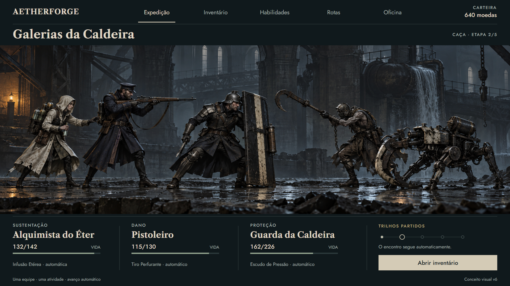
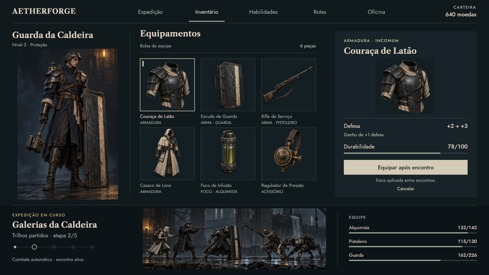
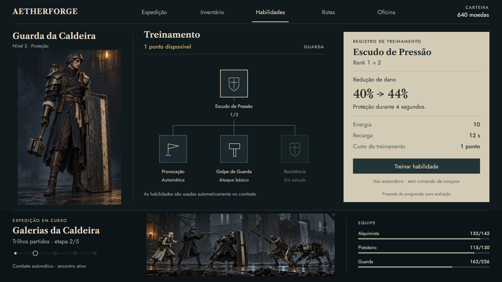
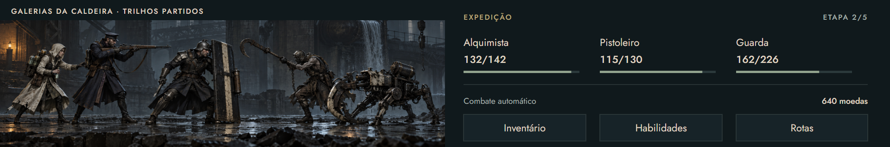
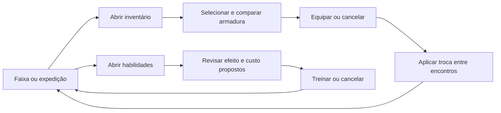

# Aetherforge — telas do idle, direção artística v6

Nova rodada de pranchas para testar a recomendação do [estudo v5](Tipografia_e_Direcao_v5.md): formas humanas e cansadas, indústria opressiva, contraste entre tecido e aço e tipografia de impressão. São conceitos das telas dentro do jogo, com arte nova feita em GPT Images e interface composta com fontes reais.

## Pranchas

| Tela | Decisão de composição | Arquivo |
|---|---|---|
| Expedição | Cena lateral como foco, três integrantes, dois inimigos distintos e estado automático claro | [PNG 1920 × 1080](conceitos/24-expedicao-prototipo-v6.png) |
| Inventário | Personagem à esquerda, seis peças no centro e comparação com ação à direita | [PNG 1920 × 1080](conceitos/25-inventario-prototipo-v6.png) |
| Habilidades | Personagem persistente, agrupamento de habilidades e registro de treinamento claro | [PNG 1920 × 1080](conceitos/26-habilidades-prototipo-v6.png) |
| Faixa compacta | Cena e equipe lado a lado; acesso direto aos painéis do idle | [PNG 1920 × 320](conceitos/27-faixa-idle-prototipo-v6.png) |

### Expedição

A estação de bombeamento substitui o cenário anterior. O Guarda tem rosto exposto, o Alquimista usa lona clara e o Pistoleiro mantém a silhueta longa do casaco. Um trabalhador alterado e um coletor quadrúpede separam ameaça humana de máquina. A iluminação quente fica restrita ao ambiente; o frio domina o espaço. O HUD não oferece conjuração manual.

### Inventário

A bolsa usa a nova folha de equipamentos. O foco está no ganho de defesa **+2 → +3**, na durabilidade **78/100** e na aplicação da troca **entre encontros**. O jogador deve selecionar uma peça, revisar a comparação e escolher Equipar ou Cancelar. A etapa de produção deve acrescentar seleção de integrante e indicação dos três slots equipados sem perder essa hierarquia.

### Habilidades

O papel claro concentra a revisão do efeito e do custo. A comparação **40% → 44%**, o ponto disponível e o rank são a mesma proposta visual da rodada v4/v5; não passam a ser regras aprovadas. Provocação e ataque básico continuam automáticos. Resistência é uma exploração visual. As linhas agrupam habilidades para avaliar a composição, sem definir novos pré-requisitos de progressão.

### Faixa compacta

Esta composição é específica para a janela baixa do idle, em vez de reduzir a tela de inventário. Na arte de 1920 × 320, os três contadores, a etapa e os acessos permanecem separados da luta. Ainda exige prova no tamanho físico e na escala de exibição usados no Godot; a imagem não demonstra desempenho ou acessibilidade do runtime.

## Fluxo representado

Os menus mantêm a expedição em contexto. O fluxo é descrito nas pranchas; as imagens e os documentos de composição são estáticos e não executam essas ações. O [fluxo de jogador anterior](Fluxo_Jogador_Artes_Idle.md) continua detalhando estados de cancelamento, recursos insuficientes e aplicação entre encontros.

## Escolhas de estilo

- **Personagens:** adultos, rosto cansado, volumes menos arredondados, equipamento que comunica peso e função. A leitura de Dishonored orienta nossa proposta de assimetria e silhueta.
- **Mundo:** arquitetura de serviço público em decadência, tubulações e estruturas grandes. BioShock orienta a relação entre identidade institucional e abandono; Lies of P orienta o contraste entre vestimenta e aço trabalhado.
- **Interface:** superfícies planas, poucas molduras e seleção em osso. A ferrugem deixa de cobrir cada controle. O registro de habilidades usa contraste de papel e tinta.
- **Letras e números:** Libre Caslon Text Bold nos títulos e Jost no corpo e nos números tabulares, com arquivos locais e licenças OFL. O gerador de imagem não desenhou as letras da interface.

Essas são decisões nossas a partir das referências, sem copiar personagens, logotipos ou arquivos comerciais. As [fontes e referências do estudo](Estudo_Referencias_Artisticas_v5.md) permanecem registradas.

## Arquivos editáveis e verificação

[Expedição](prototipos-v6/expedicao.html) · [Inventário](prototipos-v6/inventario.html) · [Habilidades](prototipos-v6/habilidades.html) · [Faixa](prototipos-v6/faixa-idle.html) · [Compositor](prototipos-v6/compose.mjs) · [CSS](prototipos-v6/telas.css).

Os documentos HTML/SVG são fontes de composição das artes, sem navegação funcional. O gerador pode ser executado com Node; a exportação PNG foi realizada em Edge/Chromium headless depois do carregamento das fontes. A verificação confirmou as fontes locais reais, quatro pranchas sem texto fora dos limites e nenhum erro de console. As composições foram inspecionadas visualmente e os recortes dos itens e as linhas da árvore foram corrigidos.

As artes geradas ficaram mais detalhadas do que a proposta de geometria econômica. Ainda há diferenças de equipamento entre o retrato e a cena. São referências de aparência; uma ficha única de personagem, modelos 3D leves, rigs, animações e medidas no motor continuam necessários. Não houve alteração de código do jogo, backend, economia ou saves. Como esta rodada altera apenas documentação e arte, não exigiu recompilação.

[Prompts completos, bases originais e processo de composição](Prompts_Prototipos_v6.md).
