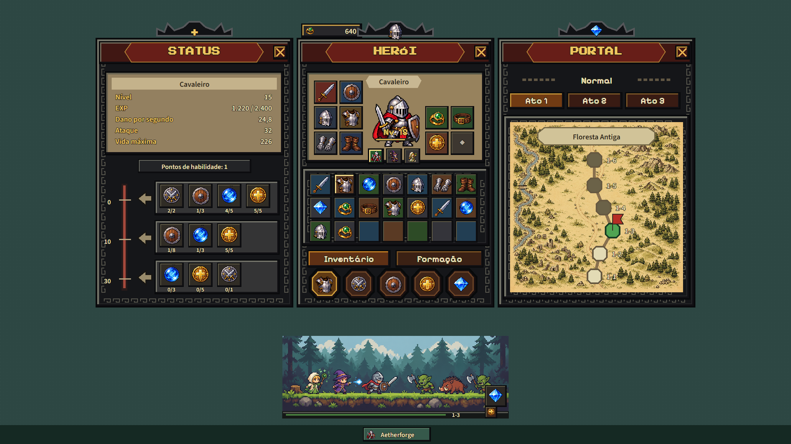
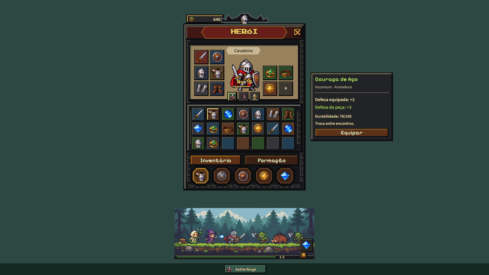
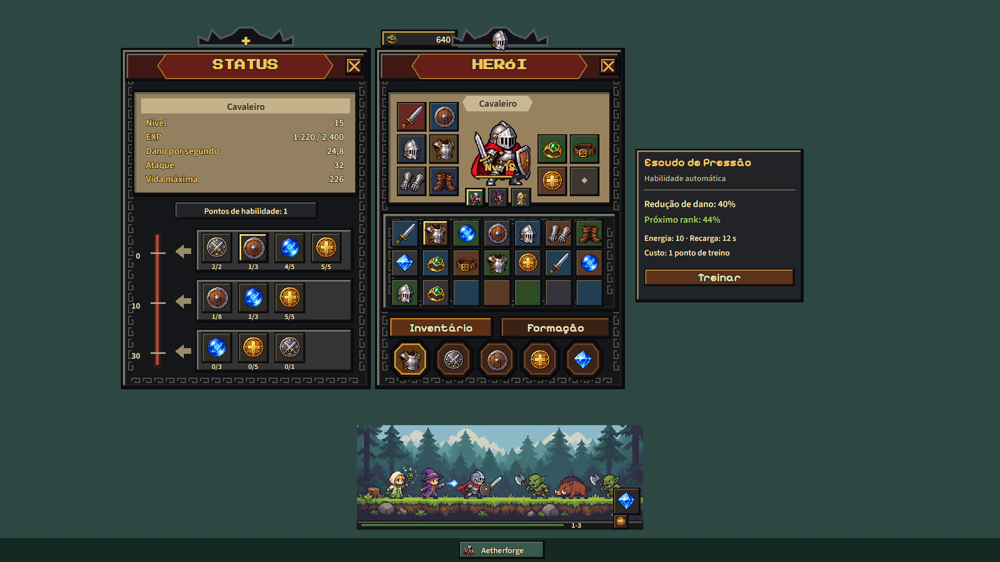

# Aetherforge — reprodução visual de Task Bar Hero

Data: 14/10/2026. Orientação desta rodada: usar Task Bar Hero diretamente como referência para corrigir os menus genéricos das pranchas anteriores. O trabalho entregue aqui é uma reprodução de apresentação, com três estados estáticos de tela. A pergunta sobre ampliar o escopo para uma reconstrução funcional em Godot permanece sem resposta nesta rodada.

## Novas pranchas

| Estado | O que aparece | Arquivo |
|---|---|---|
| Herói e inventário | Equipamentos ao redor do herói, bolsa densa, formação, navegação inferior e detalhe da peça | [Inventário — 1920 × 1080](conceitos/30-inventario-reproducao-taskbar-v7.png) |
| Status e habilidades | Janela independente à esquerda, atributos, pontos, faixas de habilidades e detalhe de treinamento | [Habilidades — 1920 × 1080](conceitos/31-habilidades-reproducao-taskbar-v7.png) |
| Status, herói e portal | Três janelas lado a lado, atos, mapa de região e etapas conectadas | [Portal — 1920 × 1080](conceitos/32-portal-reproducao-taskbar-v7.png) |

## Estrutura observada e reproduzida

A [galeria oficial da Nugem Studio](https://www.nugemstudio.com/en/games/taskbar-hero) foi consultada novamente, junto com a [página oficial na Steam](https://store.steampowered.com/app/3678970/TBH_Task_Bar_Hero/). As capturas oficiais 01 e 02, já preservadas no repositório, foram inspecionadas diretamente.

- **Janelas, em vez de uma tela inteira:** as três janelas medem 480 × 656 no estudo e são posicionadas próximas da composição observada na captura de 1920 × 1080. O desktop neutro é contexto externo ao jogo.
- **Herói e equipamento:** retrato central, pequenos slots ao redor, seleção de integrante abaixo e bolsa de sete colunas por três linhas.
- **Status:** atributos acima, pontos de habilidade no meio e fileiras de habilidades associadas a marcos na lateral.
- **Portal:** dificuldade, três atos e uma rota com nós; a região é desenhada como mapa, separada da cena de combate.
- **Arena curta:** área de 550 × 183 abaixo dos menus, com chão próprio, equipe, inimigos e efeito de ataque. O tamanho e os detalhes diferem da faixa observada, que é ainda mais baixa.
- **Acabamento:** fundo de pergaminho, borda escura com motivo geométrico, cabeçalho vinho, controles em dourado e ícones com cor por célula.

## Comparação com a referência

| Captura oficial de Task Bar Hero | Reprodução visual desta rodada |
|---|---|
|  |  |

A captura oficial é referência de pesquisa e permanece atribuída aos titulares indicados. As artes usadas na composição nova foram geradas com GPT Images; texto e controles foram compostos separadamente. O resultado segue a organização e a densidade, mas não é uma cópia pixel a pixel: arte, emblemas, fontes, nomes, mapa e alguns detalhes de interação diferem.

## Fluxo representado

1. Observar a arena compacta.
2. Abrir Herói para consultar equipamento e bolsa.
3. Selecionar uma peça e revisar seu detalhe ao lado da janela.
4. Abrir Status para consultar atributos e habilidades; selecionar uma habilidade para revisar o detalhe.
5. Abrir Portal para consultar atos, região e etapa.
6. Fechar os painéis e manter a arena como contexto.

São estados propostos para revisão visual. A forma exata de abertura, o posicionamento de tooltips, o arraste das janelas, a navegação por controle e a aplicação das ações precisam ser observados no jogo em execução antes de se alegar equivalência funcional.

## Arte, tipografia e arquivos editáveis

Esta rodada testa também o pixel art medieval do original, deixando a direção industrial 3D fora destas três pranchas. Isso não altera silenciosamente o GDD ou a direção de produção anterior. Os arquivos v3–v6 continuam preservados.

As letras não são desenhadas pelo gerador. O estudo usa Press Start 2P, Pixelify Sans e Source Sans 3 com fontes locais e licenças OFL. Não foi confirmada a fonte exata de Task Bar Hero. [Fontes desta rodada](assets/fonts/v7/sources.json).

[Fonte do inventário](reproducao-taskbar-v7/inventario.html) · [Fonte das habilidades](reproducao-taskbar-v7/habilidades.html) · [Fonte do portal](reproducao-taskbar-v7/portal.html) · [Compositor](reproducao-taskbar-v7/compose.mjs) · [CSS](reproducao-taskbar-v7/telas.css).

Os HTML/SVG são documentos de composição estática para exportar as artes. As três capturas passaram por verificação de carregamento das imagens, fontes locais reais, limites do texto e erros de console, seguida de inspeção visual. [Prompts completos e originais gerados](Prompts_Reproducao_Taskbar_v7.md).

## O que ainda não foi reconstruído

Não há, nesta entrega, implementação de combate, progressão, conteúdo, inventário funcional, economia ou integração Steam do jogo de referência. A [descrição oficial na Steam](https://store.steampowered.com/app/3678970/TBH_Task_Bar_Hero/) apresenta classes, habilidades, itens, personalização pelo Cube System, atos e dificuldades; não publica todas as fórmulas ou transições necessárias para reproduzi-los fielmente. Os valores de teste das pranchas não descrevem essas regras.

Nenhum arquivo do cliente Godot, domínio, API, persistência ou save foi alterado. A direção de um clone funcional completo ainda requer definição de escopo; não é apresentada como concluída por estas pranchas.
