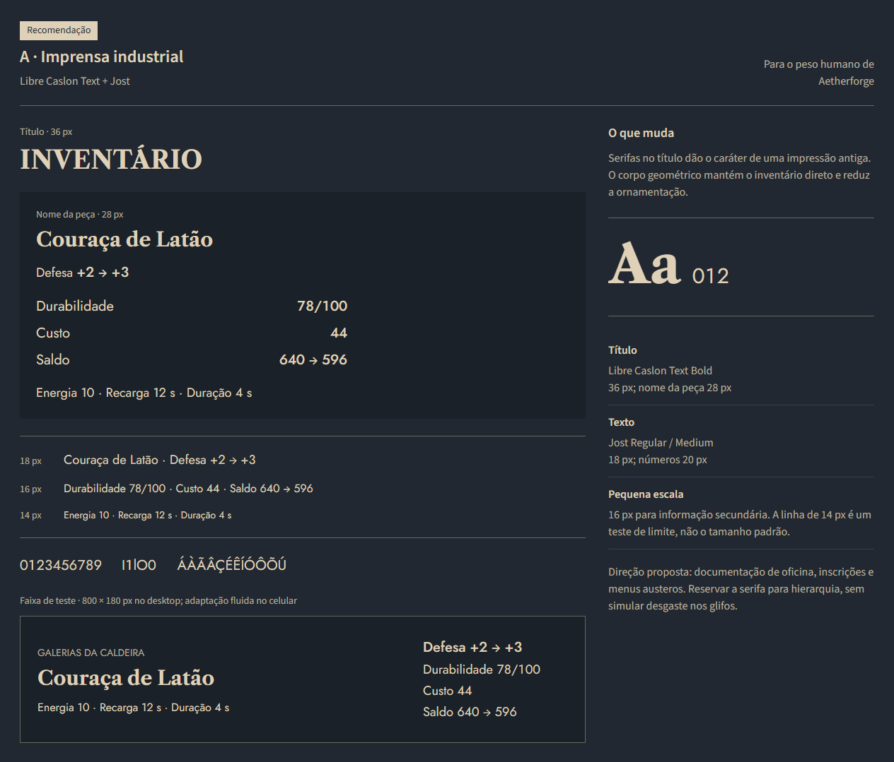
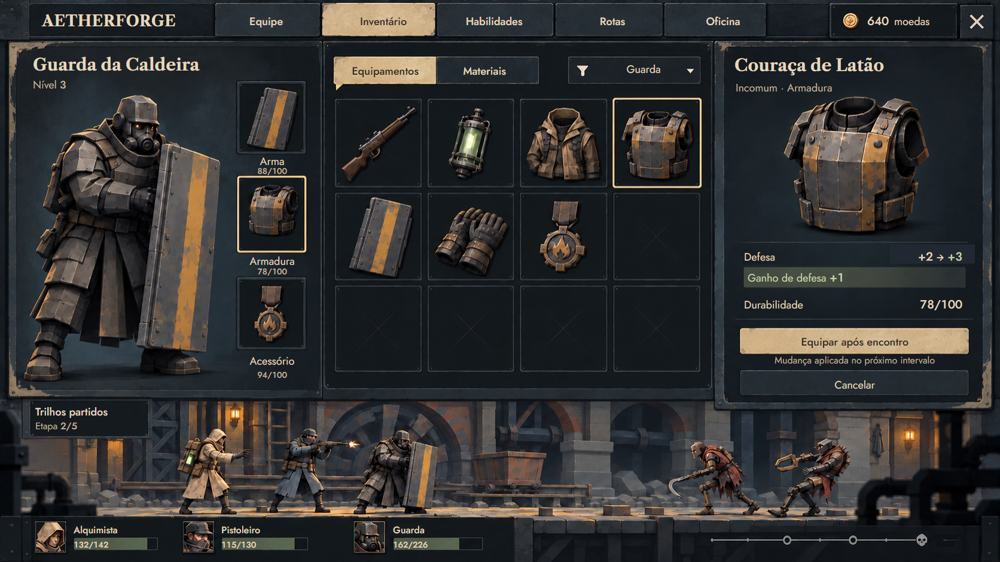
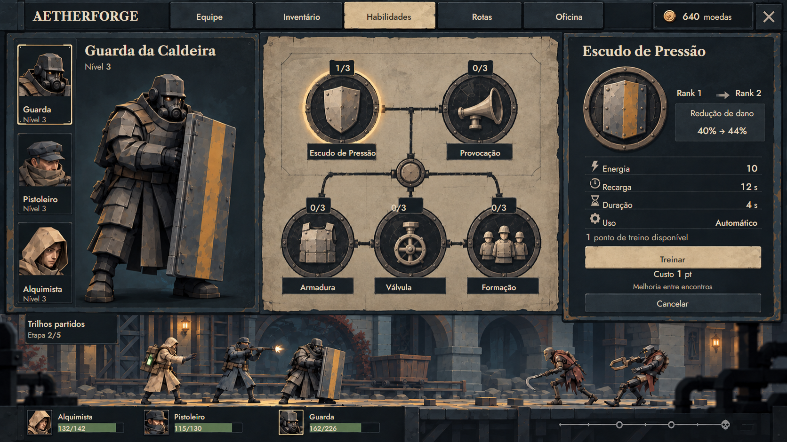
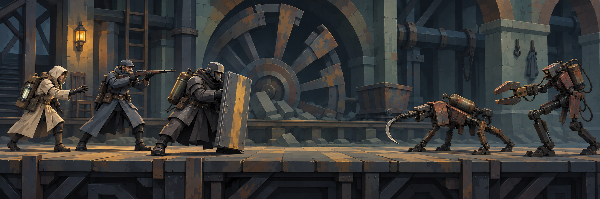

e# Aetherforge: direção artística e tipografia v5

Pesquisa e propostas de 14/10/2026. O pedido desta revisão é consolidar o estilo artístico do jogo a partir de BioShock 1 e 2, Lies of P e Dishonored, dando atenção especial às letras e aos números das artes. A v4 continua preservada como etapa anterior; as propostas abaixo ainda não representam aprovação final nem mudança no runtime.

## O que o estudo mudou

A direção deve partir de desenho de formas, materiais e hierarquia. Escurecer todas as superfícies, adicionar ferrugem e repetir botões amarelos não cria uma identidade suficiente. A v4 uniformizava letras, molduras e desgaste, aproximando elementos de funções diferentes.

Minha proposta é dar mais personalidade aos títulos, manter números de leitura direta e reduzir o ornamento repetido. Nos personagens, usar grandes planos esculpidos, gestos sob carga e materiais distintos. O [estudo dos quatro jogos](Estudo_Referencias_Artisticas_v5.md) separa fontes primárias, observações de imagens e decisões próprias de Aetherforge.

| Referência | Leitura que orienta a proposta | Aplicação em Aetherforge |
|---|---|---|
| BioShock | Tipografia e sinalização pertencem às instituições do mundo; geometria Art Déco convive com materiais decadentes | Placas e documentos com função, diferenciação entre marca, título e descrição; ornamento concentrado |
| BioShock 2 | Volume, assimetria e equipamento sugerem peso e função mecânica | Guarda inclinado sob o escudo, máquinas com pontos de apoio e ferramentas reconhecíveis |
| Lies of P | Contraste entre elegância e violência; tecido, metal e iluminação têm papéis diferentes | Tecido azul frio, lona clara e ferro escuro, com calor localizado na oficina; interface com menos moldura |
| Dishonored | Formas e proporções esculpidas; títulos e informação funcional possuem vozes diferentes | Base de silhuetas, rostos menos lisos e hierarquia editorial na interface |

Estas são interpretações visuais para nosso projeto, não uma receita atribuída aos desenvolvedores. Frostpunk continua como referência emocional de vulnerabilidade e trabalho; Task Bar Hero continua orientando o formato compacto do idle.

## Fontes encontradas nos jogos: grau de confirmação

| Jogo | Identificação encontrada | Evidência e limite |
|---|---|---|
| Dishonored | **Emerge BF** nos títulos; **Chalet Comprimé Cologne 1980** em informações da interface | O [Game Font Library](https://www.gamefontlibrary.com/games/dishonored) publica amostras e capturas anotadas. Famílias conferidas na [Bomparte’s Fonts/MyFonts](https://www.myfonts.com/collections/emerge-font-bompartes-fonts) e [House Industries](https://housefonts.com/hi/chalet). É identificação de catálogo, não confirmação obtida diretamente do estúdio. |
| BioShock 1 e 2 | **ITC Anna**, **Futura/Century Gothic** e **LHF Bell Boy**, em funções diferentes | Indicadas pelo [catálogo comunitário da série](https://bioshock.fandom.com/wiki/Fonts), com exemplos por tela. ITC Anna conferida no [catálogo da publicadora da fonte](https://www.myfonts.com/collections/anna-font-itc); Bell Boy na [Letterhead Fonts](https://letterheadfonts.com/fonts/bellboy). Não afirmar que uma única delas compõe toda a UI. |
| Lies of P | Nome exato da família da UI não confirmado nesta pesquisa | A captura de inventário foi inspecionada; a leitura visual é de serifa contida e corpo discreto. Não atribuir Cinzel, Garamond ou outra família apenas por semelhança. |

A evidência mais útil de Dishonored é a separação entre Emerge BF e Chalet. O nome do jogo e seu tratamento de logotipo não devem ser usados como se fossem o arquivo da fonte dos números do HUD. O [registro das referências de UI](referencias/v5/ref-ui-fontes.json) e as [capturas adicionais](referencias/v5/ref-ui-adicionais.json) preservam origem e hash.

As famílias comerciais identificadas podem orientar uma futura escolha licenciada. Nesta revisão, foram usadas fontes livres com arquivos e licenças OFL preservados no projeto. Elas são alternativas concretas para Aetherforge, sem se apresentar como cópias exatas das fontes originais.

## Três propostas com fontes reais

| Prova | Títulos | Texto e números | Avaliação |
|---|---|---|---|
| **A — Imprensa industrial, recomendada** | Libre Caslon Text Bold | Jost Regular/Medium | Caráter de impressão e documentação de oficina, com leitura estável do HUD |
| B — Art Déco | Limelight | Jost | Aproxima a linguagem gráfica de cartazes; reservar a títulos, pois o ornamento pode competir com o tom pesado |
| C — Belle Époque | Bodoni Moda Medium | Source Sans 3 | Contraste mais elegante; hastes finas exigem atenção em tamanho pequeno |
| D — Controle anterior | Archivo condensada | Archivo Bold condensada | Comparação com um arquivo real usado no painel anterior; não é identificação da fonte inventada nas imagens v4 |

[Prova B — Art Déco](conceitos/17-tipografia-deco-v5.png) · [Prova C — Belle Époque](conceitos/18-tipografia-belle-epoque-v5.png) · [Controle D](conceitos/19-tipografia-controle-v5.png) · [Prova tipográfica com fontes locais](tipografia-v5/index.html)

Os arquivos são dos projetos [Libre Caslon](https://github.com/impallari/Libre-Caslon-Text), [Jost](https://github.com/indestructible-type/Jost) e do [repositório Google Fonts](https://github.com/google/fonts). Autores e licenças constam dos arquivos em [assets/fonts/v5](assets/fonts/v5/sources.json). Não foi feita compra ou instalação global.

## Inventário: aplicação da proposta A

Títulos em serifa de impressão e corpo geométrico substituem a mesma voz pesada em todas as funções. A comparação +2 → +3, a durabilidade 78/100 e a carteira de 640 são texto nativo, conferível. A arte de personagem é uma continuidade da v4 para isolar a revisão tipográfica.

## Habilidades: aplicação da proposta A

A folha de treinamento concentra a ornamentação. Nome, ranks, energia, recarga e custo usam os mesmos arquivos da outra tela. Ranks e pontos de treino continuam sendo a [proposta visual da rodada anterior](Fluxo_Jogador_Artes_Idle.md), sem introduzir regras aprovadas de progressão.

As bases raster sem texto foram editadas com GPT Images. As letras foram compostas por SVG/CSS com arquivos de fonte reais e exportadas em PNG. Não foi solicitado ao gerador que imitasse o desenho de cada glifo. As fontes e números permanecem editáveis separadamente da pintura: [inventário](tipografia-v5/inventario.html), [habilidades](tipografia-v5/habilidades.html), [CSS das telas](tipografia-v5/telas.css).

Estas páginas são fontes de composição estática para exportação das artes. Não acrescentam outro protótipo de navegação ou funcionalidades de jogo.

## Estudo separado de formas e cenário

A exploração tenta tornar as pessoas menos arredondadas, a carga do Guarda mais evidente e os dois inimigos mais distintos. O cenário mantém a roda e a passarela para comparar a evolução de forma e cor com a v3. É uma possibilidade de direção, não um modelo final.

Ainda há molduras e marcas de desgaste repetidas nas bases da UI, e o enquadramento da cena encosta nos extremos dos atores. As próximas artes devem refinar esses pontos e fazer o mesmo personagem conservar identidade entre retrato e faixa. Copiar a complexidade dos jogos AAA não é um requisito: o cenário 3D leve continua dependendo das provas ART-03/ART-04 e de medidas no Godot.

## Verificação e limites

- O navegador confirmou os arquivos efetivamente usados: Libre Caslon Text Bold, Jost Roman/Medium, Limelight, Bodoni Moda e Source Sans 3; as letras e os números das provas não são aproximações pintadas.
- Os dígitos tabulares foram medidos: `111111`, `888888` e `000000` ocupam 72 px no teste de Jost Medium a 20 px. Isso permite alinhar custo, saldo e contadores sem saltos de largura.
- Setas usam Source Sans 3 quando o símbolo falta em Jost, evitando depender de uma fonte instalada no Windows.
- Prova inspecionada em 1440, 768 e 390 px, sem transbordamento horizontal. A faixa de teste mede 800 × 180 no desktop; a largura se adapta nas telas menores e o conteúdo empilha no telefone. Isso é teste tipográfico, não a janela final do jogo.
- Os dois conceitos exportados medem 1672 × 940. As correções foram conferidas nas imagens; não há mudança no cliente Godot, backend, economia ou save.

Fontes, créditos, prompts e etapas da composição: [Prompts e composição v5](Prompts_Tipografia_v5.md). A tipografia nova foi aplicada às duas telas de prova; as imagens v4 restantes permanecem históricas e não foram convertidas nesta rodada.
