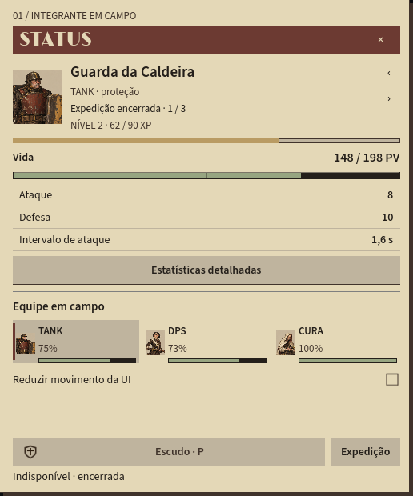

# V19 — Status, XP e loot da sessão

Entrega de 23/10/2026, continuando a [adaptação de Taskbar Hero](../referencias/taskbar-hero/Adaptacao_Aetherforge.md) e o [Status V18](UI_Status_v18.md). Usa código, textos, ícones e regras próprios. A referência orienta a organização da ficha e da bolsa; os valores de progressão vêm do [GDD Aetherforge, seções 15.2 e 15.4](../GDD_Aetherforge.md).

## Jogar e revisar

Na raiz, executar `scripts/Build.ps1` e abrir **Jogar Expedicao.cmd**. **Revisar Expedicao.cmd** reúne os três instrumentos e o palco numa janela de revisão.

- **Status:** nível, XP atual/necessária, barra real e composição dos atributos. O escudo continua acessível; o botão Expedição leva às ações da rota.
- **Herói:** recursos recebidos e bolsa 7×3. Itens obtidos podem ser selecionados por mouse ou teclado para ler raridade, função compatível e bônus previsto. A seleção rola até a descrição quando ela está fora da área visível.
- **Expedição:** pausar, recuar e reiniciar. O reinício conserva os ganhos e restaura a equipe para outra tentativa.
- **Palco e diário:** feedback de vitória, subida de nível e equipamento obtido.

O equipamento está guardado: **os bônus ainda não são aplicados**. Os ganhos pertencem apenas à execução atual e são perdidos ao fechar. A nova rota continua independente da API, do save e dos itens do protótipo integrado.

## Regras entregues

O nível começa em 1 e termina em 20. Para subir do nível `L`, o custo é `60 + 30 × (L − 1)`; o excedente segue para o próximo nível, até o limite. No nível 20 não se acumula XP adicional. Todos recebem XP de vitória, inclusive integrantes caídos.

Os atributos são calculados a partir do valor original de nível 1, com arredondamento para baixo ao final: vida +10%, ataque +6%, defesa +5% e cura +8% por nível adquirido. Não há multiplicação sucessiva dos valores já arredondados. Subir de nível preserva a quantidade de vida que falta em integrantes vivos; não ressuscita os caídos.

| Vitória na etapa | XP por integrante | Moedas da equipe | Sucata | Componente bruto |
|---|---:|---:|---:|---:|
| Entrada | 12 | 8 | 1 | 0 |
| Trilhos | 16 | 10 | 1 | 0 |
| Pressão | 20 | 12 | 2 | 0 |
| Ninho | 24 | 14 | 2 | 0 |
| Fornalha / chefe | 50 | 35 | 5 | 1 |
| **Rota técnica completa** | **122** | **79** | **11** | **1** |

Na primeira conclusão, cada integrante fica no nível 2 com **62 / 90 XP**. Recuar ou perder conserva o que já foi obtido, sem conceder recompensa pelo encontro não vencido. Uma vitória só é creditada uma vez por tentativa; outra tentativa pode gerar novos ganhos.

Encontros comuns têm 10% de chance de equipamento; o chefe garante uma peça. A raridade é comum/incomum/rara com pesos 75/20/5. Armas indicam +2/+3/+4 ataque; o foco do Alquimista também indica o mesmo bônus de cura. Armaduras indicam +2/+3/+4 defesa e acessórios +10/+15/+22 vida. A função e o tipo são sorteados. O estado do sorteio avança entre tentativas, sem reiniciar junto da rota.

A bolsa guarda 21 peças. Excedentes ficam pendentes e são contabilizados na tela; não desaparecem. Gerenciamento de espaço e retirada desses pendentes ainda não estão implementados.

## Limites desta fatia

IDL-02 tem agora nível, XP, crescimento e loot básico; **equipar, três slots funcionais, incompatibilidade de arma e durabilidade permanecem pendentes**. Não há árvore de habilidades, pontos, mineração, desbloqueio de rotas, progresso offline, salvamento da sessão nem transferência de seus ganhos.

A rota técnica conserva um encontro por cada uma de cinco etapas. Ainda não implementa as cinco vitórias por etapa comum previstas para o M1. A recompensa por encontro usa os valores do GDD, mas o total desta rota curta não representa o total da futura rota completa.

O combate preserva os valores anteriores do protótipo: intervalos de ataque de 1,6/1,25/2,4 s, infusão base 42 e escudo que reduz o dano recebido em 65%. A infusão agora cresce por nível. Isso ainda difere da base de cura 30 e do escudo de 40% previstos no GDD. Limite diário de moedas e recompensas narrativas também não fazem parte desta entrega. M1 continua incompleto.

## Implementação e verificação

`CharacterProgression`, `ExpeditionRewards` e as regras de vitória ficam no domínio `netstandard2.1`, sem dependência do Godot. O cliente apresenta esses valores e guarda somente o estado de seleção da interface. Cada recibo de vitória registra XP efetivamente aceita, níveis, recursos e eventual item com ID próprio.

As verificações de domínio cobrem limites e excedentes de XP, arredondamento, integrantes caídos, concessão única por vitória, conservação após derrota/reinício, determinismo por semente e bolsa cheia sem perda/duplicação. O teste V19 observa a rota avançar naturalmente e opera botões via `Viewport.PushInput`; não acelera regras chamando `Advance` pelo teste de UI e não emite `Pressed` diretamente. A aceleração é a opção normal de execução da simulação.

```powershell
powershell.exe -NoProfile -ExecutionPolicy Bypass -File scripts/Build.ps1
powershell.exe -NoProfile -ExecutionPolicy Bypass -File scripts/Test.ps1
powershell.exe -NoProfile -ExecutionPolicy Bypass -File scripts/Test-Integration.ps1
powershell.exe -NoProfile -ExecutionPolicy Bypass -File scripts/Test-Expedition.ps1
powershell.exe -NoProfile -ExecutionPolicy Bypass -File scripts/Test-UiV19.ps1 -Screenshots
```

As evidências locais ficam em `artifacts/ui-v19/qa/`. Escala interna e entrada sintetizada não certificam DPI físico, multimonitor, gamepad ou playtest humano.

Resultados desta entrega:

| Verificação | Resultado |
|---|---|
| Build cliente, domínio, API e checks | Passou, sem avisos/erros |
| Checks de regras e persistência | Passaram, incluindo progressão e loot |
| Legado/API e dois clientes de rede | Passaram |
| Integração: drop, transferência, equipamento e reinício da API | Passou com save isolado |
| Rota e callbacks da expedição | Passaram |
| Janelas nativas | Três IDs distintos; callbacks de seleção, fechar/reabrir e ações passaram |
| UI V19 | 13 casos: 3 de input, 4 de componentes, 2 de progressão headless e 4 revisões gráficas |

As quatro revisões gráficas usam 1920×1080 em 100/125/150% e 1366×900 em 150%. A bolsa passou após corrigir um mínimo fracionário que ultrapassava a última linha em menos de um pixel. Os seis casos de progressão foram repetidos após adicionar a rolagem da descrição, verificando que ela fica inteiramente visível. Os stderr dos 13 casos finais ficaram vazios. Em áreas curtas, o corpo continua exigindo rolagem; não há garantia de que toda a ficha caiba simultaneamente.

## Capturas do próprio Godot

[Visão completa em 100%](progressao-v19/overview.png), [bolsa após o chefe](progressao-v19/loot-chefe.png), [inspeção em 150%](progressao-v19/loot-150.png), [Status estreito em 150%](progressao-v19/status-estreito-150.png) e [loot estreito em 150%](progressao-v19/loot-estreito-150.png). São capturas do runtime desta entrega, não imagens extraídas de Taskbar Hero.


