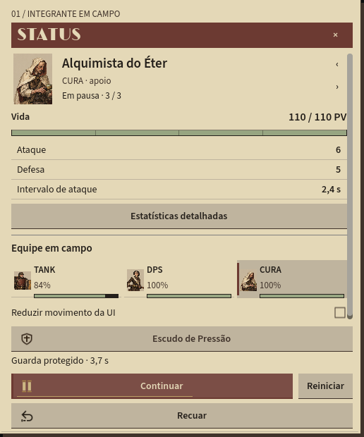
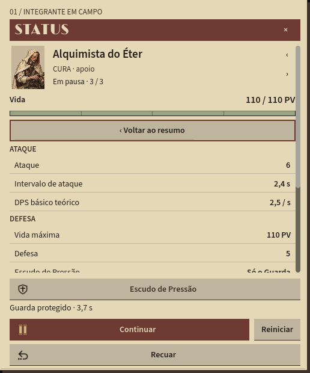
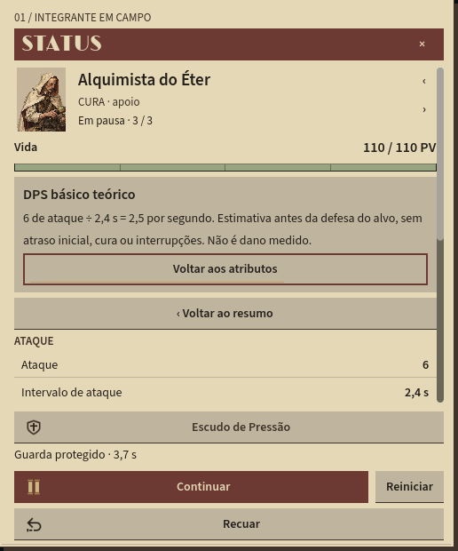

# Status V18 — integrante, resumo e detalhe

Implementação de 23/10/2026 da primeira fatia da [adaptação aprovada do Taskbar Hero](../referencias/taskbar-hero/Adaptacao_Aetherforge.md). A organização foi inspirada na pesquisa; código, arte e conteúdo continuam próprios do Aetherforge.

## O que mudou

O Status passa a acompanhar um integrante: retrato, nome, função, condição, vida atual/máxima, ataque, defesa e intervalo de ataque. Anterior/próximo circulam entre os três membros. Os seletores compactos da equipe mostram retrato, função, porcentagem de vida e barra; a ficha selecionada e o palco mantêm o mesmo alvo. O tooltip de cada seletor conserva nome e vida atual/máxima.

**Estatísticas detalhadas** abre grupos de ataque, defesa e apoio. Cada linha selecionável explica o valor, suas unidades e as regras aplicadas nesta expedição. A explicação acompanha a troca de integrante. O DPS básico teórico é identificado como ataque dividido pelo intervalo, antes da defesa do alvo e sem atrasos/interrupções: não é medição de dano causado.

Escape retorna do atributo aos detalhes, depois ao resumo e então fecha a janela. Há botões de retorno equivalentes. Tab navega apenas por controles visíveis/habilitados; Enter/Espaço ativam o controle focado. Espaço fora dos botões continua pausando a rota. As ações de expedição e o Escudo de Pressão permanecem fixos; o estado do escudo identifica explicitamente o Guarda como protegido.

Os retratos usam o atlas v12 já existente. Source Sans 3, Limelight, foco, microinterações e redução de movimento foram preservados. O Status substitui sua antiga régua de três atributos; Herói e Expedição conservam o desenho V17.

## Capturas

As imagens abaixo são capturas da execução Godot a 100%, extraídas da revisão embutida, com a simulação pausada pelo teste. Não são mockups nem capturas de Taskbar Hero.

| Resumo | Detalhe | Explicação |
|---|---|---|
|  |  |  |

No [caso estreito em 150%](status-v18/estreito-150.png), identidade e vida cabem no primeiro trecho; os demais valores e a equipe são acessados por rolagem. A revisão embutida reduz o palco e retira legendas secundárias quando precisa reservar altura para os instrumentos.

## Dados e responsabilidades

[ExpeditionStatusPanel.cs](../../src/Aetherforge.Client/ExpeditionStatusPanel.cs) recebe a simulação e a seleção de [ExpeditionView.cs](../../src/Aetherforge.Client/ExpeditionView.cs). O painel não avança o combate e não possui `_Process`; usa o refresh já centralizado na view, com limite de 100 ms. Labels só recebem texto quando seu conteúdo muda. A seleção atualiza a apresentação imediatamente.

Os valores de ataque, defesa e vida vêm de `PartyMember`. [Expedition.cs](../../src/Aetherforge.Domain/Expedition.cs) expõe o intervalo real de ataque e constantes já usadas para cura, descanso e escudo. Os literais correspondentes foram substituídos por essas constantes na própria simulação, preservando os valores anteriores. Não há duplicação de regras numéricas no painel nem dependência de Godot no domínio `netstandard2.1`.

Trocar integrante reinicializa o rastro da barra principal para não representar a diferença de vida entre pessoas como dano. As barras da equipe continuam observando o dano real e respeitando pausa/redução de movimento.

## Verificações

```powershell
powershell.exe -NoProfile -ExecutionPolicy Bypass -File .\scripts\Build.ps1
powershell.exe -NoProfile -ExecutionPolicy Bypass -File .\scripts\Test.ps1
powershell.exe -NoProfile -ExecutionPolicy Bypass -File .\scripts\Test-Integration.ps1
powershell.exe -NoProfile -ExecutionPolicy Bypass -File .\scripts\Test-UiV18.ps1 -Screenshots
```

A suíte V18 usa as verificações compartilhadas de fonte, layout e movimento, acrescidas dos estados resumo/detalhe/atributo, troca circular, seleção compartilhada, consistência com a simulação, ativação por teclado e retorno em camadas. Usa `Viewport.PushInput`, sem emitir `Pressed` para testar a navegação.

São três casos headless de input em 100/125/150%, quatro fixtures de componentes (incluindo redução de movimento) e cinco casos gráficos embutidos: 1920×1080 em 100/125/150% e 1366×900 em 100/150%. Cada caso também verifica os limites de janelas em áreas úteis virtuais 1366×728, 1920×1040 e 2560×1400. Em espaços curtos, o corpo rola e as ações/fechar permanecem fora da rolagem.

Evidências locais: `artifacts/ui-v18/qa/*.json`, logs e capturas em subpastas. Essa matriz não é medição de DPI físico, uso multimonitor ou input físico humano. A suíte gráfica desta entrega usa os instrumentos embutidos para revisão; a estrutura das três janelas independentes permanece no modo normal.

Resultado: os 12 casos V18 passaram, assim como build, `Test.ps1`, `Test-Integration.ps1` e `Test-Expedition.ps1`. Um smoke gráfico adicional confirmou três IDs de janelas nativas distintos e os callbacks de pausa/seleção/fechar/escudo/recuo/reset; logs em `artifacts/ui-v18/qa/native-windows*.log`. Esse smoke usa callbacks `Pressed`, não é prova de input físico nativo; a navegação V18 foi verificada separadamente por `Viewport.PushInput`.

## Como abrir

**Revisar Expedicao.cmd** abre os três instrumentos junto ao palco para comparar. **Jogar Expedicao.cmd** mantém a faixa compacta; clique em **Status** para abrir a ficha independente.

## Limites mantidos

Este incremento não implementa níveis/XP, pontos, árvore de habilidades, equipamento funcional, bônus de itens nem ganhos offline na nova rota. O detalhe explica as regras atuais e informa quando equipamento ainda não participa. Os controles existentes de cura e escudo continuam sendo os da expedição local.

API, integração multiplayer, persistência e o save manual em `data/` não foram alterados para esta entrega. O M1 completo permanece pendente conforme [Desenvolvimento](../Desenvolvimento.md).
